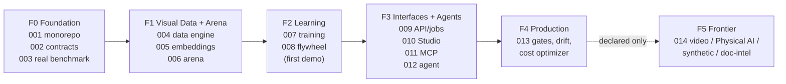
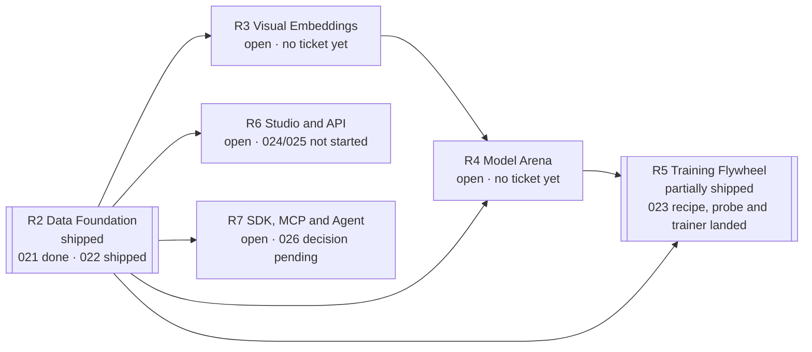

# Roadmap — Vision Lens

> **Last updated:** November 2026  
> **Status key:** 🟢 Shipped · 🔵 Planned · ⏸ Deferred · ❌ Removed · 🏗 Building (spec in progress)
>
> **North star:** a Visual Intelligence Engineering Workbench — the local-first engineering
> layer connecting visual data, specialized models and measured operational outcomes.
> Decisions: ADR-005 (pivot), ADR-006 (monorepo), ADR-007 (local-first), ADR-008 (evidence
> policy), ADR-009 (agent safety), ADR-010 (spec governance, superseded by ADR-020). Detailed
> plan lives in local planning material that is not tracked (ADR-020); this file is the tracked
> mirror.

---

## Phase map (Vision Lens)

| Phase | Focus | Specs | Outcome | Status |
|---|---|---|---|---|
| F0 | Foundation | 001 monorepo · 002 domain/contracts · 003 real benchmark | rebirth scaffold, entity store · VisA ground truth + runner (003, shipped) | 🏗 001 🟢 · 002 🟢 (domain contracts + entity store + legacy importer) · 003 🟢 (real VisA benchmark harness; the first measurement was taken on a degenerate all-train split and is retired, the tracked split is now a real 60/20/20 partition) |
| F1 | Visual Data + Arena | 004 data engine · 005 embeddings/search · 006 model arena | trustworthy datasets + calibrated model comparison | 🔵 |
| F2 | Learning | 007 training · 008 active-learning flywheel | specialized models + measured data loop — **first demo** | 🔵 |
| F3 | Interfaces + Agents | 009 API/jobs · 010 Studio · 011 MCP · 012 agent runtime | four equivalent surfaces + safe investigations | 🔵 |
| F4 | Production | 013 release gates, observability, drift, cost optimizer | promotion gates, incident primitives, cost control | 🔵 |
| F5 | Frontier | 014 declarations | video / Physical AI / synthetic / doc-intel reserved | ⏸ (declared) |

**First demo (closes F2):** import VisA subset → audit quality → embedding baseline probe →
arena (VLM vs local) → review hard cases (Studio) → AL batch → retrain → holdout delta
report (quality × cost × latency) → same investigation via agent over MCP.

---

## Historical record: v2.0 (the legacy CLI)

Feature-complete and shipped (2024-01 → 2026-08). Preserved as `packages/core`/`cli`/`sdk`
(spec 001). Highlights: H1 cost & reliability (async batches, prompt caching, structured
output) · H2 data richness (lean schema, linking, SQLite) · H3 platform (hybrid routing,
self-critique, `--learn`, SDK, plugins) · H4–H5 hardening & breadth (Azure batch, atomic
writes) · H6 intelligence (suggest-categories, active-learn queue, calibration table) ·
H7 architecture gate (ports/adapters: Reporter, FileRepository; readonly data; provider
split) · H8 enterprise (S3/GCS/Azure outputs, webhooks, Bedrock/Vertex, TypeDoc) ·
H9 semantic retrieval (text embeddings + hybrid search) · H11 workflow intelligence
(sessions, consensus, diff).

Superseded by Vision Lens decisions:

| Was | Now |
|---|---|
| "No GUI / no HTTP server" (ROADMAP 2026-05: "What we are not building") | Superseded by ADR-005 — Studio, API and MCP are core surfaces (specs 009–011) |
| H12 COCO/YOLO/Label-Studio exports (YOLO = artificial full-image boxes, H12.2) | Spec 004: Ultralytics **classification** layout (per-class/split dirs); detection exports only with real geometry; Label-Studio flow → 010 review + 008 queue |
| H13 FTS5 / quantization / RRF; H15 HNSW/sharding | Superseded by spec 005 (LanceDB + real visual encoders); text search remains available |
| H14 CLIP-via-Ollama, query expansion, rerank | Absorbed into spec 005 encoder registry (SigLIP 2 / CLIP / DINOv2 on MPS) |
| H16 integrity items (readonly partial cache, maxAttempts rename, dep classification, index schema versioning, fs/sdk docs) | Spec 001/002 hygiene tasks — per-item status in the H16 table below |
| "Video out of scope" | F5 frontier track (spec 014) |
| Multi-user/SaaS exclusion | Still excluded for the product; SaaS exploration was a separate unmerged track |

### H16 integrity carryovers — status (spec 001)

| Item | Status | Note |
|---|---|---|
| H16.1 readonly partial cache | ✅ | all `PartialAnalysisCache` fields `readonly`; type-level test asserts mutation fails typecheck (`packages/core/tests/types.test.ts`) |
| H16.2 maxAttempts rename | ✅ | shipped earlier in 8da7a28 |
| H16.3 dependency classification | ✅ | `better-sqlite3` in `packages/core` optionalDependencies; guarded dynamic import with actionable error + missing-module test (`packages/core/tests/reporter/sqlite-missing.test.ts`) |
| H16.4 FileRepository in run paths | ✅ | shipped with H7 ports/adapters |
| H16.5 index schema versioning | 🔵 | superseded by 002 fingerprint v2 — full-config fingerprints replace the name-only hash |
| H16.6 fs/sdk docs rows | ✅ | AGENTS.md boundary table carries `packages/core/src/fs/` + `packages/sdk/` rows |

---

## Vision Lens phases in detail

### F0 — Foundation (specs 001–003)

- Monorepo (pnpm + Turborepo), `vision-lens` CLI, CI fast gate,
  AGENTS boundary table for package layout — **zero behavior change, 361 tests green
  throughout** (001).
- Domain model + `packages/contracts` (14 entities, Zod, OpenAPI), SQLite store,
  fingerprint v2 fixing `src/index.ts:77` name-only hash (002).
- Shipped in 002: 14 versioned Zod entities with Prediction≠Annotation enforced structurally,
  the generated OpenAPI 3.1 seed, the SQLite entity store with migrations, repositories and
  the lineage walk, and the idempotent `vision-lens import-run` legacy importer.
- Real benchmark, **shipped under 003**: VisA subset (CC BY 4.0, license registry), seeded
  gold splits, metrics runner (per-class F1, ECE calibration, latency, cost), regression
  baselines. The dataset is fetched and checksum-pinned (`datasets/registry.json`), the
  committed gold manifest holds 700 real images (`benchmarks/splits/visa-subset.gold.json`), and
  the first real run scored `gpt-4o` at **macro F1 0.9795** / **balanced accuracy 0.9700** over
  all 700 of them. The tracked evidence is the gold set, the raw predictions and the baseline
  (`benchmarks/splits/visa-subset.gold.json`, `benchmarks/predictions/visa-subset.gpt-4o.json`,
  `benchmarks/baselines/visa-subset.json`); the run report (`benchmarks/results/<runId>/`) is a
  local artifact that the documented command reproduces. Every number comes from the 003
  artifacts (`benchmarks/baselines/<suite>.json`, `benchmarks/splits/*.gold.json`,
  `datasets/registry.json`) produced by `vision-lens benchmark run|gate|report`.
  **That first number is retired, not a product claim.** It was measured on the v1 split, whose
  700 assignments were all in `train`: the upstream release has no session information, so each
  class is one capture group, and a group larger than every quota cannot be divided into three
  partitions. With no held-out set it measures nothing, so the baseline entry carries
  `status: "retired"` and the reason. The tracked split is now the v2 one
  (`benchmarks/splits/visa-subset.v2.gold.json`, strategy `stratified`, 420 train / 140 val /
  140 test, item-level and stratified by class and anomaly), the suite id is `visa-subset.v2`,
  and the benchmark gate refuses to bless a number that was measured on a split other than the
  tracked one. The first measurement on the v2 split is still to be run.
- Synthetic accuracy claims retired: the legacy colour-swatch harness (package script
  `benchmark:legacy`, formerly the default accuracy runner) stays only as a unit-test
  fixture; it is not an accuracy source (ADR-008).

### F1 — Visual Data + Arena (004–006)

- Ingestion (hashing, EXIF sanitize, thumbnails, bomb guards), immutable snapshots,
  data-quality lab (dup/near-dup, leakage, imbalance), corrected exports (004).
- Python vision service (SigLIP 2 / CLIP / DINOv2 on MPS, memory admission), LanceDB,
  hybrid visual/text search, clustering (005).
- Model Arena: suites across VLM providers × encoder-probe × trained models; temperature
  scaling calibration; consensus v2 (agreement, not declared confidence — fixes
  `src/analyzer/consensus.ts:53`); Pareto reports (006).

### F2 — Learning (007–008) — first demo

- Training engine: linear probe → staged/full fine-tune, MPS backoff, MLflow local,
  checkpoints/resume, model registry v0 + model cards with license lineage (007).
- Flywheel: uncertainty×diversity selection, review queue, budget-aware cascade
  (local → specialized → VLM → human), holdout-proven delta reports (008). `--learn`
  stays as prompt aid during its deprecation window, superseded by real training.

### F3 — Interfaces + Agents (009–012)

- Fastify API + OpenAPI from contracts + SQLite job queue (resumable, idempotent, SSE)
  (009).
- Studio: dataset explorer, annotation review with provenance (AI-suggested ≠
  human-approved), experiment compare, A/B arena. **Visual design arrives from an external
  uxpilot.ai prototype** — spec 010 defines structure/flows and the integration point
  (tokens + skin layer), not the visual language (010).
- MCP server: tiered tools (read → analyze → propose → gated → approval-required), untrusted
  visual content as data, no fs/exec surface (011, ADR-009).
- Agent runtime: LangGraph investigator, budgets, checkpoints, approval gates,
  artifact-cited reports, evaluation harness with golden tasks (012).

### F4 — Production (013)

Release gates (macro-F1 floor, critical-class recall floor, calibration drift bound,
latency/cost budgets) · promotion/rollback via registry pin · inference service with
content-hash caching · OpenTelemetry traces + cost ledger · drift monitors (embedding PSI,
label distribution, calibration decay) → incident primitives ("time travel") ·
total-expected-cost optimizer reports (inference + review + FP + FN).

### F5 — Frontier (014, declared only)

Video intelligence · Physical AI sensors (Calibration, SynchronizedSequence reserved in 002)
· synthetic data factory (real-holdout-validated) · document intelligence ·
open-vocabulary concepts · SAM-family GPU workers (optional adapters, ADR-007).
Activation requires a new ADR + spec per track.

---

## Phase map (vNext series, 015-027)

The canonical design package delivered 2026-11-11 is integrated verbatim under `docs/vnext/`
(65 tracked files, 64 of them covered by `docs/vnext/MANIFEST.sha256`, validated). It supersedes the earlier design
only where it says so (`docs/vnext/00-ADOPTION-NO-OVERWRITE.md`): Python-first public ML
library, a lightweight remote SDK split from the fat in-process exports, Python usable
in-process without an HTTP server, the VisA number treated as a regression baseline with no
holdout claim, registry and publishing gates before any availability claim, and one Python
distribution with optional extras. The working breakdown of the pack is local planning
material (ADR-020); this section is the tracked mirror. Statuses here are implementation
statuses in words, not the emoji key above: done, partially shipped (concrete gaps named),
divergence recorded (maintainer decision pending), not started. Each milestone ships one
reproducible vertical slice and counts as done only after passing its exit gate; the full
train definition (R0 to R9) is `docs/vnext/23-RELEASE-ROADMAP.md`.

Shape key: the subroutine box is partially shipped, plain boxes are open. R2 feeds every later
milestone: the leakage-resistant split and the scorecard gate what R3 through R7 may claim.

| Release | Focus (specs in this series) | Exit gate | Status |
|---|---|---|---|
| R0 Reconcile | reconciliation record, baseline, the Python-first decision (015, 016) | zero lost work; green baseline; signed reconciliation | 015 done · 016 divergence recorded, maintainer decision pending |
| R1 Python Library | public `visionlens` wheel (017), JSONL worker protocol (018), CPU vision adapter (019), TS facade (020) | the wheel works without Node; TS and Python reach golden parity | 017 and 018 partially shipped · 019 shipped · 020 shipped |
| R2 Data Foundation | leakage-resistant split (021), evaluation scorecard v2 (022) | nonempty train/val/test; source, license and hash gating | 021 done · 022 shipped |
| R3 Visual Embeddings | no ticket in this series yet | Recall@k test; hardware profiling; index mismatch tests | not started |
| R4 Model Arena | no ticket in this series yet | identical locked test set; per-class plus cost and latency reports | not started |
| R5 Training Flywheel | encoder plus linear probe baseline (023) | active learning vs random; independent holdout delta | 023 partially shipped (the pinned recipe, the probe and the trainer) |
| R6 Studio and API | thin npm remote client (024), read-only Studio Arena slice (025) | one guided end-to-end workflow with accessibility and SSE | not started |
| R7 SDK, MCP and Agent | MCP dataset investigator (026) | same operation parity; injection and budget approval gates | divergence recorded, maintainer decision pending |
| Process | ADR-020 repository separation (027) | knowledge kept under `docs/procedures/`; the tracked-file guard stays green | done |

Spec-level statuses (post-audit, 2026-11-12; row 019 updated 2026-11-14):

| Spec | Pack id | Release | Scope | Status |
|---|---|---|---|---|
| 015 | VLN-001 | R0 | reconciliation report and the baseline record the rest of the series cites | done |
| 016 | VLN-002 | R0 | Python-first ML runtime ADR and the owner map of what moves to Python | divergence recorded, maintainer decision pending: the spec's python-ownership artifacts (its numbered ADR, the owner map, the boundary checker) never landed; `python/visionlens` exists and supersedes the spec's "no python yet" premise |
| 017 | VLN-003 | R1 | public `visionlens` distribution: packaging, extras, wheel, publishing gates | partially shipped: the wheel is built, `uv.lock` and the release gate landed with PR #42, the typed facade for capabilities and image metadata shipped with the dated packaging amendment of ADR-011, and the verification workflow that runs the gate in CI landed with no registry credential and no publish step |
| 018 | VLN-004 | R1 | cross-language JSONL worker protocol: handshake, events, errors, cancellation | partially shipped: the protocol landed across contracts, core and Python (both hosts and the suites); golden fixtures, secret redaction, retry backoff, the `CANCEL_REQUESTED` job transition, the schema generator and the ADR still open |
| 019 | VLN-005 | R1 | one CPU vision adapter with golden predictions and fingerprints | shipped: the model capability registry landed, with the pinned siglip2-base record (the exact revision, the sha256 of the real weights and the license, refused unless all three are present) and the two readers that resolve it, refusing the same records field by field; the weights loader landed next, and it is the only place the bytes of a model are fetched: the license gate, the explicit permission, the trust policy, the allowlisted source at the pinned revision, the safetensors format and the digest are all proved before the bytes land in the cache; the CPU adapter landed too: the decoder, the canonical preprocessing, the device planner (one vocabulary, one resolver, the CPU admitted and an accelerator refused with its reason), the SigLIP2 adapter, the content-addressed artifact with its manifest and the golden parity gate over one file both languages read, with the real run recorded (six committed fixtures, 768 dimensions, float32, on the CPU); the failure paths landed next: the matrix of the typed refusals (a corrupt image is an error sample and the other images still embed, a pixel bomb is refused before the pixels are allocated, a path outside the approved root, a missing permission, a digest mismatch, a pickle checkpoint, an unsupported device and an out of memory are each one typed error), and a run in which EVERY image was refused fails with one typed error and writes no artifact, because a run that embedded nothing is not a run; the single-writer commit landed too (the TypeScript side validates the manifest and commits the derived artifact and the model version, and the Python side writes no domain row); the worker runs with the network disabled unless provider access is explicitly required, and the text of an image is data and never an instruction; the guard refuses the connections, the datagrams and the resolution of a name, and its allowance belongs to the thread that opened it; the single-writer commit verifies the checksum of the manifest it commits and is idempotent by content; the operation is registered in the bridge of VLN-004 with a typed success result and a typed error result; the verification record of the whole ticket is in `docs/architecture/vision-adapter-verification.md`, with the exact command, the environment, the git SHA, the exit code and the output of every gate, and it names what the ticket did NOT prove: no accelerator other than the CPU, no calibration of the embeddings, no OCR, and a throughput number that belongs to one machine on one day; the ticket landed in two PRs, the registry in #48 and the adapter in #49; the worker now serves the RECORDED shape of `vision.embed` over the channel, so the adapter is reachable and not only a library: the params of the request name the shape, the runtime is opt in through four environment variables, and the run over the channel produced the same content address as the run over the library |
| 020 | VLN-006 | R1 | TypeScript facade over the Python worker, old CLI path preserved | shipped: the facade landed as-built over the worker client that shipped in the worker module, and the divergence the row carried is closed in the direction of the tree (the spec of the ticket named a file layout that never existed; ADR-021 records the decision). The seam is a port with one method (`runEmbedding`) and one implementation, so a second implementation is a new class and not a new call site. The route is an explicit opt in and never an inference: the targets are `python` and `disabled`, there is no `typescript` target because the ML calculation is not replicated in TypeScript, and a route that is off refuses with `ROUTE_DISABLED` naming the environment variable that turns it on, without starting a process. The capability of the worker is registered only after a handshake that validates the protocol major, the contract major and the shape of the hello, and an operation the worker did not announce is refused before it runs. The artifact is validated before the row is written: the facade recomputes the digest of the content from the manifest and the digest of the vectors from the bytes on disk and compares both with what the worker declared, the reference it publishes is relative to the approved root and content addressed, and a traversal or a symlink that leaves the root is refused. TypeScript stays the only writer of the domain: the facade asks a sink to commit the row and never imports the store. There is no paid fallback, and a run record with an idempotency key makes a repeated request do the work once. The surface is additive: a new subpath `@vision-lens/core/facade`, a new CLI group (`vision-lens python embed`) with its own exit map (0, 2, 3, 4, 5), and no change to the root export lists of the core and of the SDK, to the provider vocabulary or to any existing flag; the frozen baselines are now tests. The facade is inside the enforced module boundary: the boundary table gained a row, the eslint zone gained the rule, and the boundary gate plants a violating facade fixture and proves the rule fires |
| 021 | VLN-007 | R2 | leakage-resistant train/val/test partition and the gate that protects it | done |
| 022 | VLN-008 | R2 | evaluation scorecard: held-out metrics, calibration, per-sample artifacts | shipped: the scorecard module, the regime gate and five suites, the `benchmark scorecard` CLI command with its typed refusals, the committed pointer directory and the documentation of the held-out figure landed. The CLI `benchmark gate` carries no scorecard yet, so a suite cannot migrate from the whole-set regime to the scorecard regime from the command line yet |
| 023 | VLN-009 | R5 | local encoder plus linear probe baseline, recorded on CPU and MPS | partially shipped: the pinned recipe and the probe landed. The recipe is resolved in Python (`python/visionlens/src/visionlens/training/recipe.py`) and validated in TypeScript (`packages/core/src/training/train-recipe.ts`), it carries every field that decides a run (the pinned encoder, with every field of the registry record but its notes, the pinned split and the fingerprint of the partition and the hash of the manifest it recomputes, the item ids of the three partitions, the version of the ontology, the documented class weight of every class, the estimator, the hyperparameters, the seed, the device policy, the budget) and its fingerprint is the `fp2:` digest of the whole configuration, not of a name. The two sides compute that digest with the same canonical serialisation and the parity gate proves it over the tracked registry and the tracked split (`pnpm run training:recipe:parity`), in both regimes of class weight, so the claim has a command and not a sentence. The refusals name the field they are about: a record that does not carry a field a run needs, the floating revision `latest`, a split whose partitions share an item id (the leak that makes every number of a run a number of the training set), a class whose weight is not documented, a device the record does not support, a partition that holds no item, a split that names a snapshot or a manifest it does not have, and a record whose declared address is not the digest of its own body. The shape of the recipe comes from ONE place: the schema is generated from the Zod schema the TypeScript side validates with, it travels with the Python package, and the resolver and the reader both validate against it, so the two sides refuse the same recipes. The decision and the divergence from the spec are in `docs/adr/022-training-recipe.md`: the `training` extra lands with the estimator and not with the recipe, because the recipe imports none of the heavy stack. The probe and the digest-pinned checkpoint landed with it: the estimator is a scikit-learn logistic regression fitted inside the `training` extra (`python/visionlens/src/visionlens/training/probe.py`), it overfits the tiny fixture of the ticket to a hundred percent of train accuracy and its coefficients differ from the initialization, the class map of the run is built from the gold vocabulary and a label outside it is a hard error and not a coercion, the class weight of every class is documented and `none` means the class is not weighted and never that it is dropped, and the support of every class is recorded. The checkpoint is content addressed (`python/visionlens/src/visionlens/training/checkpoint.py`): the manifest carries the sha256 of the checkpoint file, the class map and the epoch, the file is named after its own digest, the publication is atomic (a temporary file and a rename, the manifest last) and a checkpoint whose bytes changed is refused before it is loaded. The decision and the divergence from the spec are in `docs/adr/023-probe-and-checkpoint.md`: the checkpoint is a JSON document and not a pickled estimator, so the digest of a run is reproducible on every machine and loading a checkpoint never executes code that came with the file. The trainer and the loader of the frozen features landed with it (`python/visionlens/src/visionlens/training/trainer.py`, `python/visionlens/src/visionlens/training/features.py`): the run trains on the `train` partition and selects on the `val` one, the partition of the run is the one the recipe pins (a run over items nobody pinned is refused), the test partition is never named by the loader, the artifact of features is reused and never recomputed, EVERY artifact of the run is checked and refused when its revision, its preprocessing or its dimension differ from the recipe (naming both sides), it is refused when it mixes two revisions or two preprocessings, the pairing of a vector with an item is by the digest of the image, the device is resolved by the planner of the platform and the reason of the resolution and of the fallback are recorded, an explicit device nobody admits is refused instead of substituted, the cold read and the warm read are two numbers, and the run records the throughput of the fit and the peak memory of the process. The MPS arm of the ticket is not reachable through the trainer until the build admits the accelerator, and the trainer says so instead of running somewhere else. NO RUN IS RECORDED YET: there is no experiment record in the tree and no `benchmarks/experiments/`, so the trainer has no number of its own to show and the accuracy of this rung is still an unmeasured claim. The decision and the divergence from the spec are in `docs/adr/024-trainer-and-frozen-features.md`: the early stopping criterion belongs to the M2 rung, so the M0 trainer refuses a recipe that carries one instead of silently ignoring it. The resume and the cancel paths, the locked holdout evaluation, the arena comparison, the experiment record, the registration of the model version and the promotion gate are still open |
| 024 | VLN-010 | R6 | thin npm remote client with no heavy transitives | not started |
| 025 | VLN-011 | R6 | read-only Studio Arena slice over the controlled API | not started |
| 026 | VLN-012 | R7 | MCP dataset investigator: tool parity, injection and budget gates | divergence recorded, maintainer decision pending: `packages/mcp/` does not exist; only the read-only contract inputs it cites are in the tree |
| 027 | - | process | ADR-020 repository separation: procedures kept, personal machinery removed, tracked-file guard green | done |

The two divergence rows that are still open (016, 026) each carry their divergence record
inline, naming how the written plan and the shipped tree drifted apart (audited 2026-11-12), and
leave the maintainer the choice between rewriting as-built, closing as superseded, or
implementing later; no choice is recorded yet. Row 020 carried a divergence of the same kind and
it was closed on 2026-11-15 by implementing the facade as-built over the worker client that
shipped, with the decision recorded in `docs/adr/021-python-worker-facade.md`.

| Series | State after the reconciliation audit (015, done) |
|---|---|
| 001-014 foundation | largely landed at the foundation: monorepo (001), entities and contracts (002), real benchmark splits (003); 004 and 006 partially landed; 005, 007, 008, 011, 012, 013, 014 not started; 009 and 010 placeholders. Tracked record: `docs/migration/vision-lens-vnext-reconciliation.md` |

---

## Phase map (Phase II extension: the computer vision capability packs)

The canonical package delivered 2026-11-11 is integrated verbatim under `docs/vnext/`
(65 tracked files, 64 of them covered by `docs/vnext/MANIFEST.sha256`, validated). A second delivery of 2026-11-15
adds the drop-in handoff of the canonical agent (`docs/vnext/AGENTS-HANDOFF.md`, also appended
to `docs/vnext/VISIONLENS_FULL_SPEC.md`) and the Phase II extension
`docs/vnext/extensions/computer-vision-2027/` (20 tracked files, 19 of them covered by
`MANIFEST-PHASE-II.sha256`, validated).
The extension adds no entry to the canonical manifest: the pack covers its own files and the
extension covers its own. The canonical manifest moved only with the delivery of 2026-11-15,
which adds the handoff and replaces the hashes of the README and of the full spec.

**The extension is a PROPOSAL, and it says so in its own first line.** It does not represent
implemented features, open pull requests or executed tests. Nothing of it is shipped, and no
ticket of it is in the canonical backlog. What it brings is SCOPE, an ORDER and a DISCIPLINE:
eight computer vision labs, five waves, 33 new tickets (`VLCV-*`, ids that do not collide with
the `VLN-*` of the canonical backlog) and a scientific standard (the metric per task, the
mandatory error slices, the unit of the split, the promotion gate) that the canonical pack
already asked for and that this repository is still building toward.

The reconciliation of the 33 tickets against the live tree is in
`docs/migration/visionlens-phase-ii-reconciliation.md`, and the first ticket of the extension
IS that reconciliation: `VLCV-001`.

### The waves

| Wave | Depends on | Labs | What must be true to advance |
|---|---|---|---|
| CV0 preparation | R0, R1, R2 | foundation | the baseline of the repository is preserved, the licence of the data is reviewed by a human, and one golden output exists |
| CV1 multi-capability demo | R3, R4 (subset) | 09 classification, 14 similarity, 15 matting | three tasks over the SAME dataset, with quality, latency and errors, reproducible, and a real decision between two methods |
| CV2 geometry | annotation boxes, the adapter and the evaluator | 10 detection, 13 PPE (research) | AP and critical recall over real classes, with the licence of every weight and every datum verified |
| CV3 time and text | video ingest and the temporal contract, OCR | 12 counting, 11 ALPR | an offline clip, the invariants of the temporal ids, an audit trail and a consented demo |
| CV4 gated frontier | R5 to R8 (subset) and approvals | 16 chest X-ray (research), grounding, documents | research-only gates, an external domain validated, licences and measurements |

The waves are not dates. The extension says that every new family can be postponed while
R0 to R4 are not stable, and the order is by value and not by the numbering of the labs:
09, 14
and 15 first, then 10 and 13, then 12, and 11 and 16 stay controlled research laboratories.

### The eight labs

| Lab | Pack | Priority | Dataset and its licence | Primary metrics |
|---|---|---|---|---|
| 09 | Transfer Learning (PyTorch) | P0 | Oxford-IIIT Pet, a candidate and not attached | macro-F1, ECE, balanced accuracy |
| 10 | Object detection (YOLO and RT-DETR) | P1 | Open Images V7 by sample, the licence verified per image | COCO AP@[.50:.95], AP_small, p95 |
| 11 | ALPR and OCR | P3, research | UFPR-ALPR, academic and non commercial, no redistribution | exact plate match, CER, end-to-end recall |
| 12 | Video counting | P2 | a clip with authorization, MOT17 only after the terms review | count MAE, event P/R, HOTA and IDF1 |
| 13 | PPE | P2, research | SHWD as a candidate, the rights of every image to review | critical recall, false alert rate, abstention |
| 14 | Visual similarity | P0 | Oxford Pets as a candidate, with annotated relevance pairs | Recall@k, mAP@k, nDCG, p95 |
| 15 | Background removal | P1 | P3M-10k as a candidate, MIT with portrait rights caution, DIS5K non commercial and no redistribution | mIoU, boundary F1, SAD, latency |
| 16 | Chest X-ray | P4, research only | CheXpert and VinDr-CXR under a research agreement | AUROC and AUPRC per pathology, ECE, shift |

**Lab 09 is where PyTorch enters the training path.** The M0 rung of the canonical ladder is a
scikit-learn logistic regression over frozen vectors, and that is what this repository ships
today (spec 023, the pinned recipe, the probe and the digest-pinned checkpoint). The trainable
head and the fine tuning of lab 09 are the M1 and the M2 rungs
(`docs/vnext/12-TRAINING-EXPERIMENTS-MLFLOW.md:6`, `:7`), which the canonical pack declares as
the later rungs and not as this ticket. The labs of lab 09 are therefore not a contradiction of
the work in flight: they are the same ladder, two rungs above.

### The scientific standard the extension adds

The extension does not only add scope. It fixes the standard that the canonical pack asks for
and that this repository still has to build:

- the metric is per TASK and there is no universal score: macro-F1 and ECE for classification,
  AP and critical recall for detection, CER for OCR, count MAE and HOTA for tracking, Recall@k
  for retrieval, mIoU and SAD for matting, AUROC and AUPRC for the research labs;
- the SPLIT UNIT is the real dependency unit: by patient in a radiograph, by vehicle and by
  sequence in a plate, by recording and by camera in a video, by perceptual duplicate group in
  an image set. When there is no valid metadata, the test is declared INCONCLUSIVE and no
  holdout is fabricated;
- the FAILURE SLICES are mandatory: rare class, blur, occlusion, lighting, camera, domain,
  patient, short text;
- the failures of inference, the OOM, the timeout, the dropped frames and the unreadable files
  stay in the denominator;
- the SCORE of the model, the CALIBRATED confidence, the heuristic threshold, the UNCERTAINTY
  and the quality measured on the benchmark are five different things and are never mixed;
- the PROMOTION is per task and the threshold is defined BEFORE the test;
- the claims that are forbidden: "YOLO acerta 99%", "X-ray diagnostica", "SAM3 roda em MPS",
  and any benchmark that was never executed.

---

## Phase map (Phase III extension: the dual SDKs and the backend API)

The extension `docs/vnext/extensions/sdk-api-2027/` arrives on 2026-11-15 as a proposal, with 58
tracked files, 40 tickets, 7 candidate schemas and 9 candidate fixtures. Its own manifest covers
57 of the files and the validator of the pack reports zero errors over the 40 tickets, the 7
schemas and the 9 fixtures.

**The extension is a PROPOSAL, and it says so in its own first line.** It does not assert that an
SDK, an endpoint, a package or a number exists. The candidates of `contracts-proposed/` are
examples, and they never become a source of truth over `packages/contracts` or over the OpenAPI
snapshot.

### Three products and six execution paths

| Path | What it is | What it never does |
|---|---|---|
| Python local standalone | import `visionlens`, run the inference, write a manifest and a CAS under a local directory | no HTTP, no Node, no implicit remote egress |
| Python remote sync | `VisionLensClient` submits `POST /v1/jobs`, waits by polling or by SSE, downloads the output | no Torch in the client, no raw server path |
| Python remote asyncio | `AsyncVisionLensClient` with `httpx`, cancellable and bounded | the cancel of a local wait does not cancel the server job |
| TypeScript HTTP | `@vision-lens/sdk/client` with an injected `fetch`, browser and Node | a browser never sees the filesystem and never sees a tensor |
| TypeScript Node local | the root and the legacy exports preserved, plus an opt-in bridge to the managed Python worker | the import is explicit and never crosses into the browser bundle |
| Raw backend API, CLI and MCP | the Fastify `/v1` enforces the auth, the licences and the budgets | the CLI and the MCP are clients of the same services, never a fork of the policy |

### The gates, the epics and the tickets

| Gate | Epic | Tickets | What the gate decides |
|---|---|---|---|
| 0 | G0 Reconciliation | VLSDK-001 to 004 | the inventory of the tree, the baseline of the npm exports and of the contracts, and the approval of the five boundary ADRs |
| 1 | G1 Python local | VLSDK-005 to 010 | the isolated package, the local facade, the model registry with the CPU planner, the immutable artifact sink, the typed errors and the wheel |
| 2 | G2 Contract spine | VLSDK-011 to 015 | the job shapes, the error taxonomy, the OpenAPI generated from the accepted routes, the golden fixtures and the skew gate |
| 3 | G3 Backend | VLSDK-016 to 025 | the Fastify app, the capabilities, the CAS ingest, the durable job, the lease queue, the worker handshake, the SSE, the cancel, the artifacts and the first end to end vertical |
| 4 | G4 Clients and conformance | VLSDK-026 to 032 | the Python sync and async clients, the browser safe TS client, the SSE parser, the cross transport parity and the preserved npm root |
| 5 | G5 Node local, browser, release, docs, security, ops | VLSDK-033 to 038 | the opt-in Node bridge, the cross runtime smoke, the PyPI and npm dry runs, the guides, the threat model tests and the operational gates |
| 6 | G6 CV packs | VLSDK-039 and 040 | the classification lab 09 with its evaluation suite, and the retrieval lab 14 over the encoder |

Thirty-four of the forty tickets are P0, five are P1 and one is P2: the only P2 is the opt-in Node
local bridge, and it is late on purpose. The order is a dependency order and not a wish list:
the contract spine of the gate 2 exists so that the backend of the gate 3 and the clients of the
gate 4 are built against the same wire and never against a guess.

### The measures the extension adds

| Dimension | The goal the extension names | How this repository reads it |
|---|---|---|
| Installation | the base wheel carries no Torch, no Transformers and no Node | a clean venv is the proof |
| TS portability | the `/client` smoke runs in the browser and in Node with no `node:*` import | the bundle graph is the gate |
| Cross client parity | full schema conformance over the golden fixtures | an exact contract, with the tolerances documented |
| API correctness | the 202, the idempotency, the replay of the SSE, the cancel and the crash tests pass | correctness over the speed of a demo |
| CV quality | one baseline per task, with the split locked and the provenance recorded | no invented universal accuracy |
| DX | four runnable guides | a published package only after the smoke |
| Supply chain | a reproducible lock and build, a SBOM, an audit of the model licences | no accidental redistribution |
| Operational | the depth of the queue, the failure rate, the p95 by operation and by hardware, the storage of the artifacts | observed values, never a marketing claim |

### The five ADRs the extension proposes

`ADR-P3-001` the public interfaces and the separation of the local state, `ADR-P3-002` the HTTP
error and the operation envelopes, `ADR-P3-003` the packaging and the versioning of the SDK,
`ADR-P3-004` the ingest and the retention of the assets, `ADR-P3-005` the durability of the jobs.
The five are PROPOSALS: none of them overrides ADR-011 to ADR-018, and none of them is accepted
by the integration of the pack.

---

## What we are not building (current)

| Item | Reason |
|---|---|
| Owned foundation models | Adapt, evaluate and operate existing ones (constitution governance) |
| Multi-user / SaaS / RBAC | Single-user local-first; revisit with validated demand (vision monetization hypotheses) |
| Distributed/multi-GPU training | One MPS device; CUDA only via optional adapters (ADR-007) |
| Medical imaging vertical | Validation/regulatory burden out of scope for now; the chest X-ray tickets of the Phase II extension stay rejected until a dated amendment of this row, and no lab of this repository is ever a clinical claim |
| Local planning material in git | Planning stays local (ADR-020); ADRs + this roadmap are the tracked record |
| Live video, continuous camera and public stream | The first release of the video lab is an offline clip with a retention policy; no camera, no stream |
| Identification of people across clips | Counting is ephemeral and clip scoped; no biometrics, no persistent identity, no cross-video linkage |
| Automatic inspection or enforcement automation | The PPE lab produces visible evidence for a human review; it is never a safety control |
| Automatic deletion of duplicated assets | The visual similarity lab detects near duplicates; it never deletes |
| A second contract language or a competing schema | The Zod schemas of `packages/contracts` own the public entities; a proposed capability pack is a proposal until an ADR says otherwise |
| A public diagnostic API | The Phase III extension forbids it too, and lab 16 stays research only |
| A second public backend | Fastify stays the only public backend; FastAPI without a scoped requirement and an ADR is an anti-pattern of the extension |
| Python writing into the canonical SQLite | The store has one writer, the TypeScript service; Python standalone keeps its own local manifest and CAS |
| Torch in a plain install | The base wheel carries no Torch and no Transformers; the heavy stack arrives with the extra that needs it |
| The proposed OpenAPI over the snapshot | The OpenAPI is generated from the routes the server really accepts, and the proposal is a candidate |
| Publishing to a registry without an explicit approval | The release is a protected workflow, and the dry runs of the extension are dry |

## Metrics that matter (Vision Lens additions)

| Area | Metric | Target |
|---|---|---|
| Evidence | Benchmark on real data only (VisA subset) | enforced (003) |
| Calibration | ECE per model on the gold split | reported every arena run (006) |
| Reproducibility | Same config+snapshot+seed+env → val macro-F1 Δ | ≤ 0.02 (007) |
| Flywheel | AL batch → holdout macro-F1 delta vs random batch | measured, reported per round (008) |
| Cost | Cost per correctly-processed image (cascade vs single-model) | Pareto-reported (006/013) |
| Review | Human review minutes per accepted model improvement | ledger-tracked (008/013) |
| Integration | CLI = API = Studio = MCP parity table | green in CI (009/011) |
| Ops | p95 list endpoints @10k samples | < 50 ms (009) |

(Legacy CLI metrics — cache hit rate, unknown rate, hybrid cost split — remain tracked in
`packages/core`.)
