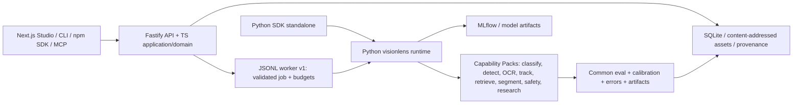

# VisionLens 2027+ — Phase II Master Specification

**Tema:** Computer Vision Capability Packs, multimodal grounding, temporal intelligence and evidence-driven visual AI.  
**Data:** 15/11/2026. **Documento aditivo, não substitutivo.**

## 1. Decisão executiva

**Recomendação:** acrescentar ao VisionLens **capability packs especializados** apoiados por uma única infraestrutura de ingestão, treino, inferência, avaliação, proveniência e Studio; não construir oito aplicações independentes nem trocar a arquitetura. O escopo imediato é aprender e demonstrar CV real, com datasets legítimos e métricas reprodutíveis. O escopo estratégico é tornar o VisionLens um ambiente para descobrir, adaptar, comparar, auditar e operacionalizar pipelines visuais de ponta a ponta.

**Resultado concreto a demonstrar:** importar um dataset licenciado, identificar tarefas compatíveis, executar baseline tradicional e um encoder moderno, registrar predições com evidência, fazer correções humanas, avaliar no mesmo holdout travado, mostrar erros por slice e custo/latência; repetir a experiência para pelo menos três tarefas sem duplicar infraestrutura. O exemplo de showcase indicado é Oxford-IIIT Pet, que oferece labels de raça, região da cabeça e trimaps, permitindo classificação + retrieval + segmentação em um mesmo universo de dados [S02](SOURCES.md#s02).

### 1.1 O que o ZIP original já decide

| Documento canônico | Decisão preservada nesta extensão |
|---|---|
| `02-ARCHITECTURE-DECISION.md` | Python possui runtime ML e treino; TS mantém plataforma e API/CLI/Studio; JSONL versionado liga os dois |
| `03-PRODUCT-AND-SUCCESS.md` | Visual AI Workbench local-first, comparação científica, custo por resultado, múltiplas interfaces |
| `07-CONTRACTS-PROTOCOL.md` | Zod/SQL existentes são autoridade; `vision.predict`, `vision.embed`, `eval.run`, `model.train` já estão propostos |
| `10-INGEST-CURATION-ANNOTATION.md` | assets originais imutáveis, lineage, audit, conversão COCO só com boxes reais, vídeo como horizonte posterior |
| `11-VISION-MODEL-REGISTRY-INFERENCE.md` | registry versionado por modelo/checkpoint/preprocess/device/license, sem `latest` em benchmarks |
| `12-TRAINING-EXPERIMENTS-MLFLOW.md` | maturidade M0–M4, holdout intacto, treinamentos com limites, MLflow |
| `13-EVALUATION-SCIENCE.md` | splits sem leakage, comparação em protocolo idêntico, métricas por slice, abstention |
| `23-RELEASE-ROADMAP.md` | R0–R8 como trilha fundamental; R9 frontier permanece opcional |
| `27-FRONTIER-CAPABILITY-REGISTER.md` | vídeo/segmentação/documentos/3D já são **hipóteses de fronteira**, não features entregues |

O ZIP não contém o repositório completo/working tree. A descrição da branch `feat/visual-lens` é snapshot de 11/11/2026; o estado real pode ter mudado. **Não foi executado nem testado código da aplicação** aqui.

## 2. Product thesis — das demos para plataforma de decisão

**Wedge:** *Visual AI Engineering, Evaluation & Data Quality*. O valor não está em ter mais um botão “detectar objetos”; está em reproduzir a decisão entre abordagem clássica, encoder, modelo especializado, VLM e intervenção humana sob orçamento, licença e restrições de segurança.

- **Usuário primário:** engenheiro de CV/applied AI que precisa criar pipelines reproduzíveis e escolher modelos; segundo: equipe de QA/dados industriais; terceiro: dev integrando por SDK e agentes.
- **Valor central:** menor tempo da pergunta visual a um experimento validado, comparável e reproduzível. Metrificação por tarefa, não score universal.
- **Diferenciação testável:** (a) operação uniforme em Python/CLI/Studio/API/MCP; (b) dataset/model lineage; (c) registro de custo real ou estimado; (d) agentes apenas como investigadores auditáveis; (e) *task adapters* sem apagar o código TypeScript.
- **Contra-posicionamento:** não virar somente editor de imagens, serviço de OCR genérico, competidor de anotação horizontal ou ferramenta de vigilância/diagnóstico.

### 2.1 Tese de monetização: hipóteses, não pesquisa de mercado quantitativa

| Vertical potencial | Job com orçamento plausível | Moat via VisionLens | Risco / horizonte |
|---|---|---|---|
| Inspeção de qualidade e anomalias | Reduzir retrabalho e falsos alarmes em produção | dados defeituosos raros, revisão e ROI operacional | **melhor investigação B2B**, requer cases reais |
| Catálogo e e-commerce | Limpar fundo, detectar produtos, deduplicar, categorizar | batch + QA humano + custo por SKU | **bom primeiro produto demonstrável**; muita concorrência |
| Document intelligence | OCR robusto, caixas/tabelas, extração revisável | provenance por região + field-level eval | forte valor potencial; dados sensíveis |
| Logística e inventário | Contagem de itens/fluxo em vídeo sem identificação de pessoas | eventos e contagem com erro auditável | integrar depois de tracking validado |
| EPI/segurança ocupacional | Evidenciar situação de uso de equipamentos visíveis | thresholds, abstention, evidência e auditoria | alto custo de falsos negativos; nunca única barreira de segurança |
| Saúde (raio-X) | Pesquisa de robustez/calibração de modelos | avaliação por paciente/site/protocolo | **somente pesquisa**, não produto clínico no roadmap atual |
| Leitura de placas/pessoas | Exercício técnico e dados de teste com consentimento | pipeline OCR/tracking e privacidade | **não** escolher como wedge inicial de negócio |

**Evidência que muda a tese:** 5–10 entrevistas com usuários de um mesmo vertical; problemas e dados reais compartilháveis; intenção de pagamento ou pilotos; resultado comparativo falsificável; orçamento/risco de privacidade aceitos. Não usar projeções fictícias de TAM ou qualidade de modelo.

## 3. Os oito laboratórios da imagem: mapa integrado

| ID imagem | Pack proposto | Primitivas a reutilizar | Tipo de saída | Métricas primárias | Prioridade sugerida |
|---|---|---|---|---|---|
| **09** | Transfer Learning Lab | dataset, encoder/probe, trainer/MLflow | classe, logits, prob. calibrada | macro-F1, ECE, balanced acc. | **P0** |
| **10** | Object Detection Lab (YOLO/RT-DETR) | imagens, anotação de bbox, workers | caixas+classes+score | COCO AP@[.50:.95], AP_small, p95 | P1 |
| **11** | ALPR/OCR Lab | crop/rectificação, detecção, OCR, revisão | regiões + caracteres + abstenção | exact plate match, CER, recall end-to-end | P3 / dados restritos |
| **12** | Video Counting Lab | detecção, tracking, media timestamps, eventos | trilhas efêmeras + crossing events | MAE de contagem, IDF1/HOTA, event P/R | P2 |
| **13** | PPE Safety Lab | detecção, associação pessoa↔equipamento | evidência visível, ausente, desconhecida | recall crítico, false-alert rate, abstention | P2 / domínio sensível |
| **14** | Visual Similarity Lab | embeddings, index, metadata filters | top-k e evidências | Recall@k, mAP@k, nDCG, p95 | **P0** |
| **15** | Background Removal Lab | segmentação/matting, revisão por máscara | RGBA+alpha+provenance | mIoU, boundary F1, SAD, latency | P1 |
| **16** | Chest X-ray Research Lab | ingest restrito, classificação multilabel, calibração | predição experimental + incerteza | AUROC/AUPRC por patologia, ECE, shift | P4 / pesquisa apenas |

O detalhamento completo, dados e critérios de aceite de cada item estão em [LABS-09-16.md](LABS-09-16.md).

## 4. Camadas e interfaces — sem refatoração abrangente

### 4.1 Abstração proposta: Capability Pack

Um *pack* é um registro declarativo e testável: `taskKind`, versão, dados/labels aceitos, operador de preprocessamento, estratégia de inferência, algoritmo de avaliação, política de licenciamento, perfil de hardware, schema de evidência e capacidades de exportação. Não é necessariamente um package npm separado, serviço ou banco. Um pack define *opções de comportamento*, não uma engine concorrente.

**Regra de evolução dos contratos:** usar primeiro os tipos e operações existentes; novos campos de task/geometria/tempo só após inspeção da Zod e ADR. Um discriminated union versionado para outputs tipados será melhor do que `Record<string, any>`, mas é uma proposta, não mudança automática. Tipos candidatos:

- `ClassificationPrediction`: classes, scores, multilabel/abstain, calibrator revision.
- `DetectionPrediction`: `xyxy`/`xywh` de acordo com convenção **explicitamente versionada**, `labelId`, image orientation, confidence; variantes com OBB.
- `TextRegionPrediction`: polygon/box, Unicode normalized text, char confidences **se o modelo fornecer**, language, canonicalizer/version.
- `SegmentationPrediction`: mask/alpha artifact reference, coordinate space, contour/trimap optional.
- `TrackingResult`: `trackId` **efêmero por clip**, frame/timestamp, bboxes e crossing events; nenhuma identidade entre câmeras por default.
- `RetrievalResult`: query/snapshot/encoder/index fingerprints, candidates, raw similarity vs calibrated relevance separadas.
- `MedicalResearchPrediction`: etiquetas e incertezas para coorte acadêmica, **nenhuma interface de laudo ou diagnóstico**.

Não serializar imagens, máscaras grandes ou vídeo em JSONL. Armazenar referências de artifacts verificados com hash, tamanho, MIME e escopo. Resultado sem ground truth continua **prediction**, não annotation.

### 4.2 Entidades internas propostas (verificar antes de migrar)

`VideoAsset`, `FrameSample`, `GeometryAnnotation`, `MaskArtifact`, `TrackFragment`, `TemporalEvent`, `OCRTextRegion`, `ReviewDecision`, `TaskEvaluationSuite`. Podem ser *value objects* e artefatos primeiro; criar tabelas somente quando consulta/transação exigir. Cada entidade temporal amarra timestamps e versão de decode. Não adicionar tabela específica para cada laboratório.

### 4.3 Pipeline comum

`DatasetSnapshot + LicenseGate → Decode/EXIF → TaskPreprocess → ModelAdapter → StructuredPrediction → Validate → Per-sample Audit → TaskEvaluator → Error Explorer → Human Review → Experiment`. Treinamento e promoção só após gates do pacote original. Os novos módulos herdam orçamento de segundos, memória, egress, operações e aprovação do worker.

### 4.4 Experiência do Studio

- **Task Gallery**: selecionar tarefa, dados permitidos e hardware; etiqueta `research-only` onde aplicável.
- **Evidence Explorer**: grids de imagens, boxes, máscaras/alpha, timeline, OCR com região de origem e comparações *overlay*; versões e confidences explicadas.
- **Arena por tarefa**: nunca plotar `AP` de boxes ao lado de `AUROC` de radiografia como se fossem a mesma escala de qualidade; comparar modelos apenas na mesma suite/split/label-space.
- **Error Workbench**: falhas mais frequentes por tamanho, oclusão, iluminação, câmera, domínio, paciente, texto curto etc.; breadcrumbs para imagem de origem.
- **Live video**: fora do primeiro release; começar por upload/clip offline, sem câmera contínua, sem stream público.
- **Acessibilidade**: overlays com legendas textuais, tabela de detections navegável, controles de timeline via teclado, contraste e labels; nunca depender apenas de cor de bounding box.

## 5. Padrão científico comum — obrigatório

### 5.1 Avaliação por tarefa (sem uma única métrica universal)

| Task | Métricas | Failure slices obrigatórios |
|---|---|---|
| Classification | macro-F1, balanced accuracy, AUROC/AP para multilabel, ECE/Brier quando calibrada | classe rara, blur, domain, OOD, color/lighting |
| Detection/PPE | COCO AP@[.50:.95], AP_small, recall crítico, false alerts/hr | escala, oclusão, classes parecidas, background adversarial [S19](SOURCES.md#s19) |
| OCR/ALPR | character error rate, exact-match, end-to-end recall, reject/unknown rate | ângulo, chuva/noite, caracteres ambíguos, parte coberta |
| Tracking/counting | count MAE, event P/R, IDF1/HOTA, throughput | oclusão, reentrada, cruzamentos repetidos, FPS variável [S20](SOURCES.md#s20) |
| Retrieval | Recall@k, mAP@k/nDCG, coverage, index build/search p95 | near duplicate vs semantic similarity, long-tail |
| Segmentation/matting | mIoU, boundary F1, SAD/MSE em alpha, latency | cabelo fino, transparência, bordas, sombras |
| X-ray research | class AUROC/AUPRC, sensibilidade em limiar predefinido, ECE, external shift | paciente, hospital, AP/PA, dispositivos, idade quando permitido |

### 5.2 Regras transversais

1. **Split unit = unidade de dependência real**: por paciente em raio-X, veículo e sequência em ALPR, gravação/câmera/sessão em vídeo, produto/fotógrafo/sessão em e-commerce, perceptual duplicate group em imagens; quando não há metadados válidos, declarar o teste *inconclusivo*, não fabricar holdout.
2. Congelar suite, IDs, ontologia, preprocessamento e scoring antes de comparar; dados selecionados pela estratégia de active learning não entram no test.
3. Distinção obrigatória entre score do modelo, confidence calibrada, heuristic threshold, incerteza/abstention e qualidade medida no benchmark.
4. Falhas de inference, OOM, timeout, dropped frames e leituras ilegíveis integram denominador relevante. Não calcular só sobre successes.
5. Medir cold/warm p50/p95, throughput, peak RSS/VRAM, tamanho de weights, tempo de indexação, custos e tempo de revisão. Comparar energia/custo **quando medidos**.
6. Introduzir adversarial slices: rotação/crop/oclusão/iluminação; nunca augment test set silenciosamente nem reportar apenas médias.
7. Cada claim de melhoria precisa de baseline, hipótese, intervalo de confiança quando válido, revisão de regressões e evidência reproduzível; MLflow registra artefatos [S23](SOURCES.md#s23).
8. Política de promoção é específica por tarefa: por exemplo, `recall crítico >= threshold definido antes do teste` para EPI; sem usar thresholds inventados como garantia.
9. É proibido afirmar que “YOLO acerta 99%”, que “X-ray diagnostica”, que “SAM3 roda em MPS” ou que benchmark sintético demonstra performance real sem execução/medição.

## 6. Dados: qualidade, licenciamento, segurança e negócio

**Recomendação de fixture público:** Oxford-IIIT Pets como `starter suite`, sujeito à licença CC BY-SA 4.0 e direitos dos autores das imagens [S02](SOURCES.md#s02). Ingest somente pequeno subconjunto com atribuição e *no raw data in Git* até aprovação. Complementos:

- Detection: Open Images V7 por amostra com permissões revisadas (Google avisa que não garante direitos de cada imagem) [S21](SOURCES.md#s21).
- OCR de placas: dataset UFPR-ALPR **restrito a pesquisa acadêmica não comercial e sem redistribuição**; demo pública usa placas sintéticas e/ou dados próprios consentidos [S08](SOURCES.md#s08).
- PPE: SHWD como candidato para investigação, mas origem de imagens de busca exige revisão dos direitos individuais antes de publicar [S09](SOURCES.md#s09).
- Segmentação/matting: P3M-10k com acordo original MIT (inspecionar modalidades e imagens) [S10](SOURCES.md#s10); DIS5K **termos originais não comerciais e sem redistribuição**, mesmo que espelho declare Apache-2.0 [S11](SOURCES.md#s11).
- Raio-X: CheXpert com acordo de uso de pesquisa; VinDr-CXR exige credenciamento, treinamento e DUA; nada de baixar ou redistribuir automaticamente [S13](SOURCES.md#s13), [S14](SOURCES.md#s14).

A matriz detalhada com restrições por origem está em [DATA-MODEL-LICENSES.md](DATA-MODEL-LICENSES.md). **Licença de código, licença de checkpoint, licença de dados e direito sobre imagem são quatro verificações distintas.** Um checkout do GitHub não substitui esse gate.

## 7. Segurança e risco específico de CV

- **Input:** decompression bombs, imagens truncadas, EXIF geográfico, DICOM identificável, URLs SSRF, codecs/containers de vídeo vulneráveis, symlinks/path traversal. Ingest via sandbox offline com quotas, validation e hash.
- **Output:** boxes ou máscaras podem revelar rostos/placas/dados de saúde; evitar previews públicos por default. Artefatos têm retenção, escopo, nível de sensibilidade, delete cascade e audit.
- **Model supply chain:** manter hashes e fontes permitidas, preferir safetensors/ONNX; não `trust_remote_code=True` nem unpickle arbitrário; lock de versões, SCA e revisão do runner.
- **Agentes:** texto visível em placas, cartazes, imagens ou documentos é dado não confiável. OCR nunca promove texto para instrução. Tool policy/approval é externa ao modelo.
- **Pessoas:** contagem sem identificação persistente. `trackId` não é identidade pessoal nem deve permitir cross-video linkage por default. Pixelização/redação quando necessária.
- **EPI:** detectar evidência de um item visível, sem converter imagem ambígua em certificação de segurança. Regra fail-safe, revisão por especialista e limiares predefinidos.
- **Raio-X:** pesquisa sem diagnóstico, recomendações terapêuticas, laudos automáticos, claims clínicos ou upload de exames de pacientes sem governança. Se houver intenção clínica futura, escopo e conformidade regulatória independentes [S24](SOURCES.md#s24).
- **Licença:** Ultralytics YOLO26 tem regime AGPL-3.0 ou licença Enterprise; o projeto não pode presumir que serve como base permissiva para SaaS proprietário [S05](SOURCES.md#s05). Manter RT-DETR como comparador permissivo sujeito à licença de checkpoint [S04](SOURCES.md#s04).

## 8. Fases e decisão de investimento

**Se a meta é um portfólio técnico distinto com caminho comercial**, priorizar 09+14+15, depois 10+13; 12 depois de 10; 11 e 16 permanecem laboratórios de pesquisa controlados. Não seguir a numeração 9→16 por inércia.

| Onda | Dependências reais | Capability packs | Critério para avançar |
|---|---|---|---|
| **CV0 — preparação** | R0, R1, R2 (ao menos contratos/splits com prova) | foundation API e suite comum | baseline do repo atual preservado, dataset/legal gate, 1 output gold |
| **CV1 — demo multicomp** | R3, R4 subset | 09 classificação + 14 similaridade + 15 máscara | três tarefas no mesmo dataset; quality+latency+errors; reproduzível |
| **CV2 — geometria** | annot boxes, adapter and eval | 10 detection + 13 PPE (research) | AP e crítico recall com classes reais; licença verificada |
| **CV3 — tempo e texto** | video ingest/temporal contract, OCR | 12 tracking/count + 11 ALPR | offline clip, temporal ID invariants, audit, demo consentida |
| **CV4 — fronteira gated** | R5–R8 subset + approvals | 16 chest X-ray research, open vocabulary, grounding, document+video | research-only gates; domínio externo validado; licenças/medição |

Trabalho detalhado em [EXECUTION-PLAN.md](EXECUTION-PLAN.md). Não converter estas ondas em datas garantidas. Cada nova família pode ser adiada caso R0–R4 não esteja estável.

## 9. Research frontier — além da imagem original

**Trilhas 2027+:** open-vocabulary text-to-box/segment; segmentação/seguimento de objetos em vídeo; grounding visual com regiões e referências; OCR+layout e estrutura de documentos; detecção de anomalias de produto; sintéticos para casos raros com avaliação no holdout real; orientação do modelo e quantização para edge; keypoints/pose; 3D/depth/sensor fusion; inspeção visual industrial OBB; satellite/geo imagery; temporal visual RAG; visual regression de interfaces web; human-in-the-loop e dataset drift. Registro priorizado em [RESEARCH-RADAR-2027.md](RESEARCH-RADAR-2027.md).

**Observação sobre novidade:** SAM 3 já existe, SAM 3.1 foi anunciado em 2026, mas o repositório oficial exige GPU CUDA; não classificar como implementação local Apple Silicon garantida [S16](SOURCES.md#s16). SAM 2 tem pesos/código Apache-2.0 e é melhor hipótese para um adapter experimental independente [S15](SOURCES.md#s15). DINOv3 vem sob licença própria e requer análise do checkpoint [S17](SOURCES.md#s17). PaddleOCR PP-OCRv6 foi anunciado em junho de 2026 [S07](SOURCES.md#s07).

## 10. Definition of Done desta **fase documental**

- Oito task briefs completos + arquitetura incremental + pesquisa com fontes + políticas de dados/modelos + backlog rastreável + quatro specs iniciais.
- IDs da imagem 9–16 preservados; `VLCV-*` não colidem com o backlog legado `VLN-*`.
- Nenhum contrato ou ADR atual alterado. Nada de declarar um módulo “implementado” só porque existe um doc.
- Cada funcionalidade exige avaliação com fixture e benchmark próprio, não screenshot de inferência.
- Todo risco de licenciamento/PII/segurança e evidência faltante tem decisão de gate explícita.

**Próxima ação para o agente:** ler [AGENT-HANDOFF.md](AGENT-HANDOFF.md), reconciliar o repositório real e propor o menor PR que cria uma `TaskSuite` compatível e prova paridade entre duas tarefas num dataset licenciado. O trabalho não é autorizado a escrever código indiscriminadamente só com base neste documento.
