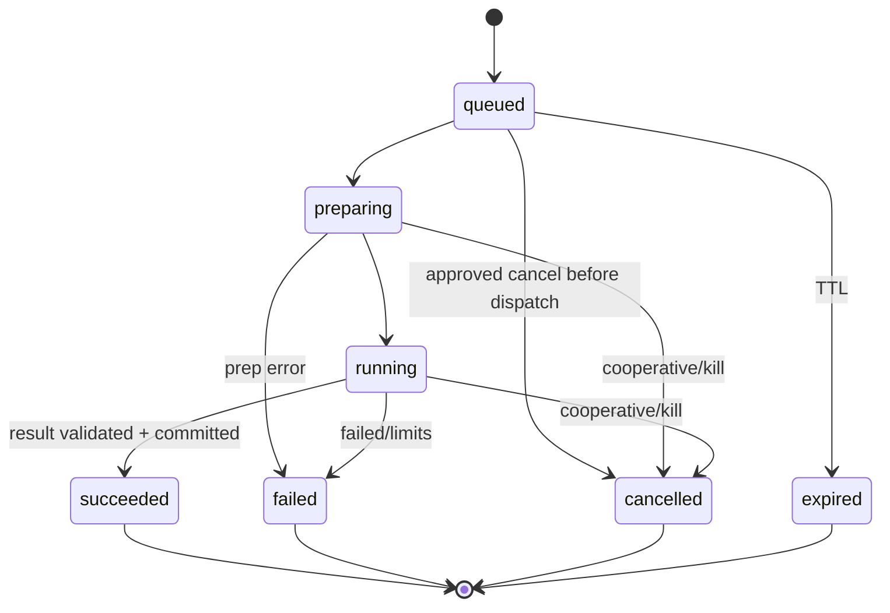

# VisionLens Backend API — Fastify, jobs, media, contracts, segurança e operação

**Status:** especificação futura. **Base comprovada no ZIP:** `apps/api` placeholder em 2026-11-11; `packages/contracts` Zod/existing OpenAPI snapshot e TS SQLite já são decisões arquiteturais. Não pressupõe endpoints implementados. Backend público recomendado é **Fastify**, com Python somente como runtime/worker de ML.

## 1. Scope e architecture boundaries

- **Ingress/API:** Fastify, OpenAPI gerado, CORS/CSRF/DNS rebinding, auth, scopes, validação e rate limit, request tracing, upload seguro e downloads autorizados.
- **Application layer:** `CommandHandlers`, `QueryHandlers`, job lifecycle, transactional idempotency, license/data-use gates, policy engine, artifact access control, event-store writer, budgets.
- **Persistence:** TS store existente SQLite + CAS local, com adapter Postgres apenas depois de ADR. Uma fonte de verdade para job state/audit/provenance.
- **Execution:** `WorkerSupervisor` gerencia 1+ Python processes com protocolo `visionlens.worker.v1` JSONL; workers recebem refs autorizadas e políticas, não credenciais gerais. Jobs ML nunca rodam no event loop Fastify.
- **Dataset/annotation:** Prediction != Annotation. Dataset snapshots imutáveis; train/eval usam split versionado e ligado a provenance; fonte de verdade domain TS, não banco paralelo Python.
- **Studio & SDK:** consumidor de endpoints públicos, sem privilégio de admin por estar na mesma máquina e sem acesso livre ao FS do servidor.

```text
HTTP/Studio/SDK/CLI/MCP
   │ auth + scopes + rate/cost
   ▼
Fastify API /v1 (schema)
   │                      ├── Assets upload/download -> staging -> validate -> CAS
   ▼                      ├── Queries -> read-model (scoped)
Application services      └── Commands -> idempotency -> durable jobs/events
   │                                  │
   ├── TS domain store SQLite <───────┘
   ├── policy/approval ledger
   └── worker queue/supervisor ──JSONL v1──> Python visionlens
                                               │
                                         immutable output artifact
                                               │
                                     validate + commit reference
```

## 2. API surface, HTTP semantics e versioning

All endpoints below are **proposed**. Never insert directly into tracked OpenAPI snapshot; first reconcile route names and implemented Zod. Base path `/v1`. `GET /health/live` intentionally outside v1 auth (non-sensitive); `/health/ready` should reveal only readiness, not internal secrets to unauthenticated public clients.

### 2.1 Endpoints P3-MVP

| Method + Path | Scope | Request | Success | Important invariants |
|---|---|---|---|---|
| `GET /v1/capabilities` | `capabilities:read` or authorized local | query optional | 200 `Capabilities` | negotiated installed/runnable/allowed, contract worker versions |
| `GET /v1/models` | `models:read` | filters pagination | 200 page | immutable model revisions and licenses |
| `GET /v1/models/{id}` | `models:read` | ID | 200 | resolve exact digest, not mutable latest |
| `POST /v1/assets` | `assets:write` | streamed upload (single file) | 201 `Asset` | size/MIME/hash scan/canonical CAS, no paths |
| `GET /v1/assets/{id}` | `assets:read` | ID | 200 metadata | workspace isolation before lookup |
| `POST /v1/datasets` | `datasets:write` | name + policy | 201 `Dataset` | license provenance and owner |
| `POST /v1/datasets/{id}/snapshots` | `datasets:write` | sample IDs & ontology revision | 201 `DatasetSnapshot` | immutable, split leakage checks on eval |
| `GET /v1/datasets/{id}` | `datasets:read` | ID | 200 | ETag and pagination for samples |
| `POST /v1/jobs` | `jobs:submit` plus operation policy | operation, params, budget | 202 `Job` + Location | Idempotency-Key, durable accepted state |
| `GET /v1/jobs/{id}` | `jobs:read` (scoped) | ID | 200 `Job` | current terminal/queued status, ETag |
| `GET /v1/jobs/{id}/events` | `jobs:read` | Last-Event-ID / after | 200 text/event-stream | durable replay and reconnect |
| `POST /v1/jobs/{id}/cancel` | `jobs:cancel` / owner | reason optional | 202/200 updated state | cancellation request vs actual terminal cancellation |
| `GET /v1/jobs/{id}/result` | `jobs:read` | ID | 200 only after success; 409 if not ready | references only, typed output |
| `GET /v1/artifacts/{id}` | `artifacts:read` | ID | 200 metadata | no private bytes in default metadata |
| `GET /v1/artifacts/{id}/download` | `artifacts:read` | ID + Range optional | 200/206 redirect/stream | scoped, expiring URLs, SHA-256 |
| `GET /v1/evaluations/{id}` | `evaluations:read` | ID | 200 | locked split, scorer revision, comparability |

### 2.2 Later but planned (not P3-MVP)

`POST /v1/assets/uploads` / `PUT /v1/assets/uploads/{id}/parts/{part}` / `POST .../complete` for large file sessions; `POST /v1/imports/local-runs` for explicit Python standalone sync; `GET /v1/audit-events`; `POST /v1/annotations/proposals` and `POST /v1/annotations/{id}/review`; `POST /v1/model-promotions` gated; `POST /v1/agent-runs` read-only default and approval grants; private worker registration; webhooks with HMAC and replay nonce. Promotion/annotations may already be proposed canonically: avoid duplicate public shapes.

## 3. Request/response canonical candidate

### 3.1 Create job

```http
POST /v1/jobs HTTP/1.1
Authorization: Bearer <scoped-token>
Content-Type: application/json
Idempotency-Key: asset01-classify-rev01
X-Request-ID: req-client-123

{"operation":"vision.predict","params":{"assetId":"asset_01","modelId":"model_01@rev2","taskKind":"image.classification"},"budget":{"maxSeconds":120,"maxUsdMicro":0}}
```

- Server authenticates and obtains workspace from claims; never trusts user-supplied `workspaceId`.
- Hash canonicalized effective payload with actor+workspace+operation+budget+policy/config for idempotency; same key+different payload returns 409.
- Enforce model capability/license/privacy/data-use, maximum duration, rate limit and budget **before** queueing. Synchronous request must never download a model as implicit side effect.
- Transaction: allocate job ID + idempotency record + `queued` state + creation event before returning 202. Subsequent worker execution at-least-once must be deduplicated by job lease and result-commit key.

```http
HTTP/1.1 202 Accepted
Location: /v1/jobs/job_01
Content-Type: application/json
ETag: "job_01-v1"

{"data":{"jobId":"job_01","status":"queued","operation":"vision.predict","submittedAt":"2026-11-15T12:00:00Z","lastEventSequence":0},"meta":{"requestId":"req_01","contractVersion":"1.0.0"}}
```

### 3.2 Job completion and result retrieval

`GET /v1/jobs/{id}` returns current `status`, `phase`, `progress` optionally, `lastEventSequence`, creation/completion timestamps and `resultRef` only if committed. `GET /v1/jobs/{id}/result` returns `JobResult` with task-discriminated `PredictionRun` metadata, `ArtifactRef`s (id/mediaType/hash/byteLength) and provenance. Large masks/embeddings/images never embedded in JSON response.

`GET /v1/jobs/{id}/result` while processing is `409 JOB_NOT_READY` (or another documented accepted 202 if carefully standardized; choose one consistently). Failed job returns typed problem `JOB_FAILED` with sanitized public details and preserved internal diagnostics via secured tracing, no raw stderr to client.

### 3.3 HTTP errors as RFC 9457 candidate

```http
HTTP/1.1 409 Conflict
Content-Type: application/problem+json

{
  "type": "https://visionlens.dev/problems/idempotency-conflict",
  "title": "Idempotency key conflict",
  "status": 409,
  "detail": "The key was previously used with a different request.",
  "code": "IDEMPOTENCY_CONFLICT",
  "requestId": "req_01",
  "retryable": false
}
```

`visionlens.dev` is a **placeholder domain**, not verified ownership or a working URL. Adopt a controlled domain or `about:blank`/URN after ADR; do not ship links that imply ownership. Problem details typed extensions must not leak scoped IDs/user existence.

### 3.4 SSE frame sample

```text
id: job_01:2
event: progress
data: {"jobId":"job_01","seq":2,"kind":"progress","completed":3,"total":10}

id: job_01:3
event: result
data: {"jobId":"job_01","seq":3,"kind":"result","status":"succeeded","resultRef":"res_01"}

```

Worker JSONL progress and API SSE are **distinct protocols** and event schemas. API converts and persists events, never directly forwards raw Python stdout to clients; server may add heartbeat SSE comments. A reconnect with `Last-Event-ID: job_01:2` replays seq>2, subject to retention and authorization, using stable ID. Do not place 20 MB mask bytes in SSE.

## 4. Job state machine, idempotency and durability

### 4.1 State transitions



`cancelRequested` is a flag or explicit intermediate state; never mark a running job `cancelled` until supervisor confirms termination/quiescence. On restart, expired leases are retried only if operation is idempotent and artifacts are staged in temporary runs. Durable queue can start as SQLite lease/polling with single-writer TS; Redis/Postgres is not a mandatory requirement for portfolio/local single-user.

### 4.2 DB logical schema (candidate; NOT migration SQL)

| Entity | Required fields/concurrency rules |
|---|---|
| `job` | id, workspace, actor, operation, canonical request hash, contract/model/ontology refs, state, version, created/started/completed, lease owner/expiry, budget, resultRef, errorRef |
| `job_event` | job_id, seq bigint/safe id, kind, public payload, created_at, unique(job_id,seq); append-only |
| `idempotency_key` | workspace, actor class, key hash, payload hash, job_id, expires_at; unique within scope |
| `artifact` | ID, content sha256, byteLength, MIME, sensitivity label, retention, creation job, CAS ref, access policy |
| `upload_session` (later) | id, workspace, expected hash/size, state, parts, expiry, actor, assigned scope |
| `worker_lease` | job, attempt, worker ID, heartbeat, expires_at, device profile and cancellation token |
| `audit_event` | actor, action, target, policy decision, time, requestId, immutable record/digest |

Audit results and model predictions/annotations may have existing TS entities: **reuse them**, avoid creating duplicate tables if repository already owns them. `jobId` is not a dataset or prediction ID. Cross-scope reads should generally return indistinguishable 404/403 per agreed privacy policy to avoid enumeration.

### 4.3 Idempotency lifecycle

- Dedup scope `{workspace, actor_or_client, idempotencyKey}` plus stable canonical request fingerprint; TTL proposed >= 24h for queued jobs, with explicit persisted metadata. Altering user authorization does not grant access to the original job.
- Requests with equal key and body return same response/job reference even after a network timeout (within TTL). Different payload returns 409. If first request is in a transaction conflict, loser waits/looks up rather than submits duplicate.
- Worker may retry due to crash; *at-least-once execution* acceptable for pure compute, **exactly-once side effects are not assumed**; commits guarded by compare-and-swap/unique id and artifact hashes.
- Cancellation and promotion require separate idempotency/audit; never treat a retry of `model.promote` like an idempotent `GET` without explicit design.

## 5. Worker supervisor and JSONL v1 reconciliation

Existing proposed `worker-request.v1.schema.json` permits exactly `vision.embed`, `vision.predict`, `dataset.audit`, `eval.run`, `model.train`, and fields `protocol`, `kind`, `requestId`, `operation`, `contractVersion`, `workspaceId`, `params`, `budget`. Do **not** remove required fields or add `taskKind` at the top level; place new CV task options under `params` after schema review, or ship a versioned worker contract update.

### Handshake

1. Supervisor starts trusted command: Python from explicitly configured executable/virtualenv, `-m visionlens.bridge.worker` with **fixed argv**; no shell or user-controlled `PYTHONPATH` from HTTP.
2. Python emits `hello` with protocol major, runtime build, supported operation codes, installed extras, devices, size limits, capabilities. `hello` shape is not in the supplied worker-event example and needs an accepted schema.
3. Supervisor validates protocol/schema/version compatibility; on mismatch marks worker unhealthy and jobs `RESOURCE_UNAVAILABLE` instead of silently routing to hosted models.
4. Each request JSONL frame bounded in bytes/nesting; binary inputs transferred by scoped CAS refs; output only JSONL on stdout, logs on stderr with redaction.
5. `progress/result/error` are *one response stream per request ID*, with increasing seq; result at most once. Cancellation/timeouts are explicit protocol actions requiring schema versioning; if no protocol cancel exists, supervisor can terminate worker after grace period and reconcile durable job state.
6. Supervisor validates result JSON/hash before TS transactional commit; poison/invalid result quarantined, job failed with stable error code.

### Hardware scheduling policy

Local: typically 1 active heavy model worker on CPU/MPS by default, per-model concurrency limit and memory guard; avoid assuming how many users are present. Remote CUDA: worker pools with pinned model/device profiles, admission by estimated memory and budget. Overload returns queue status with capacity policy; not arbitrary Fastify request timeouts.

Worker PIDs, handshake versions and subprocess cwd are operational metadata, never exposed raw in public `/v1/capabilities` if sensitive.

## 6. Media ingest: streaming, trust and storage

`POST /v1/assets` supports one bounded file initially. Suggested pipeline:

```text
HTTP upload stream
 -> auth & per-workspace quota
 -> hard byte cap + multipart part count limit
 -> quarantined temporary file (random name, no user path)
 -> verify magic/MIME, dimensions, orientation/EXIF, malware policy
 -> sanitize metadata when required and record original/sanitized provenance
 -> SHA256 streamed & CAS atomic move
 -> persist Asset record with source/license/retention/privacy flags
 -> return opaque assetId
```

`@fastify/multipart` limits must be configured by *fileSize, parts, files and aggregate proxy/request size*; Fastify's general body limit does not necessarily protect aggregate multipart traffic. Decode image with size/pixel limit and in isolated worker when untrusted; video audio/codec complexity requires independent profile and quotas.

Video for CV12 offline upload only initially; no live camera/WebRTC/RTSP exposure in P3. For large videos implement expiring upload session with part hashes and idempotent completion; signed upload URLs restricted to one object/method/content-length/checksum TTL, not wildcard storage credentials.

**Never** allow backend to fetch arbitrary `http(s)://...` supplied by untrusted SDK clients: SSRF and cloud metadata access risk. Optional remote asset import requires URL allowlist, IP restrictions incl redirects and explicit security review/ADR. Similarly no `path` in remote inputs.

## 7. Auth, RBAC, approvals and abuse control

### Modes

- **Local Studio:** bind `127.0.0.1` by default, generate short-lived random session secret; reject unknown Origin/Host; CSRF defense on cookie profile; DNS rebinding protection; secret never placed into static Next assets. Local mode still checks auth for browser requests (a loopback address alone is not authorization).
- **Remote self-hosted:** bearer tokens or standard session auth with scoped workspace ACL, MFA/invite flows if multi-user, HTTPS; CI/service keys narrowly scoped and rotatable.
- **Portfolio public demo:** no arbitrary dangerous data uploads/ModelTrain/agent exec; use seeded artifacts or strict per-IP/request budgets, synthetic licensed fixtures, global spend cap and anonymous rate limit.

### Proposed permission matrix

| Action | Scope | Approval tier |
|---|---|---|
| capabilities/models list | `models:read` | read |
| inspect dataset/job/artifact | `datasets:read` / `jobs:read` / `artifacts:read` | read |
| upload asset/create snapshot | `assets:write`, `datasets:write` | data-policy/licensing check |
| `vision.predict` / embed / eval | `jobs:submit` | compute budget cap; personally identifying data policy |
| training | `models:train` + `jobs:submit` | explicit training budget/license approval |
| annotation approval | `annotations:review` | human review |
| export private data | `artifacts:export` | actor confirmation and audit |
| model promote | `models:promote` | privileged approval and rollback target |
| agent investigate | `agents:read` | read-only default; side effects individually granted |

A local Python caller can act on its own files without network ACL but must obey library-level explicit license/data-use API and safe defaults. Backend cannot rely on SDK frontend permission checks; all critical policy belongs server-side.

## 8. Observability and operating model

- Structured logs `requestId`, `workspaceId` pseudonymous, `jobId`, `operation`, `taskKind`, `modelRevision`, `device`, `durationMs`, `status`, `errorCode`; never raw image/OCR text/plate/medical label/private paths or auth token.
- Traces across HTTP → domain command → queue → Python worker using OpenTelemetry context with trusted propagation mapping; emit device events, queue wait, model cold-start, preprocess, inference, postprocess, artifact persist.
- Metrics: HTTP error distribution, accepted jobs, queue age p95, job latency by task/model/device/batch/size, cancel success rate, worker heartbeat, OOM, artifact storage and download throughput; cost only measured or clearly labeled estimate.
- SLO candidates only after measurements: API control-plane availability, job acceptance latency, worker completion rate, artifact integrity. Do not claim a 200ms end-to-end ML latency without hardware measurements.
- Alert actionable states: repeated worker handshake failure, stalled queue, idempotency conflicts surge, corrupt CAS artifact, license violation attempt, evicted model, overspending, worker OOM.
- Backups: SQLite snapshot & CAS consistency, restoration drills; CAS GC respects active jobs, run retention and legal holds. Secrets via environment/secret manager, rotation and least privilege.

## 9. Deployment profiles and limits

| Profile | Storage | Worker | Network | Target consumer |
|---|---|---|---|---|
| Standalone Python | Python local manifest/CAS | in-process | none by default | researcher/notebook |
| Desktop local Studio | SQLite TS + disk CAS | Python JSONL CPU/MPS | loopback with session | solo developer |
| Hosted demo | read-mostly TS backend and curated CAS | very limited or precomputed | HTTPS with global caps | showcase |
| Team self-hosted | managed DB + object store **after ADR** | Python pool | HTTPS + scoped users | team integration |
| GPU scaling | job scheduling + external worker registration | CUDA pool | private authenticated channel | heavier models |

No default Kubernetes, Kafka, Redis, Postgres, autoscaling, S3 or multi-tenancy migrations in MVP. Add them only on workload/operational evidence and with adapter-based migration/rollback, never because "production needs microservices".

## 10. Test plan backend + failure injection

1. Fastify route JSON schema validation and OpenAPI snapshot stable; auth checked **before** resource lookup; request ID and ProblemDetails stable.
2. 202 Location and job persisted before response; repeated idempotency same body same job; conflicting body 409; durable jobs survive server restart.
3. Worker JSONL invalid hello/version, invalid payload, junk stdout, stdout size limit, partial frames, mid-run crash, timeout and retry paths.
4. SSE event seq monotonic, duplicate replay dedupe, 2 subscribers independent, 24h+ retention policy, cursor expired behavior.
5. Upload >limit, spoofed MIME, corrupted JPEG, EXIF GPS, symlink/path traversal, zip bomb, malicious video; denied before model.
6. Model license blocked/unsupported device/missing extra/data-use policy; no paid provider fallback or model download by default.
7. Network 429/503 with Retry-After, WAF/proxy timeout and sdk network retry; no duplicate results/charges/annotations.
8. Crash after artifact CAS write and before job commit; recovery prevents false success, GC orphaned artifact safely.
9. Dataset eval scientific rules: split immutable/locked, leakage negative control, compare only comparable suite digests.
10. Audit privileged operations and denied calls; redaction tests with synthetic API keys, OCR plate and patient metadata.

## 11. Implementation contracts and code location

```text
apps/api/src/
  server.ts, plugins/{auth,errors,schemas,rate-limit,observability}.ts
  routes/v1/{capabilities,assets,datasets,jobs,models,evaluations,artifacts}.ts
  app/{commands,queries,policies}.ts
  jobs/{queue,lease,state-machine,event-store,idempotency}.ts
  workers/{supervisor,jsonl-adapter,capability-cache}.ts
packages/contracts/src/
  http/..., worker/..., domain/...          # proposed subpaths; inspect first
packages/core/src/
  store/...                                 # preserve existing owner/schema/migrations
python/visionlens/src/visionlens/bridge/...  # worker adapter around same ML core
```

Design for testability: Fastify `buildApp({domain, jobService, assetStore, auth, worker})` dependency injection; `fastify.inject()` integration tests without port; worker stub + real CPU integration; fixed clock/random abstraction for deterministic job lease/idempotency tests. Do **not** hardcode route logic into Next.js API handlers if Fastify is designated canonical backend. Document profile env vars and config schema, not scattered direct `process.env` reads.

## 12. Backend acceptance criteria

Backend is ready for SDK alpha only when it can accept and execute one declared `vision.predict` CPU task through a durable queue with auth, idempotent create, status + events + cancel, raw-asset safe upload, hashed result reference and OpenAPI/client schema parity. **This criterion is correctness-oriented, not throughput-oriented.** Production network exposure requires an independent hardening review, credential handling and privacy/license review.
