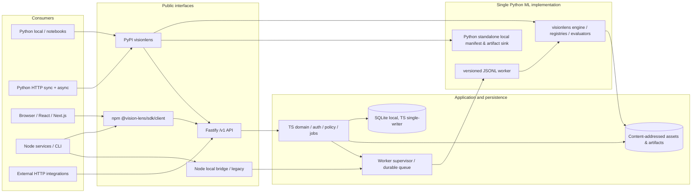

# MASTER SPEC — VisionLens Python SDK, TypeScript SDK e Backend API

**Rev:** P3.0-proposal / 2026-11-15. **Especificação complementar; implementação não verificada.**

## 1. Tese e definição de pronto

O VisionLens deixa de ser somente uma aplicação de análise/rotulagem para ser uma **plataforma integrável de processamento visual reprodutível**, com Python, TypeScript e HTTP como superfícies públicas de primeira classe. O valor não está em duplicar inferência, mas em entregar a desenvolvedores o mesmo grafo de operações, evidence, model lineage, controle de custo e governança independentemente da linguagem.

**Definition of done para fase de integração inicial (P3-MVP):**
- Usuário Python instala um wheel *sem Node*, sem Torch na instalação base, importa `visionlens`, faz `inspect()` local e executa um modelo CPU pequeno quando instala `[vision]`; captura erros tipados e `run_manifest` reprodutível.
- Usuário Python remoto instala somente a base e submete um job assíncrono via API, consulta status, acompanha SSE/reconexão, cancela e baixa artefatos autorizados; versões sync e `asyncio` possuem a mesma semântica.
- Usuário TS instala somente `@vision-lens/sdk/client`, compila em browser e Node sem importar `node:*`, Torch, Sharp ou core legado, envia o mesmo job e recebe os mesmos IDs/artefatos.
- Usuário Node pode manter `@vision-lens/sdk` legado sem regressões; modo local novo é aditivo, explícito e opcional, nunca embutido no bundle browser.
- Backend Fastify possui job durável, auth de escopo, `202 + Location`, idempotência, estado terminal, SSE replay, logs, limites de media e ponte supervisionada JSONL para Python.
- Um golden run de `vision.predict` com dataset/modelo/config idênticos preserva `taskKind`, classes/geometria, *provenance hashes*, erros e saída canônica em Python local, Python HTTP, TS HTTP e CLI/API; campos voláteis normalizados na comparação.
- Todos os canais usam OpenAPI gerado do domínio TS e schemas versionados. Nenhuma rota de produção é tomada de `contracts-proposed/` sem reconciliação.

## 2. Perfil de consumidores e prioridades

| Público | Objetivo principal | Entrada preferencial | Bloqueio impeditivo |
|---|---|---|---|
| ML engineer / pesquisador CV | testar encoders, adaptar modelos, comparar suites | Python local/Jupyter | exigir Node/HTTP para tensor in-memory |
| Engenheiro de aplicação Python | consumir inferência como serviço | Python HTTP sync/async | import de Torch na base |
| Dev React/Next.js | integrar análise visual sem saber ML infra | TypeScript HTTP | importar Sharp/Torch/segredos no browser |
| Backend Node | jobs, batch, pipeline & integrações | TypeScript HTTP ou adaptador local Node | bloquear event loop com inferência |
| Aplicativo externo/enterprise | consumir a plataforma de qualquer stack | HTTP `/v1` + OpenAPI | schema divergente, API sem auth |
| Agente/Codex/MCP | investigar datasets e avaliar modelos | operação tipada com policy gates | execução arbitrária/ações irreversíveis silenciosas |

**Order of delivery:** Python local CPU mínimo → Fastify jobs mínimo → Python remoto & TS HTTP em par → conformance de 1 operação → CV packs seguintes → Node local público → scale hardening. Não lançar SDKs separados com wire instável.

## 3. Topologia: três produtos públicos, um núcleo ML



**Read the diagram as intended architecture, not implementation status.** `visionlens` may be used locally without Fastify/Node and without the TS SQLite store. Once in *managed workspace mode*, only the TS application writes to the canonical domain store. A Python local run stores its own immutable run manifest and artifacts; it does **not** mutate TS SQLite directly. Explicit import/sync into a managed workspace goes through the API and preserves fingerprints. This resolves the apparent tension between Python in-process autonomy and ADR-014 single-writer.

### 3.1 Six execution paths, deliberately different

1. **Python local standalone:** import `visionlens`, instantiate local runner, read permitted file/bytes, run inference/evaluation, return typed objects, write manifest + CAS under user-selected local directory. No HTTP, no Node, no implicit remote egress. Use when kernel/in-memory numpy/PIL outputs matter.
2. **Python remote sync:** tiny HTTP client `VisionLensClient` resolves model capabilities, stages authorized assets, submits `POST /v1/jobs`, waits via polling/SSE, downloads output. Does not import Torch and does not get raw server paths.
3. **Python remote asyncio:** `AsyncVisionLensClient` with `httpx.AsyncClient`, cancellable and bounded; distinct from worker's async; cancellation of local wait does not automatically cancel server job.
4. **TypeScript HTTP:** `@vision-lens/sdk/client` uses injected `fetch` and streaming parser, browser/Node/edge where supported, bearer callback or configured credentials; no dependency on server-side packages. A browser never sees the filesystem or PyTorch tensors.
5. **TypeScript Node local:** existing root/legacy functionality preserved; new Node-only bridge may start managed Python worker with version handshake and route only ML operations. Import must be explicit and never cross into browser bundle. When using canonical TS workspace, store writes occur through TS app services.
6. **Raw backend API/CLI/MCP:** Fastify `/v1` accepts typed operations and enforces auth/licensing/budget. CLI/MCP are clients of the same app services, not forks of policy logic.

### 3.2 Ownership matrix (non-negotiable)

| Concern | Authoritative owner | Notes |
|---|---|---|
| Public TS domain schema and OpenAPI pipeline | `packages/contracts` + generated artifacts | inspect implemented Zod before adding |
| Runtime ML algorithms, device/backend, numerical evaluation | Python `visionlens` | unit-scientific tests and model adapters live here |
| Idempotency, users/scopes, jobs, approvals, audit and canonical SQLite | TS app/API services | single writer, durable state machine |
| Local Python standalone run & artifact manifest | Python package | independent local format, import through API only |
| Remote SDK serialization/auth/retries | respective SDK | no business-rule replication |
| Artifact bytes & content hashes | CAS/artifact layer | no raw paths across HTTP/JSONL |
| Browser/Studio views | Next.js | thin presentation of typed domain results |
| Device scheduling/cancellation | Python runtime + TS supervisor | API policy checks before dispatch |
| Public downloads, URL minting & CORS | Fastify API | scoped and expiring, never worker direct |

## 4. Public operation model (one semantic contract)

**Existing canonical operation codes (proposal in canonical ZIP):** `dataset.inspect`, `dataset.audit`, `vision.embed`, `vision.predict`, `model.train`, `eval.run`, `annotation.propose`, `model.promote`. Existing `worker-request.v1.schema.json` currently permits only `vision.embed`, `vision.predict`, `dataset.audit`, `eval.run`, `model.train`. Do **not** silently add codes without versioned schema changes and worker negotiation.

**Recommended strategy:** keep `vision.predict` as the job operation and choose the CV task by a validated `params.taskKind`, only after reconciling current Zod/schema contracts. A task-discriminated request permits classification/detection/OCR/video/segmentation/retrieval without creating 8 business operations. Dedicated ergonomic methods (`client.vision.classify(...)`) are thin wrappers around this operation and must preserve the canonical payload. `vision.embed` and `eval.run` remain separate because they return different artifacts and evaluations.

| `taskKind` proposed | Phase II module | Result family | Caveat |
|---|---|---|---|
| `image.classification` | 09 | class scores, calibration / abstention | raw score ≠ calibrated probability |
| `image.detection` | 10 | axis-aligned boxes, labels, scores | orientation-aware pixel coordinates |
| `image.ocr` | 11 | text regions + raw/normalized text | plate data can be personal data |
| `video.counting` | 12 | track/event summaries + timestamp refs | count events, not frame sum |
| `image.ppe` | 13 | detections + observable-state flags | no false assumption about occlusion |
| `image.retrieval` | 14 | ranked hit IDs + score + index revision | similarity ≠ calibrated probability |
| `image.matting` | 15 | masks/alpha artifact refs + geometry | binary mask ≠ alpha matting |
| `image.medical_research` | 16 | research labels + uncertainty | research-only; no medical claims |

**Direct Python local is allowed to have rich tensor types** (`numpy.ndarray`, `torch.Tensor`, PIL) in submodules, but every cross-language/public-HTTP response must be serializable and contract-validated; masks, embeddings and videos travel by *artifact references*, never JSON arrays of megabytes. No VLM text is treated as a command.

## 5. Public SDK API philosophy

- Same names for public concepts: `Asset`, `DatasetSnapshot`, `ModelDescriptor`, `PredictionRun`, `EvaluationRun`, `ArtifactRef`, `Job`, `Problem`. Lexical differences follow language conventions: `snake_case` Python vs `camelCase` TS; wire fields remain `camelCase`, converted by explicit aliases in Python.
- Every operation declares `sideEffectTier` (`read`, `analyze`, `compute`, `train`, `export`, `privileged`) and caps (`budget`); clients never elevate privileges merely by choosing local or remote mode.
- No "magic" defaults for checkpoint (`latest`), egress, overwrite, CPU↔GPU fallback, model downloading, patient upload or restricted datasets. Declared fallback returns a provenance event; otherwise fail closed.
- No silent conversion of `Prediction` to `Annotation`, no automatic model promotion, no evaluation on leaked splits; the evaluator can reject incompatible comparisons.
- Async jobs are canonical for network ML: `202`, `jobId`, result `artifactRef`. Low-latency live inference is a *future separate ADR*; do not introduce synchronous backend shortcut in Phase III.
- OpenAPI document is generated from accepted Zod route schemas; Python validators are generated/checked from the same JSON Schema / OpenAPI versions, with golden fixtures rather than parallel manual definitions.

## 6. API and lifecycle in one example

```text
Consumer (Python remote | TypeScript | cURL)
  -> GET /v1/capabilities  (negotiate contract/features)
  -> POST /v1/assets       (streamed upload, MIME/size/hash checks)
  -> POST /v1/jobs         (operation, taskKind, model, asset ID, budget; Idempotency-Key)
     <- 202 Location: /v1/jobs/job_...
  -> GET /v1/jobs/job_.../events (SSE, cursor replay)
  -> GET /v1/jobs/job_...        (terminal status + output refs)
  -> GET /v1/artifacts/art_.../download (scoped, short-lived delivery)
```

**Request candidate:**

```json
{
  "operation": "vision.predict",
  "params": {
    "taskKind": "image.classification",
    "assetId": "asset_01",
    "modelId": "model_cpu_demo@revision-locked"
  },
  "budget": { "maxSeconds": 120, "maxUsdMicro": 0 }
}
```

**202 response candidate** (same JSON shapes across Python HTTP/TS HTTP):

```json
{
  "data": {
    "jobId": "job_01",
    "operation": "vision.predict",
    "status": "queued",
    "submittedAt": "2026-11-15T12:00:00Z",
    "lastEventSequence": 0
  },
  "meta": { "requestId": "req_01", "contractVersion": "1.0.0" }
}
```

This shape is **proposed**, not guaranteed by the existing API (currently a placeholder). In the HTTP API, workspace/tenant identity is derived from the verified authorization context, not a user-controlled `workspaceId`; the server injects a scoped `workspaceId` when constructing the JSONL worker envelope.

## 7. Resource and cancellation semantics

- `ModelDescriptor` must specify immutable weights/revision, artifact hashes, `taskKinds`, preprocessing, model/weights license, input constraints, CPU/MPS/CUDA compatibility, optional package extras and whether hosted inference causes data egress.
- `CapabilitiesResponse` distinguishes `installed` vs `supported_by_code` vs `runnable_on_device` vs `allowed_by_policy` and reports detailed reasons. Do not map installed = ready.
- `Budget` is enforced on the server and worker; a Python local user may supply a budget and receives local errors, but this is not a security sandbox against the local program owner.
- `cancelWait()` = stops waiting client side; `cancelJob()` = requests cooperative cancellation and marks desired state server side. Losing connection does not imply cancellation. Hard kill occurs after grace period and cleanup, with consistent terminal state.
- Repeated submission with same `Idempotency-Key` + same actor/workspace + same canonical payload returns the existing job within TTL. Same key with different body returns `409 IDEMPOTENCY_CONFLICT`. Duplicate process responses must never double-promote models or duplicate event counting.
- Crash after writing an artifact but before job commit yields orphaned CAS object eligible for garbage collection (after retention); final job transition + artifact reference commit must be atomic under the TS store transaction.

## 8. Failure and consistency model

- HTTP: `application/problem+json` (RFC 9457) with extensions `code`, `requestId`, `retryable`, `details` (redacted). This requires an explicit compatibility decision with any implemented error envelope; do not rewrite one silently.
- Jobs: `queued → preparing → running → (succeeded | failed | cancelled | expired)`; `cancel_requested` as separate flag/state when needed; all transitions audited. `succeeded` only when referenced artifacts have passed hash/integrity validation.
- Event log: stable `{jobId, seq}`; replay within declared retention; `Last-Event-ID`/`after` cursor; bounded backpressure; clients fall back to polling after `EVENT_CURSOR_EXPIRED`.
- SDK retriers: GET and idempotent submissions only; bounded attempts, jitter, `Retry-After`, hard max elapsed; never retry POST without idempotency key; cancellation uses distinct idempotency semantics.
- Semantically equivalent outputs can have floating-point variation across CPU/MPS/CUDA. Contract parity must compare *typed envelopes and invariant hashes* exactly and numerical metrics within task- and backend-specific documented tolerances, not pretend bitwise identical logits.

## 9. Security and privacy by boundary

- **Python local:** runs with process user privileges; only trusted model/checkpoint loaders; configurable path allowlist and no implicit network; optional offline mode; no pretending Python library can sandbox untrusted caller code.
- **Browser:** cannot receive raw filesystem paths/API master key; authenticated requests scoped by token and origin; `fetch`-based SSE for Authorization header; no tokens in query string or browser logs.
- **Fastify:** loopback-only default plus local session token; remote deployment requires real authentication, rate limits, quotas, scoped authorization, upload constraints, DNS-rebinding/CSRF defenses for local web UI and audit of privileged effects.
- **Worker:** subprocess via fixed command/argv, no shell; constrained asset handles; max JSONL frame size, action allowlist, process/resource budgets, isolates untrusted decoders and model artifacts; no arbitrary import path in task request.
- **CV packs:** plates, faces and people tracked only in consented/test fixtures; video retention bounded; medical dataset is research-only with patient-split requirements; third-party model/license gate; policy refusal is a typed error, not a silent fallback.

## 10. Engineering and business success measures (targets, not measurements)

| Dimension | Goal / gate | Interpretation |
|---|---|---|
| Installation | Python base wheel has no Torch/Transformers and no Node requirement | verify in clean venv |
| TS portability | `/client` browser/Node smoke, no `node:*` import | bundle graph gate |
| Cross-client parity | 100% schema conformance over golden fixtures | exact contract, numeric tolerances documented |
| API correctness | 202/idempotency/SSE replay/cancel/crash tests pass | correctness over demo speed |
| CV quality | baseline per task with locked split, provenance and measurement context | no invented universal accuracy |
| DX | runnable tutorials for Python local, Python remote, TS, cURL | published package only after smoke |
| Supply chain | reproducible lock/build, SBOM, model/license audit | no accidental redistributions |
| Operational | queue depth, failure rate, p95 by operation/hardware, artifact storage | observed values, not marketing claims |

## 11. Milestone dependencies and scope control

- **Gate 0:** inspect local repo/branch; reconcile `packages/contracts`, root SDK exports, existing Python skeletons; record `KEEP/AMEND/DEFER/CONFLICT` and detect code already created by another agent.
- **Gate 1:** lock one `vision.predict` CPU fixture and model abstraction in Python; `PredictionRun` and immutable artifact manifest; wheel and no-Node import.
- **Gate 2:** Fastify single-writer API + job resource, idempotency, worker supervisor, asset upload + SSE + auth. No GPU scale.
- **Gate 3:** Python remote and TS `/client` released as local packages; golden contract tests on 1 operation. Do **not** publish registry yet.
- **Gate 4:** enable CV 09 + 14 + 15 with capability negotiation and evaluation; then Phase II dependency ordering for other packs. No clinical claims.
- **Gate 5:** Node local opt-in, docs, remote auth hardening, Python async and integration CI, signed release/provenance.
- **Gate 6 (optional):** remote GPU workers, Postgres/team workspace only if actual load and collaboration justify migration.

## 12. ADRs required before implementation-changing PRs

`ADR-P3-001` public interfaces and local-state separation; `ADR-P3-002` HTTP error and operation envelopes; `ADR-P3-003` SDK packaging/versioning and compatibility; `ADR-P3-004` asset ingest and retention; `ADR-P3-005` worker/job durability. These are **proposals** until reconciled and accepted, not overriding existing `ADR-011..018`.

## 13. Explicit anti-patterns

- Re-implement YOLO/OCR/training in JS because the TypeScript SDK needs a local mode.
- Make FastAPI a second public backend alongside Fastify without a scoped requirement and ADR.
- Use Python to write into canonical TS SQLite tables directly.
- Copy OpenAPI proposal over `packages/contracts/openapi.snapshot.json` or paper over mismatches.
- Bundle full `torch/transformers` as a dependency of plain `pip install visionlens`.
- Replace `@vision-lens/sdk` root with HTTP-only client in a minor version.
- Put pretrained weights, restricted datasets, PHI, private license files or secret keys into published wheels/npm archives.
- Publish benchmarks without split hashes, exact model revision, costs (measured vs estimated), hardware and sample counts.
- Assume `torch.mps` or CUDA support means every operator/model works identically.

Detailed deliverables live in the companion docs in this folder.
