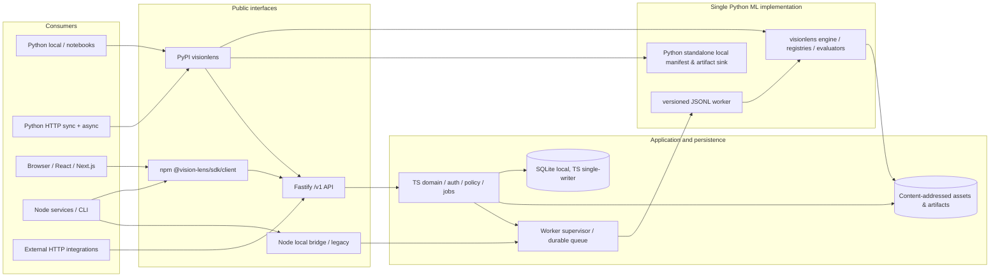
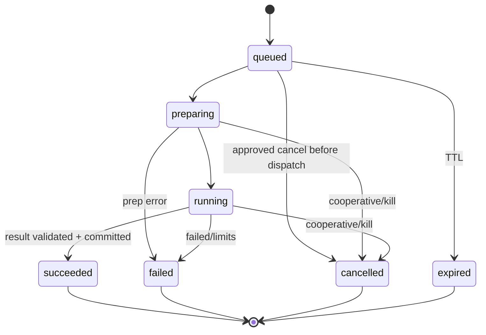

# VisionLens 2027 — Phase III: Python SDK + TypeScript SDK + Backend API

**Technical architecture & implementation supplement** — 2026-11-15.

**Status: design proposal.** These materials build on the original VisionLens canonical pack and the Phase II CV labs (09–16), without modifying them. Package names, endpoints, contracts and examples are not presented as published/implemented. The complete implementation-ready machine-readable proposals, ADRs and ticket breakdown are supplied alongside this document in the ZIP.

## Contents

1. 01 — Architecture / Product — `MASTER-SPEC.md`
2. 02 — Python SDK — `PYTHON-SDK.md`
3. 03 — TypeScript SDK — `TYPESCRIPT-SDK.md`
4. 04 — Fastify Backend API — `BACKEND-API.md`
5. 05 — Contracts & Cross-language Conformance — `CONTRACTS-AND-CONFORMANCE.md`
6. 06 — Threat Model & Security — `SECURITY-THREAT-MODEL.md`
7. 07 — Distribution / DX / CI — `DISTRIBUTION-AND-DX.md`
8. 08 — Implementation Roadmap — `IMPLEMENTATION-PLAN.md`
9. 09 — Sources & Evidence — `SOURCES.md`
10. 10 — Agent Handoff for Claude Code / Codex — `AGENT-HANDOFF.md`

---


---

# 01 — Architecture / Product

# MASTER SPEC — VisionLens Python SDK, TypeScript SDK e Backend API

**Rev:** P3.0-proposal / 2026-11-15. **Especificação complementar; implementação não verificada.**

## 1. Tese e definição de pronto

O VisionLens deixa de ser somente uma aplicação de análise/rotulagem para ser uma **plataforma integrável de processamento visual reprodutível**, com Python, TypeScript e HTTP como superfícies públicas de primeira classe. O valor não está em duplicar inferência, mas em entregar a desenvolvedores o mesmo grafo de operações, evidence, model lineage, controle de custo e governança independentemente da linguagem.

**Definition of done para fase de integração inicial (P3-MVP):**
- Usuário Python instala um wheel *sem Node*, sem Torch na instalação base, importa `visionlens`, faz `inspect()` local e executa um modelo CPU pequeno quando instala `[vision]`; captura erros tipados e `run_manifest` reprodutível.
- Usuário Python remoto instala somente a base e submete um job assíncrono via API, consulta status, acompanha SSE/reconexão, cancela e baixa artefatos autorizados; versões sync e `asyncio` possuem a mesma semântica.
- Usuário TS instala somente `@vision-lens/sdk/client`, compila em browser e Node sem importar `node:*`, Torch, Sharp ou core legado, envia o mesmo job e recebe os mesmos IDs/artefatos.
- Usuário Node pode manter `@vision-lens/sdk` legado sem regressões; modo local novo é aditivo, explícito e opcional, nunca embutido no bundle browser.
- Backend Fastify possui job durável, auth de escopo, `202 + Location`, idempotência, estado terminal, SSE replay, logs, limites de media e ponte supervisionada JSONL para Python.
- Um golden run de `vision.predict` com dataset/modelo/config idênticos preserva `taskKind`, classes/geometria, *provenance hashes*, erros e saída canônica em Python local, Python HTTP, TS HTTP e CLI/API; campos voláteis normalizados na comparação.
- Todos os canais usam OpenAPI gerado do domínio TS e schemas versionados. Nenhuma rota de produção é tomada de `contracts-proposed/` sem reconciliação.

## 2. Perfil de consumidores e prioridades

| Público | Objetivo principal | Entrada preferencial | Bloqueio impeditivo |
|---|---|---|---|
| ML engineer / pesquisador CV | testar encoders, adaptar modelos, comparar suites | Python local/Jupyter | exigir Node/HTTP para tensor in-memory |
| Engenheiro de aplicação Python | consumir inferência como serviço | Python HTTP sync/async | import de Torch na base |
| Dev React/Next.js | integrar análise visual sem saber ML infra | TypeScript HTTP | importar Sharp/Torch/segredos no browser |
| Backend Node | jobs, batch, pipeline & integrações | TypeScript HTTP ou adaptador local Node | bloquear event loop com inferência |
| Aplicativo externo/enterprise | consumir a plataforma de qualquer stack | HTTP `/v1` + OpenAPI | schema divergente, API sem auth |
| Agente/Codex/MCP | investigar datasets e avaliar modelos | operação tipada com policy gates | execução arbitrária/ações irreversíveis silenciosas |

**Order of delivery:** Python local CPU mínimo → Fastify jobs mínimo → Python remoto & TS HTTP em par → conformance de 1 operação → CV packs seguintes → Node local público → scale hardening. Não lançar SDKs separados com wire instável.

## 3. Topologia: três produtos públicos, um núcleo ML



**Read the diagram as intended architecture, not implementation status.** `visionlens` may be used locally without Fastify/Node and without the TS SQLite store. Once in *managed workspace mode*, only the TS application writes to the canonical domain store. A Python local run stores its own immutable run manifest and artifacts; it does **not** mutate TS SQLite directly. Explicit import/sync into a managed workspace goes through the API and preserves fingerprints. This resolves the apparent tension between Python in-process autonomy and ADR-014 single-writer.

### 3.1 Six execution paths, deliberately different

1. **Python local standalone:** import `visionlens`, instantiate local runner, read permitted file/bytes, run inference/evaluation, return typed objects, write manifest + CAS under user-selected local directory. No HTTP, no Node, no implicit remote egress. Use when kernel/in-memory numpy/PIL outputs matter.
2. **Python remote sync:** tiny HTTP client `VisionLensClient` resolves model capabilities, stages authorized assets, submits `POST /v1/jobs`, waits via polling/SSE, downloads output. Does not import Torch and does not get raw server paths.
3. **Python remote asyncio:** `AsyncVisionLensClient` with `httpx.AsyncClient`, cancellable and bounded; distinct from worker's async; cancellation of local wait does not automatically cancel server job.
4. **TypeScript HTTP:** `@vision-lens/sdk/client` uses injected `fetch` and streaming parser, browser/Node/edge where supported, bearer callback or configured credentials; no dependency on server-side packages. A browser never sees the filesystem or PyTorch tensors.
5. **TypeScript Node local:** existing root/legacy functionality preserved; new Node-only bridge may start managed Python worker with version handshake and route only ML operations. Import must be explicit and never cross into browser bundle. When using canonical TS workspace, store writes occur through TS app services.
6. **Raw backend API/CLI/MCP:** Fastify `/v1` accepts typed operations and enforces auth/licensing/budget. CLI/MCP are clients of the same app services, not forks of policy logic.

### 3.2 Ownership matrix (non-negotiable)

| Concern | Authoritative owner | Notes |
|---|---|---|
| Public TS domain schema and OpenAPI pipeline | `packages/contracts` + generated artifacts | inspect implemented Zod before adding |
| Runtime ML algorithms, device/backend, numerical evaluation | Python `visionlens` | unit-scientific tests and model adapters live here |
| Idempotency, users/scopes, jobs, approvals, audit and canonical SQLite | TS app/API services | single writer, durable state machine |
| Local Python standalone run & artifact manifest | Python package | independent local format, import through API only |
| Remote SDK serialization/auth/retries | respective SDK | no business-rule replication |
| Artifact bytes & content hashes | CAS/artifact layer | no raw paths across HTTP/JSONL |
| Browser/Studio views | Next.js | thin presentation of typed domain results |
| Device scheduling/cancellation | Python runtime + TS supervisor | API policy checks before dispatch |
| Public downloads, URL minting & CORS | Fastify API | scoped and expiring, never worker direct |

## 4. Public operation model (one semantic contract)

**Existing canonical operation codes (proposal in canonical ZIP):** `dataset.inspect`, `dataset.audit`, `vision.embed`, `vision.predict`, `model.train`, `eval.run`, `annotation.propose`, `model.promote`. Existing `worker-request.v1.schema.json` currently permits only `vision.embed`, `vision.predict`, `dataset.audit`, `eval.run`, `model.train`. Do **not** silently add codes without versioned schema changes and worker negotiation.

**Recommended strategy:** keep `vision.predict` as the job operation and choose the CV task by a validated `params.taskKind`, only after reconciling current Zod/schema contracts. A task-discriminated request permits classification/detection/OCR/video/segmentation/retrieval without creating 8 business operations. Dedicated ergonomic methods (`client.vision.classify(...)`) are thin wrappers around this operation and must preserve the canonical payload. `vision.embed` and `eval.run` remain separate because they return different artifacts and evaluations.

| `taskKind` proposed | Phase II module | Result family | Caveat |
|---|---|---|---|
| `image.classification` | 09 | class scores, calibration / abstention | raw score ≠ calibrated probability |
| `image.detection` | 10 | axis-aligned boxes, labels, scores | orientation-aware pixel coordinates |
| `image.ocr` | 11 | text regions + raw/normalized text | plate data can be personal data |
| `video.counting` | 12 | track/event summaries + timestamp refs | count events, not frame sum |
| `image.ppe` | 13 | detections + observable-state flags | no false assumption about occlusion |
| `image.retrieval` | 14 | ranked hit IDs + score + index revision | similarity ≠ calibrated probability |
| `image.matting` | 15 | masks/alpha artifact refs + geometry | binary mask ≠ alpha matting |
| `image.medical_research` | 16 | research labels + uncertainty | research-only; no medical claims |

**Direct Python local is allowed to have rich tensor types** (`numpy.ndarray`, `torch.Tensor`, PIL) in submodules, but every cross-language/public-HTTP response must be serializable and contract-validated; masks, embeddings and videos travel by *artifact references*, never JSON arrays of megabytes. No VLM text is treated as a command.

## 5. Public SDK API philosophy

- Same names for public concepts: `Asset`, `DatasetSnapshot`, `ModelDescriptor`, `PredictionRun`, `EvaluationRun`, `ArtifactRef`, `Job`, `Problem`. Lexical differences follow language conventions: `snake_case` Python vs `camelCase` TS; wire fields remain `camelCase`, converted by explicit aliases in Python.
- Every operation declares `sideEffectTier` (`read`, `analyze`, `compute`, `train`, `export`, `privileged`) and caps (`budget`); clients never elevate privileges merely by choosing local or remote mode.
- No "magic" defaults for checkpoint (`latest`), egress, overwrite, CPU↔GPU fallback, model downloading, patient upload or restricted datasets. Declared fallback returns a provenance event; otherwise fail closed.
- No silent conversion of `Prediction` to `Annotation`, no automatic model promotion, no evaluation on leaked splits; the evaluator can reject incompatible comparisons.
- Async jobs are canonical for network ML: `202`, `jobId`, result `artifactRef`. Low-latency live inference is a *future separate ADR*; do not introduce synchronous backend shortcut in Phase III.
- OpenAPI document is generated from accepted Zod route schemas; Python validators are generated/checked from the same JSON Schema / OpenAPI versions, with golden fixtures rather than parallel manual definitions.

## 6. API and lifecycle in one example

```text
Consumer (Python remote | TypeScript | cURL)
  -> GET /v1/capabilities  (negotiate contract/features)
  -> POST /v1/assets       (streamed upload, MIME/size/hash checks)
  -> POST /v1/jobs         (operation, taskKind, model, asset ID, budget; Idempotency-Key)
     <- 202 Location: /v1/jobs/job_...
  -> GET /v1/jobs/job_.../events (SSE, cursor replay)
  -> GET /v1/jobs/job_...        (terminal status + output refs)
  -> GET /v1/artifacts/art_.../download (scoped, short-lived delivery)
```

**Request candidate:**

```json
{
  "operation": "vision.predict",
  "params": {
    "taskKind": "image.classification",
    "assetId": "asset_01",
    "modelId": "model_cpu_demo@revision-locked"
  },
  "budget": { "maxSeconds": 120, "maxUsdMicro": 0 }
}
```

**202 response candidate** (same JSON shapes across Python HTTP/TS HTTP):

```json
{
  "data": {
    "jobId": "job_01",
    "operation": "vision.predict",
    "status": "queued",
    "submittedAt": "2026-11-15T12:00:00Z",
    "lastEventSequence": 0
  },
  "meta": { "requestId": "req_01", "contractVersion": "1.0.0" }
}
```

This shape is **proposed**, not guaranteed by the existing API (currently a placeholder). In the HTTP API, workspace/tenant identity is derived from the verified authorization context, not a user-controlled `workspaceId`; the server injects a scoped `workspaceId` when constructing the JSONL worker envelope.

## 7. Resource and cancellation semantics

- `ModelDescriptor` must specify immutable weights/revision, artifact hashes, `taskKinds`, preprocessing, model/weights license, input constraints, CPU/MPS/CUDA compatibility, optional package extras and whether hosted inference causes data egress.
- `CapabilitiesResponse` distinguishes `installed` vs `supported_by_code` vs `runnable_on_device` vs `allowed_by_policy` and reports detailed reasons. Do not map installed = ready.
- `Budget` is enforced on the server and worker; a Python local user may supply a budget and receives local errors, but this is not a security sandbox against the local program owner.
- `cancelWait()` = stops waiting client side; `cancelJob()` = requests cooperative cancellation and marks desired state server side. Losing connection does not imply cancellation. Hard kill occurs after grace period and cleanup, with consistent terminal state.
- Repeated submission with same `Idempotency-Key` + same actor/workspace + same canonical payload returns the existing job within TTL. Same key with different body returns `409 IDEMPOTENCY_CONFLICT`. Duplicate process responses must never double-promote models or duplicate event counting.
- Crash after writing an artifact but before job commit yields orphaned CAS object eligible for garbage collection (after retention); final job transition + artifact reference commit must be atomic under the TS store transaction.

## 8. Failure and consistency model

- HTTP: `application/problem+json` (RFC 9457) with extensions `code`, `requestId`, `retryable`, `details` (redacted). This requires an explicit compatibility decision with any implemented error envelope; do not rewrite one silently.
- Jobs: `queued → preparing → running → (succeeded | failed | cancelled | expired)`; `cancel_requested` as separate flag/state when needed; all transitions audited. `succeeded` only when referenced artifacts have passed hash/integrity validation.
- Event log: stable `{jobId, seq}`; replay within declared retention; `Last-Event-ID`/`after` cursor; bounded backpressure; clients fall back to polling after `EVENT_CURSOR_EXPIRED`.
- SDK retriers: GET and idempotent submissions only; bounded attempts, jitter, `Retry-After`, hard max elapsed; never retry POST without idempotency key; cancellation uses distinct idempotency semantics.
- Semantically equivalent outputs can have floating-point variation across CPU/MPS/CUDA. Contract parity must compare *typed envelopes and invariant hashes* exactly and numerical metrics within task- and backend-specific documented tolerances, not pretend bitwise identical logits.

## 9. Security and privacy by boundary

- **Python local:** runs with process user privileges; only trusted model/checkpoint loaders; configurable path allowlist and no implicit network; optional offline mode; no pretending Python library can sandbox untrusted caller code.
- **Browser:** cannot receive raw filesystem paths/API master key; authenticated requests scoped by token and origin; `fetch`-based SSE for Authorization header; no tokens in query string or browser logs.
- **Fastify:** loopback-only default plus local session token; remote deployment requires real authentication, rate limits, quotas, scoped authorization, upload constraints, DNS-rebinding/CSRF defenses for local web UI and audit of privileged effects.
- **Worker:** subprocess via fixed command/argv, no shell; constrained asset handles; max JSONL frame size, action allowlist, process/resource budgets, isolates untrusted decoders and model artifacts; no arbitrary import path in task request.
- **CV packs:** plates, faces and people tracked only in consented/test fixtures; video retention bounded; medical dataset is research-only with patient-split requirements; third-party model/license gate; policy refusal is a typed error, not a silent fallback.

## 10. Engineering and business success measures (targets, not measurements)

| Dimension | Goal / gate | Interpretation |
|---|---|---|
| Installation | Python base wheel has no Torch/Transformers and no Node requirement | verify in clean venv |
| TS portability | `/client` browser/Node smoke, no `node:*` import | bundle graph gate |
| Cross-client parity | 100% schema conformance over golden fixtures | exact contract, numeric tolerances documented |
| API correctness | 202/idempotency/SSE replay/cancel/crash tests pass | correctness over demo speed |
| CV quality | baseline per task with locked split, provenance and measurement context | no invented universal accuracy |
| DX | runnable tutorials for Python local, Python remote, TS, cURL | published package only after smoke |
| Supply chain | reproducible lock/build, SBOM, model/license audit | no accidental redistributions |
| Operational | queue depth, failure rate, p95 by operation/hardware, artifact storage | observed values, not marketing claims |

## 11. Milestone dependencies and scope control

- **Gate 0:** inspect local repo/branch; reconcile `packages/contracts`, root SDK exports, existing Python skeletons; record `KEEP/AMEND/DEFER/CONFLICT` and detect code already created by another agent.
- **Gate 1:** lock one `vision.predict` CPU fixture and model abstraction in Python; `PredictionRun` and immutable artifact manifest; wheel and no-Node import.
- **Gate 2:** Fastify single-writer API + job resource, idempotency, worker supervisor, asset upload + SSE + auth. No GPU scale.
- **Gate 3:** Python remote and TS `/client` released as local packages; golden contract tests on 1 operation. Do **not** publish registry yet.
- **Gate 4:** enable CV 09 + 14 + 15 with capability negotiation and evaluation; then Phase II dependency ordering for other packs. No clinical claims.
- **Gate 5:** Node local opt-in, docs, remote auth hardening, Python async and integration CI, signed release/provenance.
- **Gate 6 (optional):** remote GPU workers, Postgres/team workspace only if actual load and collaboration justify migration.

## 12. ADRs required before implementation-changing PRs

`ADR-P3-001` public interfaces and local-state separation; `ADR-P3-002` HTTP error and operation envelopes; `ADR-P3-003` SDK packaging/versioning and compatibility; `ADR-P3-004` asset ingest and retention; `ADR-P3-005` worker/job durability. These are **proposals** until reconciled and accepted, not overriding existing `ADR-011..018`.

## 13. Explicit anti-patterns

- Re-implement YOLO/OCR/training in JS because the TypeScript SDK needs a local mode.
- Make FastAPI a second public backend alongside Fastify without a scoped requirement and ADR.
- Use Python to write into canonical TS SQLite tables directly.
- Copy OpenAPI proposal over `packages/contracts/openapi.snapshot.json` or paper over mismatches.
- Bundle full `torch/transformers` as a dependency of plain `pip install visionlens`.
- Replace `@vision-lens/sdk` root with HTTP-only client in a minor version.
- Put pretrained weights, restricted datasets, PHI, private license files or secret keys into published wheels/npm archives.
- Publish benchmarks without split hashes, exact model revision, costs (measured vs estimated), hardware and sample counts.
- Assume `torch.mps` or CUDA support means every operator/model works identically.

Detailed deliverables live in the companion docs in this folder.


---

# 02 — Python SDK

# SDK Python de primeira classe — design de API, runtime, packaging e avaliação

**Status:** proposto. **Nome de distribuição:** `visionlens` (validar disponibilidade no PyPI); **import:** `visionlens`; **Python mínimo sugerido:** `>=3.11`, conforme 05-PYTHON-CORE-AND-PYPI do ZIP original. **Não publicado/implementado por este documento.**

## 1. Uma distribuição, duas formas de uso

O usuário não deve instalar dois projetos distintos sem necessidade. A distribuição `visionlens` contém: (a) **cliente remoto leve**, síncrono e assíncrono, utilizável sem GPU ou Node; (b) **runtime local opcional** via extras, com I/O e inferência in-process. A biblioteca expõe fachadas com objetos explicitamente diferentes para que custo, side effects e garantias não sejam confusos.

| Superfície Python | Runtime | Principais retornos | Requisitos | Persistência |
|---|---|---|---|---|
| `VisionLens.local(config)` | Python no processo atual | `PredictionRun`, `EvaluationRun`, `ArtifactRef` | `visionlens[vision]` e extras por tarefa; dispositivo compatível | manifest/CAS local independente |
| `VisionLensClient(base_url, ...)` | HTTP sync para Fastify | `JobHandle`, `Job`, typed results | instalação base + HTTP | backend TS store, refs remotas |
| `AsyncVisionLensClient(base_url, ...)` | HTTP async (`asyncio`) | `JobHandle`, async events, downloads | instalação base + HTTP | backend TS store |
| `visionlens.runtime.*` | extensões internas locais | tensores/model handles | opt-in, adaptadores | sem acesso irrestrito à store TS |

A interface local **nunca** chama Fastify automaticamente se uma operação não tiver dependência local. Erro `MISSING_EXTRA` indica como instalar, erro `UNSUPPORTED_DEVICE` identifica capabilities; **não** mudar silenciosamente para um provedor remoto pago. O cliente remoto **nunca** tenta instalar torch ou iniciar um processo Node quando falta o backend.

## 2. API pública sugerida, com exemplos de ergonomia

### 2.1 Primeira inferência CPU local (proposta)

```python
# EXEMPLO DE API FUTURA — requer implementação e um modelo aprovado.
from pathlib import Path
from visionlens import VisionLens, LocalConfig

cfg = LocalConfig(
    device="cpu",                         # "auto" opcional, mas sempre auditável
    workspace_dir=Path("./visionlens-runs"),
    offline=True,                         # proíbe downloads/egress implícitos
    model_downloads="deny",              # versão/arquivo fornecidos explicitamente
    max_input_megabytes=20,
)
with VisionLens.local(cfg) as lens:
    print(lens.capabilities())
    run = lens.vision.predict(
        input=Path("./samples/cat.jpg"),
        task_kind="image.classification",
        model="example-classifier@sha256:...",  # placeholder; real revision pinned
        options={"top_k": 3},
    )
    print(run.run_id, run.predictions, run.provenance.model_digest)
    print(run.artifact_manifest_path)
```

`model_downloads="deny"` e `offline=True` representam uma mesma intenção em dois níveis: a configuração pública deve evitar controles duplicados se o agente constatar redundância; manter um *único* `NetworkPolicy` ou flag após validação. O exemplo enfatiza comportamento, não nomes definitivos.

### 2.2 Operação Python HTTP sync com job durável

```python
# EXEMPLO FUTURO — sem Torch, sem Node local.
from visionlens import VisionLensClient

with VisionLensClient(base_url="https://example.invalid", token="<runtime-token>") as vl:
    capabilities = vl.capabilities.get()
    uploaded = vl.assets.upload_file("./samples/cat.jpg")
    job = vl.jobs.submit(
        operation="vision.predict",
        params={
            "taskKind": "image.classification",
            "assetId": uploaded.asset_id,
            "modelId": "approved-model@rev1",
        },
        budget={"maxSeconds": 120, "maxUsdMicro": 0},
        idempotency_key="my-experiment-001",
    )
    completed = vl.jobs.wait(job.job_id, timeout=180)
    if completed.status != "succeeded":
        raise RuntimeError(completed.status)
    result = vl.jobs.result(completed.job_id)
    print(result.artifacts)
```

O `wait(timeout)` controla **tempo máximo do cliente**, não `budget.maxSeconds` do servidor. Timeout no cliente não cancela o job; `vl.jobs.cancel(job_id)` é ação explícita. `submit()` exige idempotency key para ativar retries seguros de POST.

### 2.3 Python HTTP async e streaming

```python
# EXEMPLO FUTURO — API async não depende do runtime local.
import asyncio
from visionlens import AsyncVisionLensClient

async def run_job() -> None:
    async with AsyncVisionLensClient(base_url="https://example.invalid", token="<token>") as vl:
        job = await vl.jobs.submit(
            operation="vision.predict",
            params={"assetId": "asset_01", "modelId": "approved@rev1", "taskKind": "image.detection"},
            budget={"maxSeconds": 300, "maxUsdMicro": 0},
            idempotency_key="detector-2027-001",
        )
        async for event in vl.jobs.events(job.job_id, after=0):
            if event.kind == "progress":
                print(event.completed, event.total)
            if event.kind in ("result", "error"):
                break
        final_job = await vl.jobs.get(job.job_id)
        print(final_job.status)

asyncio.run(run_job())
```

SSE deve manter cursor `{jobId, seq}` para deduplicação e replay. Quando uma corrotina é cancelada, liberar conexão/recursos sem enviar `cancelJob` automaticamente, porque outros clientes podem acompanhar o mesmo processamento. `AsyncVisionLensClient` deve ser totalmente nativo async, sem `asyncio.run()` dentro de uma função que já roda no event loop (Jupyter/FastAPI).

## 3. Interface pública candidata (protocol skeleton)

```python
# Assinaturas conceituais, não arquivo implantado.
from dataclasses import dataclass
from pathlib import Path
from typing import Any, AsyncIterator, Literal, Mapping, Protocol

Device = Literal["auto", "cpu", "mps", "cuda"]
TaskKind = Literal[
    "image.classification", "image.detection", "image.ocr",
    "video.counting", "image.ppe", "image.retrieval",
    "image.matting", "image.medical_research",
]

@dataclass(frozen=True)
class ArtifactRef:
    artifact_id: str
    media_type: str
    sha256: str
    byte_length: int

@dataclass(frozen=True)
class PredictionRun:
    run_id: str
    task_kind: TaskKind
    predictions: tuple[Any, ...]
    provenance: Mapping[str, Any]
    artifacts: tuple[ArtifactRef, ...]

class LocalVisionOperations(Protocol):
    def predict(self, *, input: Path | bytes, task_kind: TaskKind, model: str, options: Mapping[str, Any] | None = None) -> PredictionRun: ...

class RemoteJobs(Protocol):
    def submit(self, *, operation: str, params: Mapping[str, Any], budget: Mapping[str, int], idempotency_key: str) -> Any: ...
    def wait(self, job_id: str, *, timeout: float | None = None) -> Any: ...
    def cancel(self, job_id: str) -> Any: ...

class AsyncRemoteJobs(Protocol):
    async def submit(self, *, operation: str, params: Mapping[str, Any], budget: Mapping[str, int], idempotency_key: str) -> Any: ...
    async def events(self, job_id: str, *, after: int | None = None) -> AsyncIterator[Any]: ...
```

A versão concretizada deve evitar `Any` nos objetos de domínio. O uso temporário na interface exploratória permite conciliar com os `Prediction`/`Annotation` implementados no repositório; após ADR e schemas, substituí-los por classes/tipos gerados.

## 4. Arquitetura interna proposta

```text
python/visionlens/                      # diretório do ZIP canônico, ainda a conferir no repo
  pyproject.toml
  README.md
  src/visionlens/
    __init__.py                      # exports estáveis; import leve
    py.typed
    api.py                           # VisionLens.local; context manager
    config.py                        # validate LocalConfig/NetworkPolicy
    errors.py                        # stable error subclasses, retry metadata
    typing.py                        # public protocols, TaskKinds
    client/
      sync.py                        # VisionLensClient, httpx.Client injection
      async_.py                      # AsyncVisionLensClient, httpx.AsyncClient
      transport.py                   # auth, retry, handshake, idempotency
      sse.py                         # parse/reconnect/cursor/dedupe
      assets.py                      # secure streaming uploads/downloads
    local/
      session.py                     # LocalVisionContext lifecycle
      manifest.py                    # readonly immutable run manifests
      artifacts.py                   # CAS writer, atomic move, SHA256
      dataset.py                     # immutable dataset & split descriptors
    registry/
      model.py                       # license/preprocessing/backend/deps
      task.py                        # allowlisted adapters; no arbitrary imports from input
    cv/
      classification.py
      detection.py
      ocr.py
      tracking.py
      ppe.py
      retrieval.py
      matting.py
      medical_research.py            # research-only policy gates
    evaluation/
      suite.py                        # task-specific evaluation plugins
      metrics.py
    training/
      recipes.py                     # optional extras; no implicit network
    bridge/
      worker.py                      # supervised JSONL server, from canonical v1
      handshake.py
  tests/...
```

Diretórios novos são proposta, não instrução para mover os serviços Python já existentes. `services/{vision,training,agents}` permanecem adapters finos até haver evidência/ADR para fusão. `__init__` não importa `cv/`, `torch` ou `transformers` avidamente. O pacote é typed (`py.typed`), sem native extensions na base.

## 5. Python local persistence versus workspace gerenciado

Esse é o ponto mais fácil de errar. Em modo standalone, Python pode gerar:

```text
workspace_dir/
  manifest.version.json
  blobs/sha256/ab/abcdef...           # bytes imutáveis, streaming
  runs/<run-id>/run.json              # manifest imutável + links para CAS
  indexes/<index-fingerprint>/        # embeddings/search, versionados
  cache/                              # derivado, descartável
```

**Não** reutilizar `packages/core/src/store` via SQLite direto. Em workspace gerenciado, Python worker deve receber somente IDs/scoped refs e entregar resultados ao TS domain through defined commit interface; se for necessário usar Python local e depois Studio, criar `POST /v1/imports/local-runs` *em fase posterior* com bundle assinado/hash auditado e idempotência, evitando sync implícito. A forma exata do manifesto requer ADR e conformance com entities já existentes.

## 6. Device planner e controle de recursos

- Base CPU sempre suportada na *test fixture*; não afirmar performance real-time. `mps`/`cuda` são capacidades explícitas por adapter+model+operator, não garantias de PyTorch por plataforma.
- Resolver `DevicePlan` com `{requested, selected, reason, fallback_used, precision, batch_size, env_fingerprint}`. Sem licença/hardware, erro tipado antes do download.
- `torch.inference_mode()` quando suportado, gestão de memory/batches, model cache com LRU e leases, backpressure quando limite de RAM/VRAM exceder; Apple Silicon MPS e CUDA testados apenas nos runners que possuírem hardware real.
- Modelo com pesos externos: usuário faz pin exato por revision/digest, license manifest, checksum; proibir execução de pickle/checkpoints arbitrários sem trust review. Bibliotecas `safetensors`/formats seguros quando disponíveis.
- Offline test garante: nenhum DNS/HTTP no import e na inferência com pesos já instalados. Logging não inclui imagem/EXIF, tokens ou path do usuário por padrão.
- Cancelamento in-process cooperativo com token; long op interrompe entre batches e limpa parcial. Não prometer matar threads Python de modo seguro.

## 7. Adapter registry e os oito labs

`TaskAdapter` define `task_kind`, `input_spec`, `model_capabilities`, `predict`, `evaluate`, `artifact_schema`, `license_policy`. Registry recebe IDs declarativos de modelos e adapters verificados; configs não podem importar módulos Python arbitrários por string. Preprocessamento/revision hash são parte do resultado.

| Lab | API ergonômica local proposta | Extra candidato | Tipos de saída |
|---|---|---|---|
| 09 | `lens.vision.classify(path, model=...)` | `[vision]` | `ClassPrediction` |
| 10 | `lens.vision.detect(path, model=...)` | `[cv-detection]` | `BoundingBox` + `Detection` |
| 11 | `lens.vision.ocr(path, model=...)` | `[cv-ocr]` | `TextRegion` + `TextObservation` |
| 12 | `lens.video.count(clip, line=..., model=...)` | `[cv-video]` | `TrackEvent` + `CountSummary` |
| 13 | `lens.vision.inspect_ppe(path, model=...)` | `[cv-detection]` | `PPEObservation`, `unobservable` |
| 14 | `lens.retrieval.query(image, index=..., k=...)` | `[vision]` | `RetrievalHit` + `indexFingerprint` |
| 15 | `lens.vision.remove_background(path, model=...)` | `[cv-matting]` | `AlphaMaskRef`, `CompositedImageRef` |
| 16 | `lens.research.analyze_xray(path, suite=...)` | opt-in/research only | research scorecard + uncertain labels |

**As funções ergonômicas só aparecem na documentação pública quando implementadas/testadas.** Backend canônico permanece `vision.predict` e workflows assíncronos; `image.retrieval` pode mapear `vision.embed` + busca versionada, conforme ADR. Módulo 16 não oferece método `diagnose` e não produz laudo clínico.

## 8. Packaging realista: `pyproject.toml`

A base instala apenas o necessário para validação e cliente HTTP. Uma referência TOML em `examples/pyproject.reference.toml` fornece metadados para adaptação. Política sugerida:

```toml
[project]
name = "visionlens"                       # nome candidato, validar PyPI
version = "0.0.0"                        # placeholder, não release
requires-python = ">=3.11"
dependencies = ["pydantic>=2,<3", "httpx>=0.27,<1"]

[project.optional-dependencies]
vision = ["numpy", "Pillow", "torch"]
training = ["scikit-learn", "torch"]
cv-detection = ["torch", "Pillow"]
cv-ocr = ["Pillow"]
cv-video = ["numpy"]
cv-matting = ["torch", "Pillow"]
agents = []
server = []
```

Esse snippet demonstra **separação de extras**, não um conjunto suficiente de dependências: versões exatas de adapters de YOLO/OCR/video, e compatibilidade de `torch`/Python/macos/CUDA precisam ser decididas com lockfiles por perfil, audit de licença e tested installs. Não publicar extras vazios e `all` artificial. Preferir conjunto mínimo para primeira entrega: `[vision]`, `[training]`, `[agents]`, `[server]`, alinhado ao ZIP canônico; adicionar `[cv-*]` somente quando implementados.

Regras:
- PEP 621 metadata e `[build-system]` explícito. Wheel puro, sdist, licença e `py.typed`; sem datasets/checkpoints/keys.
- `uv.lock` no repositório para desenvolvimento; *wheel* testado em venv limpo e sem `tool.uv.sources` local; `uv build`, `uv build --no-sources` quando aplicável.
- Unit test Python 3.11/3.12; 3.13 somente após prova de compatibilidade de torch/adapters. Dispositivos específicos em jobs opt-in.
- Distinguish `packageVersion` vs `contractVersion` vs `workerProtocolVersion` vs `modelRevision`. Aumento de versão do SDK não implica schema v2.
- Evitar ter `visionlens` e outro pacote SDK Python HTTP separado enquanto não houver razão técnica: duplicaria release/confusão de namespaces.

## 9. Error taxonomy e transport

Classes base sugeridas: `VisionLensError(code, request_id, retryable, details)`, `ValidationError`, `AuthenticationError`, `AuthorizationError`, `CapabilityUnavailable`, `MissingExtraError`, `ModelLicenseError`, `BudgetExceededError`, `RateLimitError`, `VersionMismatchError`, `ArtifactIntegrityError`, `JobFailedError`.

- HTTP error `RFC9457` → classe Python mapeada por `code`, sem parsing de `detail` em inglês; `ProblemDetails` com `type/status/title/detail/instance/code/requestId/retryable` e detalhes redigidos.
- Transport exception (`httpx.ConnectError`, `ReadTimeout`) é mapeada para `TransportError`, não significa que server-side job falhou. Para POST com idempotency key, tentar `GET` ou submit again com mesma key após reconectar.
- Async `CancelledError` é reerguido; não transformá-lo em sucesso/cancelamento de job remoto.
- `403` capability prohibited vs `424` model extra missing? Política: erros de policy com 403; indisponibilidade de hardware/model/capability 422/503 dependendo causa; mapear em catálogo, sem escolher status a partir de strings.
- Resultado com `unknown`/`unobservable` é válido e deve preservar a diferença de `None`, `False`, `0` e lista vazia.

## 10. Contrato de transport Python, isolamento e segurança

- `httpx.Client`/`AsyncClient` injetáveis, timeout por etapa, transport mock em teste, TLS verificado por padrão, proxies somente configurados conscientemente, token provider e `User-Agent` sem PII.
- `assets.upload_file` faz stream e calcula sha256 sem acumular arquivos gigantes em RAM; verifica tamanho, MIME permitido, EXIF sanitization policy do backend; client não dita authoritative MIME apenas por extensão.
- Upload não aceita `file://` ou URLs livres no backend; Python local `Path.resolve()` e symlink checks para política de diretórios, mas caller local é confiável dentro do processo.
- `artifacts.download(..., destination=...)`: stream para arquivo temporário em diretório permitido; verificar `digest` e `length` antes de atomic rename; nunca aceitar nome de path do response diretamente.
- Pagination vira iterador/async iterador com limites para evitar paginação infinita; SSE mantém dedupe seq.
- Logs de modelo configuráveis; `TraceContext` propaga request IDs, mas desabilitar rastreamento de payloads sensíveis.

## 11. Testes e release gates específicos Python

1. Import em venv limpo sem Torch, MLflow, Transformers e sem Node presente; `python -c 'import visionlens'` passa sem I/O de rede.
2. Build wheel+sdist, inspecionar conteúdo (nada de checkpoints), instalar ambos numa instalação isolada; `py.typed` incluído; `mypy`/`pyright` sobre consumidor real.
3. Contract fixtures JSON: Python `TypeAdapter.validate_json(...)` aceita payloads válidos e rejeita inválidos; comparar wire canonical com TS Zod.
4. `httpx.MockTransport` ou equivalente: auth header, 202, 400, 401, 403, 409, 429, 503, retries, ETag, pagination, timeouts e idempotency.
5. Async Test: stream parcial, reconnect cursor, cancel consumer, 2 consumers do mesmo job, `_close` resource leak, timeout vs job cancel.
6. Local CPU golden: imagem sintética/licenciada, seed/pipeline, model pinned, deterministic contract; memória e CPU bounds; sem downloads surpresa.
7. Scientific gates fora de fast CI: held-out split por sujeito/clip, avaliação classification/detection/OCR/tracking/retrieval/matting tasks, MPS/CUDA smoke quando hardware existir.
8. Security: malicious path, zip bomb, corrupt EXIF, model download blocked, prohibited patient/plate data route, sensitive logs redacted.
9. Release only after package name ownership validated, license review, docs/examples executed against built artifact, signed CI/tag and rollback proof.

## 12. Ambiguidades a fechar no ADR do primeiro PR

- **Standalone output contract:** se usará `run.json` + CAS próprio ou snapshot import compatível; não escrever canonical SQLite.
- **Model IDs:** se a convenção de revision será `model@rev` vs objeto `{id, revision}`; preferir objeto tipado se o repositório já usar.
- **Image input:** `Path|bytes|PIL|numpy` no core local, sem tornar PIL/Numpy dependências base; heavy types só em submodules.
- **TS ↔ Python coordinate frames:** normalização EXIF e `bbox` pixels/normalized; não estimar shapes a partir da string da classe.
- **Public package name:** validar PyPI e domínio; `visionlens` é provisório.
- **Torch version matrix:** não fixar sem resolver ambiente 3.11/3.12 macOS/CPU/CUDA e licenças.

**Termo de aceite:** Python tem real uso standalone, não é apenas uma casca HTTP de outro serviço; e ao mesmo tempo oferece um cliente HTTP leve coerente com o SDK TypeScript e o backend.


---

# 03 — TypeScript SDK

# SDK TypeScript/npm — browser, Node, compatibilidade e modo local

**Status:** proposta aditiva. **Namespace existente no ZIP original:** `@vision-lens/sdk`; root já reexporta APIs de `@vision-lens/core` no snapshot observado. **Nunca trocar esse root por HTTP-only em release minor.** O fato de existir no branch não prova publicação npm.

## 1. Quatro pontos de entrada, dois executores

| Import | Ambiente | Natureza | Disponibilidade proposta |
|---|---|---|---|
| `@vision-lens/sdk/client` | Browser, Node, edge com fetch/Streams | cliente HTTP typed | P3-MVP, primeiro |
| `@vision-lens/sdk` | Node (segundo legados) | exports existentes de core/legacy | **preservar** |
| `@vision-lens/sdk/legacy` | Node, quando relevante | alias explícito para workflow legado | deprecação gradual |
| `@vision-lens/sdk/node` | Node somente | gerenciamento de worker Python local e façade | P3-later, após bridge estável |
| `@vision-lens/sdk/types` (opcional) | qualquer TS | tipos públicos sem runtime | adicionar só se justificar |

`/client` não contém implementações de classificadores/detectores nem carrega Python. `@vision-lens/sdk/node` **não** duplica os algoritmos, apenas orquestra um Python worker JSONL e serviços TS. Import `@vision-lens/sdk/client` em Next.js Client Components e browser não pode puxar `node:fs`, `sharp`, `child_process`, `@vision-lens/core`, variáveis secretas ou OpenTelemetry server SDK. Em Next.js Server Components/server actions pode usar o mesmo cliente com token restrito ao servidor.

### 1.1 Tipos de uso

```typescript
// Exemplo FUTURO de cliente universal, não implementado neste suplemento.
import { VisionLensClient } from '@vision-lens/sdk/client';

const client = new VisionLensClient({
  baseUrl: 'https://example.invalid',
  getAccessToken: async () => runtimeToken,
  fetch: globalThis.fetch,
  timeoutMs: 30_000,
});

const capabilities = await client.capabilities.get();
const asset = await client.assets.upload(file);  // Blob/File browser; stream adapter Node
const job = await client.jobs.submit({
  operation: 'vision.predict',
  params: { taskKind: 'image.classification', assetId: asset.assetId, modelId: 'approved@rev1' },
  budget: { maxSeconds: 120, maxUsdMicro: 0 },
  idempotencyKey: 'demo-001',
});
const done = await client.jobs.wait(job.jobId, { signal: abortController.signal });
if (done.status === 'succeeded') {
  const run = await client.jobs.result(done.jobId);
  console.log(run.artifacts);
}
```

`client.jobs.wait` abortado por `AbortSignal` **não** cancela o job no servidor. `client.jobs.cancel` é outra chamada explícita e autorizada.

### 1.2 Node-only local: nenhuma VM embutida nem pseudo TS ML

```typescript
// EXEMPLO DE ENTRYPOINT FUTURO; requer JSONL supervisor implementado.
import { createLocalVisionLens } from '@vision-lens/sdk/node';

await using vision = await createLocalVisionLens({
  workspaceDir: './.visionlens',
  pythonExecutable: '/opt/venvs/visionlens/bin/python', // configurável, validado
  device: 'cpu',
  allowModelDownloads: false,
});
const run = await vision.predict({
  taskKind: 'image.detection',
  inputPath: './fixtures/warehouse.jpg',
  modelId: 'model-verified@rev1',
});
console.log(run.artifacts);
```

**Nota:** `await using` depende da versão/target TypeScript e da implementação de `Symbol.asyncDispose`; aceitar alternativa `try/finally { await vision.close(); }` como baseline mais portátil. Executável Python não pode vir de input HTTP/agent, usar allowlist + `spawn(cmd, args, { shell: false })`, handshake e limites de processos; falha `PYTHON_WORKER_UNAVAILABLE` com diagnóstico. O Node bridge só pode escrever no store TS via aplicação canônica e não acessa SQLite Python side.

## 2. API object model — ergonomia sem esconder semântica

```ts
// Modelagem conceitual; gerar/deduzir schemas dos contratos aceitos.
export type JobStatus = 'queued' | 'preparing' | 'running' | 'succeeded' | 'failed' | 'cancelled' | 'expired';

export type JobSubmit = {
  operation: 'vision.predict' | 'vision.embed' | 'dataset.audit' | 'eval.run' | 'model.train';
  params: Record<string, unknown>; // substituir por discriminated union versionada
  budget: { maxSeconds: number; maxUsdMicro: number; maxTokens?: number };
  idempotencyKey: string;
};

export type VisionLensClientConfig = {
  baseUrl: string;
  fetch?: typeof globalThis.fetch;
  getAccessToken?: () => Promise<string> | string;
  timeoutMs?: number;
  retry?: { maxAttempts: number; maxElapsedMs: number };
};

export type VisionLensApi = {
  capabilities: { get(): Promise<Capabilities> };
  assets: { upload(file: Blob | File, opts?: UploadOptions): Promise<Asset> };
  jobs: {
    submit(request: JobSubmit): Promise<Job>;
    get(id: string): Promise<Job>;
    wait(id: string, options?: { signal?: AbortSignal; timeoutMs?: number }): Promise<Job>;
    events(id: string, options?: { after?: number; signal?: AbortSignal }): AsyncIterable<JobEvent>;
    cancel(id: string): Promise<Job>;
    result(id: string): Promise<JobResult>;
  };
  models: { list(query?: ModelQuery): Promise<Page<ModelDescriptor>> };
  datasets: { get(id: string): Promise<Dataset> };
  evaluations: { get(id: string): Promise<EvaluationRun> };
  artifacts: { download(id: string): Promise<Response | Blob> };
};
```

`Capabilities`, `Asset`, `Job`, `JobEvent`, `ModelDescriptor`, `Dataset`, `EvaluationRun` e `JobResult` acima dependem dos schemas canônicos existentes; o pseudo-TS omite suas definições por **não haver evidência** de que sejam equivalentes às definições locais. Não introduzir `Record<string,unknown>` como tipo estável para `params`: gerá-lo como discriminated union ao estabilizar `taskKind` e a avaliação de diferentes packs.

### 2.1 API ergonômica opcional

Após o contrato estar estável, aceitar atalhos que **só transformam input**:

```ts
client.vision.classify({ assetId, modelId, topK: 3 });
client.vision.detect({ assetId, modelId, minScore: 0.45 });
client.vision.ocr({ assetId, modelId, languageHint: 'pt-BR' });
client.video.count({ videoAssetId, modelId, crossingLine: [p1, p2] });
client.vision.retrieve({ queryAssetId, indexId, limit: 10 });
client.vision.segment({ assetId, modelId, mode: 'alpha' });
```

Todas essas chamadas são futuras e retornam `Job` assíncrono HTTP. Não criar `.diagnose()` para raio-X. O SDK não decide o modelo, license, safety policy nem threshold clínico implicitamente.

## 3. Organização de pacotes e build

```text
packages/sdk/                          # existing, preserve current exports
  package.json
  src/
    index.ts                          # exports atuais, snapshots de compatibilidade
    client/
      index.ts                        # only public browser/Node SDK exports
      client.ts                       # typed fetch wrapper; injected fetch
      auth.ts                         # token callback, safe header policy
      transport.ts                    # retries and timeouts
      events.ts                       # robust SSE parser with reconnection
      assets.ts                       # browser Blob/FormData, streamed options
      errors.ts                       # typed problem details
    node/
      index.ts                        # Node-only, opt-in, future
      worker-supervisor.ts            # child process, health, cancellation
      local-store-adapter.ts          # TS domain single-writer access
    generated/
      api.openapi.d.ts                # auto-generated, no hand edits
    legacy.ts                         # compatibility exports
  test/
    browser/
    node/
    contract/
```

`package.json` desired exports example (merge with existing, do not overwrite):

```json
{
  "name": "@vision-lens/sdk",
  "type": "module",
  "exports": {
    ".": { "types": "./dist/index.d.ts", "import": "./dist/index.js" },
    "./client": { "types": "./dist/client/index.d.ts", "import": "./dist/client/index.js" },
    "./legacy": { "types": "./dist/legacy.d.ts", "import": "./dist/legacy.js" },
    "./node": { "types": "./dist/node/index.d.ts", "node": "./dist/node/index.js" }
  },
  "sideEffects": false
}
```

`node` conditions must be *tested* in supported bundlers; adding only `node` may need `default`/explicit error stub for unsupported environments, depending resolver. `sideEffects:false` is correct only after a side-effect audit. Generated code should not be in manually maintained public `index.ts` if it causes import graph surprises. A future breaking root migration requires major + migration tool, not a casual alias change.

## 4. Typed HTTP from OpenAPI, not handwritten divergent clients

- Accept route schema on TS backend first (`packages/contracts` Zod and generated OpenAPI). Validate resulting OpenAPI specification structurally, check schema diff against previous version.
- Use `openapi-typescript` to emit path/types, optionally `openapi-fetch` or an intentionally small wrapper around `fetch` to implement transport; compare DX + runtime bundle rather than assume one library is essential.
- OpenAPI-generated **TypeScript types do not validate runtime JSON**. Parse critical status/discriminators/errors at runtime (reused shared Zod schemas or small generated validators) without dragging the full TS domain/store into browser bundle.
- TS `strict`, `noUncheckedIndexedAccess`, `exactOptionalPropertyTypes` where compatible with mono-repo; no auto coercion of model outputs, binary masks or dates.
- Test OpenAPI generator drift in CI. Generated `.d.ts` never edited by hand; verification fails if a clean generator invocation changes git output.
- Browser cache optional: ETag/conditional GET for read endpoints; never cache private artifact URLs in public CDN by default.

## 5. Retry, request safety e AbortSignal

Default candidates (numbers subject to test): `maxAttempts=3`, `maxElapsedMs=30_000`, exponential backoff full jitter, honor `Retry-After` bounded. Retry GET/HEAD and `POST /v1/jobs` **only** with valid Idempotency-Key; never auto-retry `POST /v1/annotations/{id}/review` or model promotions. Treat 408/429/502/503/504 plus transport failures as retry candidates only when safe and server contract supports it. A 429 `Problem` includes retryable bool and optional `Retry-After`.

A per-request `AbortSignal` aborts HTTP attempt and pending backoff but never sends server cancellation implicitly. `wait` polls `GET /v1/jobs/{id}` with jitter and terminal condition; SSE is preferred for progressive UI, with fallback on unsupported proxies.

### 5.1 SSE/streaming authentication issue

Native browser `EventSource` cannot set arbitrary `Authorization` headers directly. Therefore prefer **`fetch` response streaming** to `GET /v1/jobs/{id}/events` with Bearer header and an SSE parser compatible with chunk boundaries (`event:`, `id:`, `data:`, comments, multiline data). On reconnection set `Last-Event-ID` header or accepted `after` cursor; never encode bearer token in URL. Cookies + CSRF are an independent authentication profile, not a shortcut.

SSE guarantees ordered events within a job only when read from a durable per-job seq log, not from ad-hoc Python stdout. Dedupe on `(jobId, seq)`; strict event size and JSON schema; heartbeat frames are not progress. If cursor expired return explicit `EVENT_CURSOR_EXPIRED` and recover via `GET job`, not infinite retry.

## 6. Assets and browser memory model

- `client.assets.upload(blob|file)` makes streaming/presigned upload over backend's approved flow. File names are untrusted labels; MIME from browser is an assertion, not proof.
- For files above simple-upload limit, use server-defined upload sessions (`POST /v1/assets/uploads`) and chunk/part hashes after separate ADR; do not buffer 4K video in memory.
- JavaScript `Blob` may represent bytes in-memory/on-disk; SDK must not call `.arrayBuffer()` unconditionally on large assets. Use `FormData` where appropriate or browser-native `fetch` body with explicit content type and length handling.
- Browser is forbidden to send filesystem path strings to backend. Node local path allowed only for explicitly local operation and bounded directory policy.
- Download returns scoped streaming handle/Response to avoid RAM explosion; optional helper `toBlob` for small payload and `saveToFile` Node-only adapter.

## 7. Runtime errors e types

Proposed error classes:

```ts
class VisionLensError extends Error {
  readonly code!: string;
  readonly requestId?: string;
  readonly status?: number;
  readonly retryable!: boolean;
}
class AuthenticationError extends VisionLensError {}
class AuthorizationError extends VisionLensError {}
class ValidationError extends VisionLensError {}
class VersionMismatchError extends VisionLensError {}
class BudgetExceededError extends VisionLensError {}
class ModelUnavailableError extends VisionLensError {}
class JobFailedError extends VisionLensError {}
class ArtifactIntegrityError extends VisionLensError {}
```

Wire problem implements RFC 9457 candidate + `code/requestId/retryable`; HTTP fetch failures get `TransportError` (no presumed job state). No English-language parsing; no `console.error()` containing token/full signed URL/body by default.

For result union, use `taskKind` as discriminator with exhaustive `switch` and `assertNever`; masks and embeddings are typed `ArtifactRef`, not giant arrays. TS `number` cannot represent arbitrarily large integer counters exactly: cap event `seq` to safe integer or serialize as string if unbounded, with explicit contract choice.

## 8. Compatibility, semver e distribution

- Root exports **existing** tested snapshot. `@vision-lens/sdk/client` experimental release can ship in same npm package under a minor *only if no existing subpath collision*. Otherwise new prerelease/major.
- `@vision-lens/sdk/legacy` added as alias with controlled deprecation; must not throw warnings on normal import in production unless migration policy decided.
- Use `exports` allowlist, `.d.ts`, ESM format, `files` allowlist, `npm pack --dry-run` and installation in external fixture consumer. Verify browser/Next.js bundling, Next server, Node maintained LTS and TS compiler minimum recorded.
- `@vision-lens/react` optional future hooks as **thin adapter to client and TanStack Query**, no requirement for core and not first milestone; no app-specific JSX inside general npm client.
- Auth examples show server-side token handling; browser token only scoped, short-lived, never hardcoded, not in `NEXT_PUBLIC_*` secrets.
- npm provenance and trusted publishing in CI, explicit release gates; include documented API vs SDK version compatibility matrix.

## 9. TS conformance and safety test plan

| Test group | Precise check |
|---|---|
| Type-level | tsc errors on wrong task params once union generated; strict nullability/unknown enum |
| Bundle | `/client` uses no `node:*`, `child_process`, `sharp`, `torch` or root `@vision-lens/core` transitive imports |
| Consumer | clean npm install, `import { VisionLensClient } .../client` Node; browser bundling; Next client/server fixtures |
| HTTP | injected mock `fetch`, auth provider, 202/Problem/Retry-After, timestamps/IDs, json schema runtime guard |
| Idempotency | duplicate POST same key/body => one job; changed body => 409; network drop after accepted request |
| Stream | arbitrary chunk boundary splits, UTF-8 split, multiline data, seq gap, reconnect, replay dedup |
| Local Node | worker timeout/crash/invalid JSONL/bridge version mismatch, no shell, one terminal event, cleanup |
| Migration | regression snapshots for root/legacy CLI exports and old TypeScript consumers |
| Model | CPU fixture equality with Python local/server, tolerance pinned by evaluator; artifact sha256 |
| Security | no access token in URL/log, malicious signed URL/SSRF protection, untrusted error details escaped |

## 10. Trade-offs, alternatives e exit criteria

**Alternative A — all-in TS with ONNX/WASM:** attractive for some inference/browser use cases, but not parity for training/many CV models; offer later as optional *backend implementation of selected models* with exact model digest, profiling and threshold gates, not a blanket replacement for Python.

**Alternative B — one npm SDK local-only:** breaks browser/remote/edge and couples shipping to heavy native dependencies. Rejected.

**Alternative C — completely separate packages `@vision-lens/client` and `@vision-lens/sdk`:** may reduce import graph, but creates compatibility and release overhead; keep subpath `/client` until `npm pack`/bundle smoke proves separation impractical.

**Definition of done TS:** browser/Node can call the same job API with typed results, bundled dependency surface small/isolated, old public exports preserved, network failures safe, conformance green, and Node-local bridge uses Python rather than duplicating ML.


---

# 04 — Fastify Backend API

# VisionLens Backend API — Fastify, jobs, media, contracts, segurança e operação

**Status:** especificação futura. **Base comprovada no ZIP:** `apps/api` placeholder em 2026-11-11; `packages/contracts` Zod/existing OpenAPI snapshot e TS SQLite já são decisões arquiteturais. Não pressupõe endpoints implementados. Backend público recomendado é **Fastify**, com Python somente como runtime/worker de ML.

## 1. Scope e architecture boundaries

- **Ingress/API:** Fastify, OpenAPI gerado, CORS/CSRF/DNS rebinding, auth, scopes, validação e rate limit, request tracing, upload seguro e downloads autorizados.
- **Application layer:** `CommandHandlers`, `QueryHandlers`, job lifecycle, transactional idempotency, license/data-use gates, policy engine, artifact access control, event-store writer, budgets.
- **Persistence:** TS store existente SQLite + CAS local, com adapter Postgres apenas depois de ADR. Uma fonte de verdade para job state/audit/provenance.
- **Execution:** `WorkerSupervisor` gerencia 1+ Python processes com protocolo `visionlens.worker.v1` JSONL; workers recebem refs autorizadas e políticas, não credenciais gerais. Jobs ML nunca rodam no event loop Fastify.
- **Dataset/annotation:** Prediction != Annotation. Dataset snapshots imutáveis; train/eval usam split versionado e ligado a provenance; fonte de verdade domain TS, não banco paralelo Python.
- **Studio & SDK:** consumidor de endpoints públicos, sem privilégio de admin por estar na mesma máquina e sem acesso livre ao FS do servidor.

```text
HTTP/Studio/SDK/CLI/MCP
   │ auth + scopes + rate/cost
   ▼
Fastify API /v1 (schema)
   │                      ├── Assets upload/download -> staging -> validate -> CAS
   ▼                      ├── Queries -> read-model (scoped)
Application services      └── Commands -> idempotency -> durable jobs/events
   │                                  │
   ├── TS domain store SQLite <───────┘
   ├── policy/approval ledger
   └── worker queue/supervisor ──JSONL v1──> Python visionlens
                                               │
                                         immutable output artifact
                                               │
                                     validate + commit reference
```

## 2. API surface, HTTP semantics e versioning

All endpoints below are **proposed**. Never insert directly into tracked OpenAPI snapshot; first reconcile route names and implemented Zod. Base path `/v1`. `GET /health/live` intentionally outside v1 auth (non-sensitive); `/health/ready` should reveal only readiness, not internal secrets to unauthenticated public clients.

### 2.1 Endpoints P3-MVP

| Method + Path | Scope | Request | Success | Important invariants |
|---|---|---|---|---|
| `GET /v1/capabilities` | `capabilities:read` or authorized local | query optional | 200 `Capabilities` | negotiated installed/runnable/allowed, contract worker versions |
| `GET /v1/models` | `models:read` | filters pagination | 200 page | immutable model revisions and licenses |
| `GET /v1/models/{id}` | `models:read` | ID | 200 | resolve exact digest, not mutable latest |
| `POST /v1/assets` | `assets:write` | streamed upload (single file) | 201 `Asset` | size/MIME/hash scan/canonical CAS, no paths |
| `GET /v1/assets/{id}` | `assets:read` | ID | 200 metadata | workspace isolation before lookup |
| `POST /v1/datasets` | `datasets:write` | name + policy | 201 `Dataset` | license provenance and owner |
| `POST /v1/datasets/{id}/snapshots` | `datasets:write` | sample IDs & ontology revision | 201 `DatasetSnapshot` | immutable, split leakage checks on eval |
| `GET /v1/datasets/{id}` | `datasets:read` | ID | 200 | ETag and pagination for samples |
| `POST /v1/jobs` | `jobs:submit` plus operation policy | operation, params, budget | 202 `Job` + Location | Idempotency-Key, durable accepted state |
| `GET /v1/jobs/{id}` | `jobs:read` (scoped) | ID | 200 `Job` | current terminal/queued status, ETag |
| `GET /v1/jobs/{id}/events` | `jobs:read` | Last-Event-ID / after | 200 text/event-stream | durable replay and reconnect |
| `POST /v1/jobs/{id}/cancel` | `jobs:cancel` / owner | reason optional | 202/200 updated state | cancellation request vs actual terminal cancellation |
| `GET /v1/jobs/{id}/result` | `jobs:read` | ID | 200 only after success; 409 if not ready | references only, typed output |
| `GET /v1/artifacts/{id}` | `artifacts:read` | ID | 200 metadata | no private bytes in default metadata |
| `GET /v1/artifacts/{id}/download` | `artifacts:read` | ID + Range optional | 200/206 redirect/stream | scoped, expiring URLs, SHA-256 |
| `GET /v1/evaluations/{id}` | `evaluations:read` | ID | 200 | locked split, scorer revision, comparability |

### 2.2 Later but planned (not P3-MVP)

`POST /v1/assets/uploads` / `PUT /v1/assets/uploads/{id}/parts/{part}` / `POST .../complete` for large file sessions; `POST /v1/imports/local-runs` for explicit Python standalone sync; `GET /v1/audit-events`; `POST /v1/annotations/proposals` and `POST /v1/annotations/{id}/review`; `POST /v1/model-promotions` gated; `POST /v1/agent-runs` read-only default and approval grants; private worker registration; webhooks with HMAC and replay nonce. Promotion/annotations may already be proposed canonically: avoid duplicate public shapes.

## 3. Request/response canonical candidate

### 3.1 Create job

```http
POST /v1/jobs HTTP/1.1
Authorization: Bearer <scoped-token>
Content-Type: application/json
Idempotency-Key: asset01-classify-rev01
X-Request-ID: req-client-123

{"operation":"vision.predict","params":{"assetId":"asset_01","modelId":"model_01@rev2","taskKind":"image.classification"},"budget":{"maxSeconds":120,"maxUsdMicro":0}}
```

- Server authenticates and obtains workspace from claims; never trusts user-supplied `workspaceId`.
- Hash canonicalized effective payload with actor+workspace+operation+budget+policy/config for idempotency; same key+different payload returns 409.
- Enforce model capability/license/privacy/data-use, maximum duration, rate limit and budget **before** queueing. Synchronous request must never download a model as implicit side effect.
- Transaction: allocate job ID + idempotency record + `queued` state + creation event before returning 202. Subsequent worker execution at-least-once must be deduplicated by job lease and result-commit key.

```http
HTTP/1.1 202 Accepted
Location: /v1/jobs/job_01
Content-Type: application/json
ETag: "job_01-v1"

{"data":{"jobId":"job_01","status":"queued","operation":"vision.predict","submittedAt":"2026-11-15T12:00:00Z","lastEventSequence":0},"meta":{"requestId":"req_01","contractVersion":"1.0.0"}}
```

### 3.2 Job completion and result retrieval

`GET /v1/jobs/{id}` returns current `status`, `phase`, `progress` optionally, `lastEventSequence`, creation/completion timestamps and `resultRef` only if committed. `GET /v1/jobs/{id}/result` returns `JobResult` with task-discriminated `PredictionRun` metadata, `ArtifactRef`s (id/mediaType/hash/byteLength) and provenance. Large masks/embeddings/images never embedded in JSON response.

`GET /v1/jobs/{id}/result` while processing is `409 JOB_NOT_READY` (or another documented accepted 202 if carefully standardized; choose one consistently). Failed job returns typed problem `JOB_FAILED` with sanitized public details and preserved internal diagnostics via secured tracing, no raw stderr to client.

### 3.3 HTTP errors as RFC 9457 candidate

```http
HTTP/1.1 409 Conflict
Content-Type: application/problem+json

{
  "type": "https://visionlens.dev/problems/idempotency-conflict",
  "title": "Idempotency key conflict",
  "status": 409,
  "detail": "The key was previously used with a different request.",
  "code": "IDEMPOTENCY_CONFLICT",
  "requestId": "req_01",
  "retryable": false
}
```

`visionlens.dev` is a **placeholder domain**, not verified ownership or a working URL. Adopt a controlled domain or `about:blank`/URN after ADR; do not ship links that imply ownership. Problem details typed extensions must not leak scoped IDs/user existence.

### 3.4 SSE frame sample

```text
id: job_01:2
event: progress
data: {"jobId":"job_01","seq":2,"kind":"progress","completed":3,"total":10}

id: job_01:3
event: result
data: {"jobId":"job_01","seq":3,"kind":"result","status":"succeeded","resultRef":"res_01"}

```

Worker JSONL progress and API SSE are **distinct protocols** and event schemas. API converts and persists events, never directly forwards raw Python stdout to clients; server may add heartbeat SSE comments. A reconnect with `Last-Event-ID: job_01:2` replays seq>2, subject to retention and authorization, using stable ID. Do not place 20 MB mask bytes in SSE.

## 4. Job state machine, idempotency and durability

### 4.1 State transitions



`cancelRequested` is a flag or explicit intermediate state; never mark a running job `cancelled` until supervisor confirms termination/quiescence. On restart, expired leases are retried only if operation is idempotent and artifacts are staged in temporary runs. Durable queue can start as SQLite lease/polling with single-writer TS; Redis/Postgres is not a mandatory requirement for portfolio/local single-user.

### 4.2 DB logical schema (candidate; NOT migration SQL)

| Entity | Required fields/concurrency rules |
|---|---|
| `job` | id, workspace, actor, operation, canonical request hash, contract/model/ontology refs, state, version, created/started/completed, lease owner/expiry, budget, resultRef, errorRef |
| `job_event` | job_id, seq bigint/safe id, kind, public payload, created_at, unique(job_id,seq); append-only |
| `idempotency_key` | workspace, actor class, key hash, payload hash, job_id, expires_at; unique within scope |
| `artifact` | ID, content sha256, byteLength, MIME, sensitivity label, retention, creation job, CAS ref, access policy |
| `upload_session` (later) | id, workspace, expected hash/size, state, parts, expiry, actor, assigned scope |
| `worker_lease` | job, attempt, worker ID, heartbeat, expires_at, device profile and cancellation token |
| `audit_event` | actor, action, target, policy decision, time, requestId, immutable record/digest |

Audit results and model predictions/annotations may have existing TS entities: **reuse them**, avoid creating duplicate tables if repository already owns them. `jobId` is not a dataset or prediction ID. Cross-scope reads should generally return indistinguishable 404/403 per agreed privacy policy to avoid enumeration.

### 4.3 Idempotency lifecycle

- Dedup scope `{workspace, actor_or_client, idempotencyKey}` plus stable canonical request fingerprint; TTL proposed >= 24h for queued jobs, with explicit persisted metadata. Altering user authorization does not grant access to the original job.
- Requests with equal key and body return same response/job reference even after a network timeout (within TTL). Different payload returns 409. If first request is in a transaction conflict, loser waits/looks up rather than submits duplicate.
- Worker may retry due to crash; *at-least-once execution* acceptable for pure compute, **exactly-once side effects are not assumed**; commits guarded by compare-and-swap/unique id and artifact hashes.
- Cancellation and promotion require separate idempotency/audit; never treat a retry of `model.promote` like an idempotent `GET` without explicit design.

## 5. Worker supervisor and JSONL v1 reconciliation

Existing proposed `worker-request.v1.schema.json` permits exactly `vision.embed`, `vision.predict`, `dataset.audit`, `eval.run`, `model.train`, and fields `protocol`, `kind`, `requestId`, `operation`, `contractVersion`, `workspaceId`, `params`, `budget`. Do **not** remove required fields or add `taskKind` at the top level; place new CV task options under `params` after schema review, or ship a versioned worker contract update.

### Handshake

1. Supervisor starts trusted command: Python from explicitly configured executable/virtualenv, `-m visionlens.bridge.worker` with **fixed argv**; no shell or user-controlled `PYTHONPATH` from HTTP.
2. Python emits `hello` with protocol major, runtime build, supported operation codes, installed extras, devices, size limits, capabilities. `hello` shape is not in the supplied worker-event example and needs an accepted schema.
3. Supervisor validates protocol/schema/version compatibility; on mismatch marks worker unhealthy and jobs `RESOURCE_UNAVAILABLE` instead of silently routing to hosted models.
4. Each request JSONL frame bounded in bytes/nesting; binary inputs transferred by scoped CAS refs; output only JSONL on stdout, logs on stderr with redaction.
5. `progress/result/error` are *one response stream per request ID*, with increasing seq; result at most once. Cancellation/timeouts are explicit protocol actions requiring schema versioning; if no protocol cancel exists, supervisor can terminate worker after grace period and reconcile durable job state.
6. Supervisor validates result JSON/hash before TS transactional commit; poison/invalid result quarantined, job failed with stable error code.

### Hardware scheduling policy

Local: typically 1 active heavy model worker on CPU/MPS by default, per-model concurrency limit and memory guard; avoid assuming how many users are present. Remote CUDA: worker pools with pinned model/device profiles, admission by estimated memory and budget. Overload returns queue status with capacity policy; not arbitrary Fastify request timeouts.

Worker PIDs, handshake versions and subprocess cwd are operational metadata, never exposed raw in public `/v1/capabilities` if sensitive.

## 6. Media ingest: streaming, trust and storage

`POST /v1/assets` supports one bounded file initially. Suggested pipeline:

```text
HTTP upload stream
 -> auth & per-workspace quota
 -> hard byte cap + multipart part count limit
 -> quarantined temporary file (random name, no user path)
 -> verify magic/MIME, dimensions, orientation/EXIF, malware policy
 -> sanitize metadata when required and record original/sanitized provenance
 -> SHA256 streamed & CAS atomic move
 -> persist Asset record with source/license/retention/privacy flags
 -> return opaque assetId
```

`@fastify/multipart` limits must be configured by *fileSize, parts, files and aggregate proxy/request size*; Fastify's general body limit does not necessarily protect aggregate multipart traffic. Decode image with size/pixel limit and in isolated worker when untrusted; video audio/codec complexity requires independent profile and quotas.

Video for CV12 offline upload only initially; no live camera/WebRTC/RTSP exposure in P3. For large videos implement expiring upload session with part hashes and idempotent completion; signed upload URLs restricted to one object/method/content-length/checksum TTL, not wildcard storage credentials.

**Never** allow backend to fetch arbitrary `http(s)://...` supplied by untrusted SDK clients: SSRF and cloud metadata access risk. Optional remote asset import requires URL allowlist, IP restrictions incl redirects and explicit security review/ADR. Similarly no `path` in remote inputs.

## 7. Auth, RBAC, approvals and abuse control

### Modes

- **Local Studio:** bind `127.0.0.1` by default, generate short-lived random session secret; reject unknown Origin/Host; CSRF defense on cookie profile; DNS rebinding protection; secret never placed into static Next assets. Local mode still checks auth for browser requests (a loopback address alone is not authorization).
- **Remote self-hosted:** bearer tokens or standard session auth with scoped workspace ACL, MFA/invite flows if multi-user, HTTPS; CI/service keys narrowly scoped and rotatable.
- **Portfolio public demo:** no arbitrary dangerous data uploads/ModelTrain/agent exec; use seeded artifacts or strict per-IP/request budgets, synthetic licensed fixtures, global spend cap and anonymous rate limit.

### Proposed permission matrix

| Action | Scope | Approval tier |
|---|---|---|
| capabilities/models list | `models:read` | read |
| inspect dataset/job/artifact | `datasets:read` / `jobs:read` / `artifacts:read` | read |
| upload asset/create snapshot | `assets:write`, `datasets:write` | data-policy/licensing check |
| `vision.predict` / embed / eval | `jobs:submit` | compute budget cap; personally identifying data policy |
| training | `models:train` + `jobs:submit` | explicit training budget/license approval |
| annotation approval | `annotations:review` | human review |
| export private data | `artifacts:export` | actor confirmation and audit |
| model promote | `models:promote` | privileged approval and rollback target |
| agent investigate | `agents:read` | read-only default; side effects individually granted |

A local Python caller can act on its own files without network ACL but must obey library-level explicit license/data-use API and safe defaults. Backend cannot rely on SDK frontend permission checks; all critical policy belongs server-side.

## 8. Observability and operating model

- Structured logs `requestId`, `workspaceId` pseudonymous, `jobId`, `operation`, `taskKind`, `modelRevision`, `device`, `durationMs`, `status`, `errorCode`; never raw image/OCR text/plate/medical label/private paths or auth token.
- Traces across HTTP → domain command → queue → Python worker using OpenTelemetry context with trusted propagation mapping; emit device events, queue wait, model cold-start, preprocess, inference, postprocess, artifact persist.
- Metrics: HTTP error distribution, accepted jobs, queue age p95, job latency by task/model/device/batch/size, cancel success rate, worker heartbeat, OOM, artifact storage and download throughput; cost only measured or clearly labeled estimate.
- SLO candidates only after measurements: API control-plane availability, job acceptance latency, worker completion rate, artifact integrity. Do not claim a 200ms end-to-end ML latency without hardware measurements.
- Alert actionable states: repeated worker handshake failure, stalled queue, idempotency conflicts surge, corrupt CAS artifact, license violation attempt, evicted model, overspending, worker OOM.
- Backups: SQLite snapshot & CAS consistency, restoration drills; CAS GC respects active jobs, run retention and legal holds. Secrets via environment/secret manager, rotation and least privilege.

## 9. Deployment profiles and limits

| Profile | Storage | Worker | Network | Target consumer |
|---|---|---|---|---|
| Standalone Python | Python local manifest/CAS | in-process | none by default | researcher/notebook |
| Desktop local Studio | SQLite TS + disk CAS | Python JSONL CPU/MPS | loopback with session | solo developer |
| Hosted demo | read-mostly TS backend and curated CAS | very limited or precomputed | HTTPS with global caps | showcase |
| Team self-hosted | managed DB + object store **after ADR** | Python pool | HTTPS + scoped users | team integration |
| GPU scaling | job scheduling + external worker registration | CUDA pool | private authenticated channel | heavier models |

No default Kubernetes, Kafka, Redis, Postgres, autoscaling, S3 or multi-tenancy migrations in MVP. Add them only on workload/operational evidence and with adapter-based migration/rollback, never because "production needs microservices".

## 10. Test plan backend + failure injection

1. Fastify route JSON schema validation and OpenAPI snapshot stable; auth checked **before** resource lookup; request ID and ProblemDetails stable.
2. 202 Location and job persisted before response; repeated idempotency same body same job; conflicting body 409; durable jobs survive server restart.
3. Worker JSONL invalid hello/version, invalid payload, junk stdout, stdout size limit, partial frames, mid-run crash, timeout and retry paths.
4. SSE event seq monotonic, duplicate replay dedupe, 2 subscribers independent, 24h+ retention policy, cursor expired behavior.
5. Upload >limit, spoofed MIME, corrupted JPEG, EXIF GPS, symlink/path traversal, zip bomb, malicious video; denied before model.
6. Model license blocked/unsupported device/missing extra/data-use policy; no paid provider fallback or model download by default.
7. Network 429/503 with Retry-After, WAF/proxy timeout and sdk network retry; no duplicate results/charges/annotations.
8. Crash after artifact CAS write and before job commit; recovery prevents false success, GC orphaned artifact safely.
9. Dataset eval scientific rules: split immutable/locked, leakage negative control, compare only comparable suite digests.
10. Audit privileged operations and denied calls; redaction tests with synthetic API keys, OCR plate and patient metadata.

## 11. Implementation contracts and code location

```text
apps/api/src/
  server.ts, plugins/{auth,errors,schemas,rate-limit,observability}.ts
  routes/v1/{capabilities,assets,datasets,jobs,models,evaluations,artifacts}.ts
  app/{commands,queries,policies}.ts
  jobs/{queue,lease,state-machine,event-store,idempotency}.ts
  workers/{supervisor,jsonl-adapter,capability-cache}.ts
packages/contracts/src/
  http/..., worker/..., domain/...          # proposed subpaths; inspect first
packages/core/src/
  store/...                                 # preserve existing owner/schema/migrations
python/visionlens/src/visionlens/bridge/...  # worker adapter around same ML core
```

Design for testability: Fastify `buildApp({domain, jobService, assetStore, auth, worker})` dependency injection; `fastify.inject()` integration tests without port; worker stub + real CPU integration; fixed clock/random abstraction for deterministic job lease/idempotency tests. Do **not** hardcode route logic into Next.js API handlers if Fastify is designated canonical backend. Document profile env vars and config schema, not scattered direct `process.env` reads.

## 12. Backend acceptance criteria

Backend is ready for SDK alpha only when it can accept and execute one declared `vision.predict` CPU task through a durable queue with auth, idempotent create, status + events + cancel, raw-asset safe upload, hashed result reference and OpenAPI/client schema parity. **This criterion is correctness-oriented, not throughput-oriented.** Production network exposure requires an independent hardening review, credential handling and privacy/license review.


---

# 05 — Contracts & Cross-language Conformance

# Shared contracts & conformance — Python ↔ TypeScript ↔ HTTP ↔ worker

**Design status:** proposal. **Supreme source at implementation time:** current `packages/contracts/src` implemented Zod + existing `openapi.snapshot.json` + `contracts/proposed` from canonical, reconciled against live branch; examples in this supplement are not authoritative.

## 1. Source of truth and generation direction

```text
TS domain Zod schemas (existing implementation)
  ├── canonical JSON Schema snapshots (versioned, build output)
  │      └── Python Pydantic adapters/validators (generated/checked)
  ├── Fastify accepted route schemas
  │      └── OpenAPI 3.1 snapshot (generated, compatibility diff gate)
  │             ├── @vision-lens/sdk/client generated TS path types
  │             └── Python HTTP client request/response typed models (generated/checked)
  └── fixtures/golden/v1/*.json (schema + semantic conformance)
                  ├── TS Zod parse and serialize
                  ├── Python TypeAdapter parse/serialize
                  ├── Fastify inject() HTTP response
                  └── JSONL worker adapter where relevant
```

**No competing schema sources.** Python can own internal tensor/model/training types and export schema proposal to TS for acceptance, but crossing HTTP or JSONL requires accepted canonical schema. OpenAPI cannot safely be "generated from Python server" in parallel while Fastify already owns HTTP routing. Pipeline must be deterministic, with a single checked artifact. Generated TypeScript type definitions alone are compile-time only and must be paired with runtime schema validation at trust boundaries.

### 1.1 Concrete mapping

| Concept | Wire JSON | TS | Python |
|---|---|---|---|
| operation | `operation: "vision.predict"` | discriminated literal enum | `Literal["vision.predict"]` / Enum |
| CV task | `params.taskKind: "image.detection"` | discriminated union | union typed model with alias |
| job id | `jobId` opaque string | branded type optional | `str` validated |
| model id/revision | explicit ref/digest | domain `ModelDescriptor` | typed `ModelRef` |
| timestamp | RFC3339 UTC string | branded iso string (not auto Date by default) | timezone-aware `datetime` after validation |
| box | `xyxyPixels: [x1,y1,x2,y2]` | 4-tuple | 4-length tuple of float (validated) |
| mask/embedding | `ArtifactRef` | typed ref | typed ref |
| unknown values | nullable enum state e.g. `"unobservable"` | exact literal | Enum |
| scores | raw float + `calibratedProbability: null|0..1` | numeric, optional? explicit null | `float | None` |
| errors | ProblemDetails + `code` | typed Error class | typed exception |
| artifact hash | sha256 lowercase hex | string with validator | `str` with digest parser |
| version | `contractVersion`, `workerProtocolVersion`, `packageVersion` distinct | semver string | semver string |

Semantics must be recorded in schema descriptions, not just field type. For example boxes are **absolute pixels in correctly oriented image coordinate frame**, not normalized coordinates; OCR `textRaw` and `textNormalized` are separate fields; `trackId` scoped to one `clipId`. A prediction cannot become ground truth via serialization.

## 2. Version architecture

### 2.1 Independent versions

| Layer | Example | Breaking rule |
|---|---|---|
| Python package | `visionlens` 0.x (placeholder) | SemVer of import surface; pre-1.0 changes documented |
| TypeScript npm package | `@vision-lens/sdk` existing branch | `exports`/function shape incompatible => major |
| HTTP API | `/v1` | semantically breaking wire route/resource => `/v2` migration |
| Zod domain schema | `contractVersion=1.0.0` from canonical example | domain changes schema major and migration |
| JSONL worker | `visionlens.worker.v1` | worker frame negotiation; major mismatch = fail |
| CV task output | `taskOutputVersion` *candidate* | geometry/ontology/metric behavior might require version |
| model/pipeline | exact immutable model/weights/preprocess hashes | run results always pinned |

Do not calculate compatibility from npm/Python package versions alone. `GET /v1/capabilities` returns server supported API/contract/worker majors and feature flags (coarse public subset; avoid leaking internal security info). Client sends desired contract major optionally via header `X-VisionLens-Contract-Version`; exact mechanism requires ADR. Unsupported major produces typed `VERSION_MISMATCH` with supported range, not silent coercion.

### 2.2 Unknown field policy

- Major version 1 receivers may ignore **documented optional additions** where their validators are configured for forward compatibility, but existing Zod strict() usage may reject them: do not assume ignore-by-default.
- New required fields or changes to enum meaning are breaking unless dual-reader migration has been rolled out.
- Unknown enum variants map to an explicit `Unknown` representation **only if accepted contract allows it**; otherwise throw `UNSUPPORTED_TASK_KIND` rather than fake a prediction.
- Historical fixtures for v1/v2 coexist during migration. Writers use current schema, readers accept a constrained compatibility window, persistent records migrate through audited mechanism.

## 3. Candidate operation request envelope (after repository reconciliation)

The canonical ZIP already has a proposed worker envelope. HTTP job submission must NOT force public clients to provide the worker-only `workspaceId`/`requestId`, or expose Python output directories. HTTP-to-worker translation is a protected domain operation.

```json
{
  "operation": "vision.predict",
  "params": {
    "taskKind": "image.detection",
    "assetId": "asset_abcd",
    "modelId": "approved_model_rev1",
    "options": { "minScore": 0.45 }
  },
  "budget": { "maxSeconds": 120, "maxUsdMicro": 0, "maxTokens": 0 }
}
```

**Requested-shape rules:**
1. `params` is per-operation union, not arbitrary JSON long-term; images identified by scoped asset ID in HTTP; Python local accepts Path/bytes only in its separate in-process API.
2. `maxSeconds` 1..86400, `maxUsdMicro>=0`, `maxTokens>=0` inherited from proposed worker schema; API may enforce lower caps per role.
3. `taskKind` only for `vision.predict` (new optional in existing params if supported); retrieval may require different operation ID after model/IndexSnapshot schema analysis.
4. `modelId` must resolve to a locked revision at job acceptance; never float during run.
5. Server derives workspaceId, actor, policy scope; signs/validates artifact refs. Invalid job receives 422 `VALIDATION_ERROR`; not a Python traceback.

## 4. Candidate result discriminated union

Rather than embed all outputs in one generic `Prediction`, define task-aware payloads **only if existing Prediction schema is inadequate**. A possible `TaskPrediction` union:

```ts
// PROPOSED ONLY: coordinate, task and provenance semantics matter.
type TaskPrediction =
  | { taskKind: 'image.classification'; sampleId: string; classes: Array<{ labelId: string; rawScore: number; calibratedProbability: number | null }> }
  | { taskKind: 'image.detection'; sampleId: string; boxes: Array<{ labelId: string; xyxyPixels: [number,number,number,number]; rawScore: number }> }
  | { taskKind: 'image.ocr'; sampleId: string; regions: Array<{ xyxyPixels: [number,number,number,number]; textRaw: string; textNormalized: string | null }> }
  | { taskKind: 'video.counting'; clipId: string; events: Array<{ trackId: string; eventType: 'cross_in' | 'cross_out'; timestampMs: number }> }
  | { taskKind: 'image.ppe'; sampleId: string; observations: Array<{ equipment: string; state: 'present' | 'absent' | 'unobservable' }> }
  | { taskKind: 'image.retrieval'; queryAssetId: string; indexFingerprint: string; hits: Array<{ assetId: string; score: number }> }
  | { taskKind: 'image.matting'; sampleId: string; alphaMask: ArtifactRef }
  | { taskKind: 'image.medical_research'; sampleId: string; researchOnly: true; uncertainOrMissingLabels: string[]; predictions: unknown[] };
```

**Issue ledger before adoption:** task kind may be stored at run level rather than per prediction; retrieval is index operation, not a prediction; masks can have multiple geometry encodings; OCR boxes may need polygons/rotation; medical uncertainty may require multilabel mask. Refine based on actual Phase II output requirements and existing Zod. These examples capture non-negotiable semantics, **not final field names**.

### 4.1 Cross-language serialization

- Reject `NaN`, `Infinity`, `-Infinity` and unbounded floats in JSON; use `null`/typed error where metric uncomputable, with separate reason.
- Numeric floating point score is not calibrated probability. Do not clamp uncalibrated scores to [0,1] simply because JS UI assumes confidence.
- Preserve Unicode OCR literal; normalization policy with version and locale stored in provenance, never generic `.lower()` across all scripts.
- Videos timestamps as integer milliseconds relative to clip timeline, paired with frame/timebase metadata. Ensure JS safe integer range or `string` representation before shipping.
- Images EXIF applied consistently before bounding box axes; include oriented `width/height` and transformation fingerprint.
- Missingness is first-class: `unobservable` and `not_evaluated` cannot turn into `absent` or false.
- `ArtifactRef` returned with mediaType, digest, length and access tier; signed URL is an *access link*, not a stable artifact identity.

## 5. Capability negotiation schema (proposal)

Example response:

```json
{
  "data": {
    "apiVersion": "v1",
    "contractVersion": "1.0.0",
    "features": [{
      "taskKind": "image.classification",
      "supportedByCode": true,
      "installed": true,
      "runnableOnDevice": true,
      "allowedByPolicy": true,
      "device": "cpu",
      "reasonCode": null
    }]
  },
  "meta": { "requestId": "req_00" }
}
```

A remote backend should publish aggregate public capability availability for authorized actor, not raw worker PIDs, memory addresses, paths or installed secrets. Capabilities can change between check and execution; final authorization/admission happens at `POST /v1/jobs`, preventing time-of-check/time-of-use vulnerabilities.

## 6. Stable error-code catalog (candidate)

| Code | HTTP candidate | Retryable | Meaning/action |
|---|---|---|---|
| `VALIDATION_ERROR` | 422 | no | invalid request/schema/task params |
| `AUTHENTICATION_REQUIRED` | 401 | no | new/valid token required |
| `FORBIDDEN` | 403 | no | actor missing scope |
| `POLICY_APPROVAL_REQUIRED` | 403/409 | no | explicit human gate |
| `LICENSE_BLOCKED` | 403 | no | dataset/model rights disallow action |
| `DATA_EGRESS_FORBIDDEN` | 403 | no | remote provider prohibited |
| `NOT_FOUND` | 404 | no | missing or hidden scoped resource |
| `IDEMPOTENCY_CONFLICT` | 409 | no | same key, different effective payload |
| `JOB_NOT_READY` | 409 | later | result requested before terminal success |
| `VERSION_MISMATCH` | 426/409 | no | client/worker contract major incompatible |
| `MISSING_EXTRA` | 422/503 | no until installed | Python optional dependency absent |
| `UNSUPPORTED_DEVICE` | 422/503 | no | model impossible on hardware |
| `MODEL_UNAVAILABLE` | 503 | conditional | model not loaded/installed/eligible |
| `BUDGET_EXCEEDED` | 422/403 | no | hard cap from actor/job |
| `RATE_LIMITED` | 429 | yes with Retry-After | request quota |
| `RESOURCE_EXHAUSTED` | 503 | conditional | queue/GPU/memory capacity |
| `EVENT_CURSOR_EXPIRED` | 410 | no; poll | event log no longer replayable |
| `ARTIFACT_INTEGRITY_FAILED` | 500/422 | no | hash/length corruption |
| `INTERNAL_ERROR` | 500 | conditional | hide internal exception details |

**Candidate mappings, not final status contract.** Pick one status mapping per code in accepted ADR based on existing API conventions, document and test it. RFC9457 standard fields `type/title/status/detail/instance` plus typed extensions `code/requestId/retryable`. SDK error class resolution is by `code`, never by English `title`/`detail`.

## 7. Golden fixtures and cross-transport parity

Golden fixture must include:

1. `hello.worker.v1.json`: protocol negotiation (when handshake schema accepted).
2. `job-submit.vision-classification.v1.json` and 202 response.
3. `job-status.running.v1.json`, `job-status.succeeded.v1.json`, `job-status.failed.v1.json`.
4. `problem.validation.v1.json`, `problem.version-mismatch.v1.json`, `problem.idempotency-conflict.v1.json`.
5. `event.progress.v1.json`, `event.result.v1.json`, `event.error.v1.json` including seq/cursor.
6. `prediction.classification.v1.json`, `prediction.detection.v1.json`, `prediction.ocr.v1.json`, `prediction.video-count.v1.json`, `prediction.retrieval.v1.json`, `prediction.matting.v1.json` after accepted domain schema.
7. `artifact-ref.v1.json` and malicious variations (path traversal, nested metadata, huge array).
8. Fuzzed request JSON with invalid enum, `NaN` equivalent, enormous strings, oversized nested `params`, duplicate keys, unknown major.

### 7.1 Parity oracle

```text
Input: same immutable dataset/split digest, asset bytes, model weights,
       preprocess fingerprint, task/ontology revision, inference settings,
       evaluation suite digest, device profile where numeric equality expected.

Python.local -> canonicalize semantic result
Python.remote -> API -> job result -> canonicalize
TS.remote -> API -> job result -> canonicalize
CLI/MCP -> same domain execution -> canonicalize

Compare exact: IDs/fingerprints/dimensions/classes/schema/errors/provenance refs
Compare with tolerance: logits/probabilities/coords when device/backends vary
Exclude volatile: request ID, timestamps, duration, generated job ID, worker PID
```

A Python local run has its **own** run ID and maybe local artifact ID, so the exact-match set refers to stable input/model/suite and **semantic hash/asset content**, not literal server-generated run IDs. To compare local vs remote, seed fixture IDs or map volatile IDs to normalized refs. Do not hide meaningful differences by over-normalizing.

### 7.2 Metrics by CV family

| Task | Evaluation semantics | Common failure |
|---|---|---|
| Classification | macro F1, top1/topk, ECE/abstention | class imbalance, train/test leakage |
| Detection | AP/IoU, area, false positives | coordinate frame, NMS settings |
| OCR | CER, exact plate match where policy permits | Unicode normalization, regional format bias |
| Tracking/counting | HOTA/IDF1 where tracker GT, event MAE | re-identification/duplicated crossing |
| PPE | per-class detection + observable-state precision/recall | occluded gear marked absent |
| Retrieval | recall@k, mAP/nDCG by relevance labels | stale embeddings index vs encoder |
| Matting | alpha accuracy/gradient/edge metrics | binary mask compared against alpha GT |
| Medical research | AUROC/PR with patient-level split, uncertainty policy | clinical claims without external validation |

The API should never declare a 'best model' from incomparable `suite_digest`, ontology/split/provenance, or hardware profiles; same as Phase II Arena rules.

## 8. Version skew and migration tests

Test combinations: `{SDK N-1, API N}`, `{SDK N, API N-1}`, `{worker v1, app v1}`, `{worker v2, app v1}`, old persisted artifact consumed by new SDK, new unknown task consumed by old SDK. Expected behavior is **documented compatibility or explicit typed error**, never silent mutation. For breaking migration, readers first, writers second, then migration, then old-path deprecation.

## 9. Reference machine-readable artifacts included

`contracts-proposed/job-submit.v1.schema.json`, `job-resource.v1.schema.json`, `problem-details.v1.schema.json`, and `openapi.phase3.candidate.yaml` are **implementation aids**. They must validate with JSON Schema / YAML parser in this package, but they are NOT formally approved domain contracts, nor replacements for `worker-request.v1.schema.json` or the original OpenAPI snapshot. The published API must be generated from the implemented TS route/domain schema after reconciliation.

## 10. Definition of done de conformance

- Shared contract fixtures parse in TS and Python, reject invalid variants consistently.
- HTTP API and both remote clients agree on auth, job lifecycle, ProblemDetails, cursor/retry semantics, artifact reference format and operation enumeration.
- Python local and service ML logic share numerical code and protocol adapters, without separate label/metric semantics.
- License, approval and privacy policy are applied at the correct server boundary and are not bypassable through SDK convenience wrappers.
- A change to any public schema includes version effect, fixtures, generator diff and migration tests before release.


---

# 06 — Threat Model & Security

# Phase III — Trust boundaries, threats and abuse controls

**Threat model scope:** Python wheel, npm SDK, public/local Fastify HTTP, asset ingest/CAS, Python worker, models/checkpoints, jobs and CV outputs. **Status:** proposed; deployment review required before internet exposure.

## Assets and boundaries

```text
Untrusted client/browser -> HTTP boundary -> Auth+policy+rate+idempotency -> TS application/store (single writer)
                             |                                 |
                             +-- media staging -> decoder -> CAS+ACL
                                                               |
                                                       worker supervisor
                                                               |
                                                      restricted Python ML
```

**Trust levels:** caller-supplied media, metadata, requests, prompts and model references are untrusted; SDKs are convenience clients, not trusted policy engines; worker stdout is untrusted until schema validation; model weights and Python dependencies are code/supply-chain inputs; store & CAS metadata are authoritative only after validation/commit.

## Threat register

| ID | Scenario | Prevention | Verification |
|---|---|---|---|
| T01 | arbitrary path or symlink escapes workspace | HTTP accepts asset IDs not absolute paths; worker accepts scoped pre-resolved handles; canonicalize & forbid symlink traversal | traversal/symlink tests on upload/results |
| T02 | image decompression bomb / crafted media decoder exploit | max bytes/dimensions/pixels/frame count; isolated decode process; content sniffing | fuzz/corpus, oversized media, malformed JPEG/PNG/WebP |
| T03 | malicious model weights / arbitrary pickle/code execution | allowlisted models, digests, safe weights formats, signed registries; no dynamic import string supplied by request | malicious checkpoint fixture rejected |
| T04 | auth bypass or IDOR through job IDs/assets | authorize resource workspace and action before lookup; opaque IDs not a security control | cross-tenant and guessed ID tests |
| T05 | DNS rebinding / CSRF against localhost Fastify | bind loopback; require local session secret; validate Host+Origin, CSRF where cookies, restricted CORS | rebind simulation / hostile-origin tests |
| T06 | browser tokens leak in SSE query URL | fetch streaming with Authorization header or tightly scoped cookies; never token query string | proxy/access log redaction tests |
| T07 | duplicate expensive execution / charges | idempotent job admission; durable lease and atomic result commit; budget enforced twice | same-key same-body, crash/restart, concurrent create |
| T08 | unbounded GPU/CPU cost or denial of service | quota, concurrency semaphore, worker cgroups/process limits, request deadlines, cancellation | stress tiny queue and forced OOM tests |
| T09 | data egress to external model provider | no implicit network, model/provider policies, explicit opt-in and audit, allowlisted endpoints | deny outbound and mock external provider tests |
| T10 | OCR/plate/face/person privacy leaks | scoped access, data retention, mask/redact logs and previews, explicit consent/policy, no cross-video person re-ID | redaction tests, deletion/retention exercise |
| T11 | clinical misuse / PHI exposure | lab 16 research-only, pseudonymization, patient grouping and research disclosure, forbid auto diagnosis API | reject medical auto-diagnose operation |
| T12 | prompt injection through OCR or visual agents | treat all extracted text as data, typed tool registry, permission gates, bounded context and no arbitrary code | malicious OCR prompt fixture cannot elevate permissions |
| T13 | package publish compromise | OIDC trusted publishers, protected release env, provenance where supported, SBOM/SCA, no long-lived publish tokens | dry-run publish on test registry |
| T14 | artifacts corrupted/raced or wrong-user download | content digests, atomic CAS commit, compare hash on download, scoped signed URLs | intentional corruption + concurrent write tests |
| T15 | SSE event stream leak / replay abuse | auth per stream and replay, retention cursor, no high-volume binary events, heartbeat and backpressure | expired cursor and unauthorized subscription |
| T16 | admin privileges via Python standalone import | local Python is *not* a sandbox; never share local process privileges with untrusted API users | assert no arbitrary local files accepted by API |

## Policy baseline

- **Bearer auth** remote, scoped token provider; local app session token random/rotated on launch and strictly loopback-bound. Do not accept credential in URL.
- **HTTP protection**: content length, body limits, origin/host, timeouts, consistent errors, request ID. Rate-limit protected before payload decode where possible.
- **Data minimization**: remove EXIF GPS before sharing/public demo, not silently from immutable source (retain original in controlled storage and publish derived sanitized artifact). Retention in policy; no raw plate text or patient IDs in traces.
- **Resource management**: per job predicted cost and actual CPU/GPU millis, max bytes and pixels, max queue depth, max retention, bounded model cache, blast-radius limited workers. No hidden 3rd party billing.
- **Agent privileges**: inspect/evaluate read/analyze by default; mutate/export/train/promote require explicit logged authorization and per-workspace capability.
- **Audit**: actor, workspace, operation, model revision, data-use policy, auth decision, budget, artifact refs and approval ID; exclude raw bytes/PII and tokens.

## Privacy and license decisions for Phase II labs

09 classification and 14 visual retrieval can use permissively licensed sample images after rights validation; 10 detection and 15 matting inherit model license terms; 12 counting/13 PPE require explicit privacy and anti-surveillance use policy for real footage; 11 license-plate OCR is PII-sensitive and has geographic/regulatory differences; 16 medical remains research-only and requires dataset DUA, patient leakage checks and expert oversight.

## Deployment release checklist

Before public network exposure: authenticated E2E unauthorized/cross-workspace tests; reverse proxy TLS/headers; operator runbook; secret management; log sanitization; backups+restore drill for SQLite/CAS; worker isolation; quota/cost limits; incident plan; dependency and image vulnerability scan; asset purge verification; legal review of model and dataset distribution. Do not equate a passing JSON Schema validator with sufficient protection against hostile content.


---

# 07 — Distribution / DX / CI

# Distribution, Developer Experience & Release Engineering — Phase III

**Status:** specification / release plan, not evidence of a published package. **Date:** 2026-11-15. Builds on canonical `22-PUBLISHING-DEVELOPER-EXPERIENCE.md` and `ADR-012-dual-sdks.md` without replacing them.

## 1. Three independent release products; one compatibility promise

| Product | Candidate identifier | Primary audience | Artifact | Prerequisite to publish |
|---|---|---|---|---|
| Python library | PyPI `visionlens` (availability must be verified) | notebooks, Python apps, ML engineers | universal wheel + sdist, `py.typed` | CPU import/smoke, `vision` extra, license check |
| TypeScript SDK | npm `@vision-lens/sdk` (`./client` initially) | React/Next.js, Node, other JS runtimes | ESM + `.d.ts`, export map | browser/Node integration, root legacy compatibility |
| Backend API | self-hostable `apps/api` | all SDKs, CLI, external integrations | image or runnable distribution *later* | authentication, job consistency, media safety, observability, API schema |

Package versions, API versions, wire-contract versions and model revisions are **independent**. Do not derive server compatibility merely from semver of installed clients. Before registry publication verify name/scope ownership, distribution rights, license compatibility, malware/typosquatting concerns and valid repo metadata.

## 2. Minimal first-use journeys (future, once corresponding releases exist)

### Python (local, no Node)

```bash
python3.11 -m venv .venv && source .venv/bin/activate
python -m pip install 'visionlens[vision]'
python examples/python-local.py    # future API; requires approved local model fixture
```

### Python (HTTP, no heavy ML dependencies)

```bash
python -m pip install visionlens
export VISIONLENS_URL=https://<your-server>
export VISIONLENS_TOKEN=<scoped-token>
python examples/python-remote.py    # future API and server required
```

### TypeScript (web/Node HTTP, no Python dependency on client)

```bash
pnpm add @vision-lens/sdk
# import only '@vision-lens/sdk/client', not root legacy barrel
```

### HTTP (any programming language)

```bash
curl -sS "${VISIONLENS_URL}/v1/capabilities" -H "Authorization: Bearer ${VISIONLENS_TOKEN}"
# job create requires scoped asset ID and Idempotency-Key; consult API reference
```

**Do not copy placeholder commands into production setup as if packages were released.** A reproducible local demo must ship with a fixture, an approved downloadable model or an explicit model setup step, a pinned lock/constraints and an offline smoke path.

## 3. Python packaging and dependency isolation

- Python baseline **3.11** (per original spec), CI 3.11/3.12; add 3.13 only when all extras pass. `pyproject.toml` under `python/visionlens` uses PEP 621 metadata and version sourced once.
- Installation base: typed client (`httpx`, Pydantic models, lightweight config, error types), plus pure-stdlib local inspection when feasible. No mandatory `torch`, `transformers`, `opencv`, heavy native wheel, model weights or transitive GPU dependency.
- Extras by capability and release gating: `vision`, `detection`, `ocr`, `video`, `matting`, `train`, `agents`. Never publish broad `all` until platform compatibility is tested and dependency resolution is tractable. Use `importlib.util.find_spec`/guarded imports only at feature entry points, raising `MISSING_EXTRA` with exact install advice.
- Model artifact retrieval is opt-in, version and SHA-pinned, policy/egress controlled and license checked. Data-use rights for pretrained weights are independent of package license. `torch.load` of untrusted pickle must not be the default; prefer verified safer formats/loaders.
- `python -m build` or `uv build` -> check sdist/wheel contents and metadata -> install each from a clean venv -> `python -c "import visionlens"` with no CUDA/Python service credentials -> type-check `.pyi`/`py.typed` -> API smoke with fake server and local fixture.
- CI caches may accelerate tests, but clean consumer installs cannot rely on workspace internal imports or monorepo symlinks. Release artifact contains no `samples/` with private data, checkpoints, keys or mutable caches.

### Candidate `pyproject.toml` metadata (adapt after repo inspection)

```toml
[build-system]
requires = ["hatchling>=1.25,<2"]
build-backend = "hatchling.build"

[project]
name = "visionlens" # tentative; verify ownership
version = "0.1.0" # proposal, not existing published version
requires-python = ">=3.11"
dependencies = ["httpx>=0.27,<1", "pydantic>=2,<3"]

[project.optional-dependencies]
vision = ["torch>=2", "pillow>=10", "numpy>=1.26"]
detection = ["visionlens[vision]"] # add verified adapter dependencies after license check
ocr = ["visionlens[vision]"]
video = ["visionlens[vision]"]
matting = ["visionlens[vision]"]
train = ["visionlens[vision]"]

[tool.hatch.build.targets.wheel]
packages = ["src/visionlens"]
```

The precise dependency pins above are **illustrative**, not claims that all ML backends support every OS/Python combination; production metadata must derive from reproducible lock matrices. `visionlens[vision]` self-references in extras are allowed by current Python packaging specifications, but verify the wheel resolver behavior on all target installers.

## 4. TypeScript distribution and dual entry points

- Preserve existing `@vision-lens/sdk` root exports for compatibility; `/client` is fetch-only, ESM and browser-safe; `/node` is optional Node-only; `/legacy` re-exports old functions with tests before deprecation.
- Explicit `exports` map with `types`, `import`, declared `files` allowlist, `sideEffects` value carefully audited, `engines` only after runtime tests. Never let `/client` accidentally import native `sharp`, `node:fs`, `node:child_process`, direct SQLite or developer credentials.
- `pnpm pack` with package unpack inspection. Smoke `node --input-type=module` and a bundled browser/edge consumer. `tsc --noEmit` type tests, API contract fixtures and abort/retry tests. Avoid compatibility claims for Edge platforms where streaming/connection semantics differ until tested.
- `@vision-lens/react` is optional Phase III+ DX: hooks can live as separate package later and must not become runtime SDK dependency.

## 5. OpenAPI + SDK docs pipeline

```text
accepted TS Zod routes/domains + tests
    │
    ├─> exported JSON Schema and fixtures (versioned)
    └─> OpenAPI document (generated from real Fastify route wiring)
            ├─> checked TS HTTP types or client helper generation
            ├─> Python remote typed request/response validators
            ├─> API reference / examples / code snippets
            └─> compatibility diff + consumer smoke matrix
```

- Ship openapi.json only after the backend implementation produces it. The `contracts-proposed/` documents here are candidate design inputs, **not** authoritative generated OpenAPI.
- Contract drift gate flags removed/changed fields, incompatible enum expansion, new required fields, changed status/error semantics, default behavior, auth scopes and paths. Classify schema-compatible but semantically breaking changes manually (e.g. bbox units).
- `x-codeSamples`, examples and markdown must be generated or checked against a live contract fixture. Documentation examples should fail CI if they call nonexistent routes.

## 6. Release CI stages (proposed)

1. **Source gate:** formatting, lint, secrets scan, dependency resolution, SCA and model/dataset license inventory.
2. **Unit gate:** TS core, Python standalone and SDK isolated tests. Python import without `torch` and `node` is a hard acceptance test.
3. **Contract gate:** JSON Schema + golden fixtures in both languages; Fastify `inject()` for every MVP route; OpenAPI diff from accepted snapshot.
4. **Integration gate:** ephemeral API + fake worker + SQLite + CAS for reliable deterministic tests; one genuine CPU CV fixture separate from mock tests.
5. **Resilience gate:** worker crash, post-commit crash, idempotency conflict, cursor replay, unreadable artifact, 429/503, cancellation and migration smoke.
6. **Consumer gate:** install wheel/sdist and `.tgz` into clean separate apps; Python 3.11/3.12, Node version chosen by Fastify and npm publishing, Chromium-compatible browser bundle smoke.
7. **Security gate:** local loopback auth, SSRF/path traversal/media bombs, scope enumeration, secret redaction, model download allowlist, provenance/SBOM.
8. **Publish gate:** manual review of changelog, SemVer, sample outputs, license/SPDX, docs, OIDC trusted publisher config and prerelease channel. Release from protected tag/environment only.
9. **Postpublish verification:** independently install exact published versions, verify metadata/signatures/provenance where available, import/smoke from external consumers and rollback via deprecation/patch, not by silently mutating artifacts.

PyPI's Trusted Publishing and npm Trusted Publishers both support OIDC-based CI publishing. Current npm documentation requires npm CLI >=11.5.1 and Node >=22.14.0 for OIDC; **publishing workflow runtime** can be stricter than supported SDK consumer runtime. Public npm provenance generation additionally has documented prerequisites; do not promise it on private repos. Pin action versions by reviewed commit digest in production CI, after checking current releases.

## 7. API service shipping profiles

| Profile | Realization | Constraints |
|---|---|---|
| `local` | Fastify bind `127.0.0.1`; SQLite+CAS; one supervised Python worker | local session token, no publicly exposed port, single writer |
| `demo` | HTTPS API; read-only fixture-first; per-IP/account caps; precomputed heavy outputs | no arbitrary model URLs, no hidden cloud costs |
| `self-hosted` | external auth, backup/restore, quota, metrics, owner-scoped workspaces | team mode only after tenancy design and threat model |
| `gpu` (deferred) | private authenticated scheduler + CUDA worker pool | require telemetry and delivery/business justification |

Never treat “container runs” as adequate for production safety; set kernel/OS resource controls, filesystem policies, execution limits, secret scoping and incident runbooks before internet exposure.

## 8. Docs & DevRel release artifacts

Release documentation must provide Quickstart Python local, Quickstart Python remote, Quickstart TypeScript, HTTP/cURL, an offline demo, task-specific guides for Phase II labs 09–16, error guide, hardware matrix, model/data rights, privacy posture, performance methodology, reproducibility manifest, upgrade guide, changelog and troubleshooting (`vision-lens doctor`).

Each sample has a truth status label: `runnable in released version`, `runnable after fixture setup`, or `proposed API`. Avoid screenshots and numbers claiming measured ML accuracy/latency until benchmark conditions, datasets, model hashes, sample counts and hardware are published.

## 9. Verification sources (checked 2026-11-15)

- PyPA packaging project metadata and extras: https://packaging.python.org/en/latest/guides/writing-pyproject-toml/
- PyPI OIDC trusted publishing: https://docs.pypi.org/trusted-publishers/
- npm trusted publishing requirements/provenance: https://docs.npmjs.com/trusted-publishers/
- Fastify v5 Node runtime and route schemas: https://fastify.dev/docs/latest/Guides/Migration-Guide-V5/
- OpenAPI version index and schema dialects: https://spec.openapis.org/oas/


---

# 08 — Implementation Roadmap

# Phase III — Implementation roadmap, epics, quality gates and critical path

**Status:** prioritized engineering execution plan. It is not a report of committed code. **Prerequisite:** repository reconciliation; preserve unrelated WIP and original ADRs.

## 1. Cutline: ship vertical integration rather than three unfinished libraries

**Definition of success for first alpha:** one reproducible `vision.predict` classification CPU path shared across (a) Python local, (b) Python remote, (c) TypeScript HTTP and (d) Fastify job/worker. `POST 202`, hash-pinned asset/model, provenance, error schema, idempotency, durable status and artifact read must all work. A UI and production GPU fleet are not release blockers.

Do not attempt all eight CV labs, full multi-tenancy, realtime streaming video and ML training as prerequisites to the SDK release. 09 classification is a good first task. Lab 14 retrieval is next because both can share encoders; labs 10/15/13/12/11 follow Phase II's dependency order. Lab 16 remains research-only.

## 2. Epics, dependencies and deliverables

| Gate | Epic | Ticket slice | Objective / tangible artifact | Blocking acceptance |
|---|---|---|---|---|
| G0 | Scope + compatibility | VLSDK-001..004 | current repo inventory, ADR decisions, fixtures, compatibility map | working branch reconciled, no existing source overwritten |
| G1 | Python local API | VLSDK-005..010 | package skeleton, CPU predictor, CAS manifest, device/errors, packaging | wheel imports without Node/Torch; deterministic fixture; model pinned |
| G2 | Contract spine | VLSDK-011..015 | Zod/OpenAPI mapping, canonical job/response/errors, golden fixtures | Python + TS parse same fixtures and reject invalids |
| G3 | Backend job vertical | VLSDK-016..025 | Fastify routes, auth, assets, durable jobs, queue, JSONL worker, SSE, artifacts | idempotent 202 to terminal artifacts after controlled crash/restart |
| G4 | SDK HTTP integration | VLSDK-026..032 | Python sync/async; TS `/client`; fetch/HTTPX SSE and retry | both remote SDKs same integration suite; no regressions at npm root |
| G5 | Distribution & hardening | VLSDK-033..038 | local Node bridge, browser tests, release workflow, docs, security | clean consumer smoke; CI signed publish setup; incident drills |
| G6 | First CV expansion | VLSDK-039..040 | Phase II pack 09/14 vertical tests; scorecard | immutable dataset/model/suite parity, no unsupported scientific claims |

**Overall dependency chain:** `G0 -> contract spine (+ parallel Python CPU) -> backend durable job -> HTTP SDKs -> distribution`. Some standalone Python work can run in parallel after G0. Release engineering and security tests start as early gates, not an afterthought.

## 3. Granular backlog

The machine-readable [backlog.csv](backlog.csv) contains all 40 tickets with priority, estimates (relative complexity only), dependencies and acceptance checks. The `specs/` folder expands the first 12 stories. All estimates are **hypotheses**, not delivery commitments or time promises.

### PR sequence with isolated rollback

1. **PR-A (G0):** document current `HEAD`, package graphs, API placeholder status, worker proto, root public npm symbols; no source modification. Approve ADRs against observed implementation.
2. **PR-B (G1):** Python `visionlens` import surface + pure CPU synthetic adapter + minimal `LocalRunManifest`; no filesystem write outside user-scoped local workspace, no GPU required.
3. **PR-C (G2):** propose discriminated contract extensions in `packages/contracts`, JSON Schema generation/diff and fixture suite; readers first if migration necessary. No OpenAPI snapshot hand edits.
4. **PR-D (G3):** Fastify `buildApp` auth capability/jobs routes and job store backed by existing core. Tests with fake workers, SQLite in temp directory.
5. **PR-E (G3):** safe media ingest + CAS; worker handshake supervisor, leases, cancel/retry, transactional commits; single CPU inference integration fixture.
6. **PR-F (G3):** SSE replay, cursor retention, artifact access and consistent typed errors; integration test after simulated kill/restart.
7. **PR-G (G4):** Python remote sync/async client; no optional ML import; timeout/retry/error classification and event parser tests.
8. **PR-H (G4):** TS browser/client exports + compatibility snapshots; clean Next/browser/Node consumer builds, timeout/retry/event tests.
9. **PR-I (G5):** `@vision-lens/sdk/node` opt-in local bridge, optional and only if semantics proved by real test; no CLI regression.
10. **PR-J (G5/G6):** docs, model/dataset rights, full pack tests, release artifacts, alpha publication approval. Phase II CV expansion behind capability flags.

## 4. Definition of done by component

### Python

`pytest` fixtures + failure injection; import `visionlens` without ML extras; static typing smoke; wheel+sdist clean install; CPU tiny deterministic model; CPU→MPS fallback explicit; model hash, preprocess fingerprint and run manifest; no writes to TS SQLite; no hidden outbound network.

### TypeScript

Browser-safe HTTP subpath, abort handling and optional typed auth callback; no `node:*` in `/client` dependency graph; root API equality snapshots; `/node` explicit; TypeScript strict and declarations; parity with Python/HTTP over golden fixtures; no raw server filesystem addresses.

### Fastify backend

Scoped auth, quota/idempotency, `202` job, event log and terminal result consistency; bounded/validated upload to CAS; one TS store writer; supervising Python worker with JSONL handshake; replay SSE and cancellation; no implicit model downloads; request audit/trace correlation; chaos crash/restart test.

### Security, legal and scientific

Allowed models and rights; PHI/PII not shipped as sample data; plate/person/medical tasks gated appropriately; unknown != absent; no synthetic data presented as real; scope check before resource lookup; experiment comparisons only on comparable immutable suites; no automatic promotion by agents.

## 5. Traps and explicit alternative decisions

| Concern | Default choice | Revisit only if |
|---|---|---|
| FastAPI separate service | NO; Fastify canonical public API | new Python-only use case cannot be met through Python library + Fastify |
| Postgres/Redis/Kafka | NO in first local product | real collaborative/distributed workload and measured queue bottleneck |
| Duplicated TS CV inference | NO | isolated WASM/WebGPU inference capability merits independent engine with parity evidence |
| Automatic model checkpoint download | NO | opt-in model acquisition flow with rights/hash approvals |
| Python standalone managed sync | explicit import later | stable lineage, collision and access-control rules |
| Worker transport gRPC | NO initially; JSONL v1 existing | measured protobuf/bidirectional/high-volume demands with migration plan |
| Direct browser uploads of GB videos | deferred resumable upload path | video-specific needs and storage quota design |
| Token/cost budget = mere UI setting | NO | not revisitable: server/worker enforcement mandatory |

## 6. Evidence and migration ledger (first PR output)

Create `docs/visionlens-adoption/P3-reconciliation.md` with each row `{source path, old behavior, new requirement, KEEP|AMEND|DEFER|CONFLICT, reason, owner, test evidence, rollback}`. Especially evaluate `packages/contracts`, `@vision-lens/sdk` root exports, package graph, `apps/api`, worker JSONL, `services/vision`, `services/training`, `@vision-lens/cli` aliases. For disputed shape, record an ADR and defer change until a golden fixture exists.

## 7. Acceptance demonstration script for alpha

1. From clean Python venv import only base package; show `pip freeze` has no Torch and `visionlens` imports without Node.
2. Install CPU extra, run approved fixture classification, inspect immutable manifest with SHA-256 + model revision.
3. Launch local API authenticated on `127.0.0.1`, upload same fixture, submit job with idempotency key, replay same request and observe same job ID, change body with same key and observe `409`.
4. Restart API/worker mid job, verify eventual correct recovery or explicit failure without double result. Retrieve job via TypeScript SDK and Python remote SDK.
5. Subscribe twice to SSE with cursor, reconnect, replay exactly once at client abstraction, fetch artifact hash and verify bytes match metadata.
6. Attempt unauthorized cross-workspace asset read, out-of-policy model, huge upload, invalid job/task, expired cursor; verify typed and redacted errors.
7. Run golden parity for same model/input/revision with documented numerical tolerances. Produce evidence file with versions, hardware, counts and timings *measured in that run*.

**Release stop:** any consumer cannot install from produced artifacts, extra imports leak into browser/base Python, worker can bypass policy, idempotency duplicates paid compute, or essential provenance fields are missing.


---

# 09 — Sources & Evidence

# Fontes, evidências e limitações — VisionLens Phase III

**Data da checagem externa:** 2026-11-15. Este suplemento contém design técnico proposto. Uma URL oficial citada fundamenta uma capacidade de *framework/standard*, não comprova que o VisionLens implementou a funcionalidade.

## Materiais internos inspecionados

| Evidência | Conclusão limitada |
|---|---|
| `VisionLens (1).zip` — `VisionLens_2027_Canonical_Spec` (65 arquivos, snapshot 2026-11-11) | Python-first CV, TS application/domain ownership, worker JSONL v1, Zod, proposed contracts, `apps/api` placeholder, dual SDK already proposed |
| `VisionLens_2027_Expanded_Phase_II.zip` (Phase II aditiva, 09–16) | Capability packs task-aware, proveniência, avaliação, direitos/licenças, roadmap CV; não prova código implementado |
| canonical `05-PYTHON-CORE-AND-PYPI.md` | Python >=3.11 e um pacote PyPI `visionlens` candidato; `services` devem ser preservados até migração incremental |
| canonical `06-NPM-SDK-CLI-COMPATIBILITY.md` | root npm SDK existente no branch histórico reexportava legado; não presumir mesma situação no branch atual |
| canonical `07-CONTRACTS-PROTOCOL.md`, JSON Schemas worker propostos | JSONL v1 e `contractVersion` são candidatos explícitos; scripts não podem alterar suas semânticas sem reconciliation |
| canonical `18-FASTIFY-API-AUTH-DEPLOY.md` | `apps/api` descrito como placeholder na fotografia 2026-11-11; rotas deste suplemento não são APIs verificadas |

O repositório de trabalho **não** foi inspecionado por este pacote; antes de codificar, verificar `HEAD`, alterações não commitadas, versões efetivas e branches. Arquivos do ZIP não são evidência de status atual em 2027.

## Referências primárias de tecnologia / padrões

1. Fastify v5 migration (Node.js 20+, full JSON schemas): https://fastify.dev/docs/latest/Guides/Migration-Guide-V5/
2. Fastify validation & serialization warning for user schemas: https://fastify.dev/docs/v5.8.x/Reference/Validation-and-Serialization/
3. PyPA `pyproject.toml` metadata and optional dependencies: https://packaging.python.org/en/latest/guides/writing-pyproject-toml/
4. PyPI Trusted Publishing (OIDC): https://docs.pypi.org/trusted-publishers/
5. npm Trusted Publishing (OIDC, npm CLI/Node CI minimum, provenance conditions): https://docs.npmjs.com/trusted-publishers/
6. OpenAPI version index (3.1 and 3.2 supported as separate specifications): https://spec.openapis.org/oas/
7. RFC 9457 `application/problem+json`: https://www.rfc-editor.org/rfc/rfc9457
8. JSON Schema draft 2020-12: https://json-schema.org/draft/2020-12
9. Pydantic v2 TypeAdapter API: https://docs.pydantic.dev/latest/api/type_adapter/
10. HTTPX async, clients and streaming: https://www.python-httpx.org/async/
11. MDN Server-sent events and reconnection: https://developer.mozilla.org/en-US/docs/Web/API/Server-sent_events/Using_server-sent_events
12. OWASP API Security Top 10 2023: https://owasp.org/API-Security/editions/2023/en/0x11-t10/
13. OpenTelemetry semantic conventions: https://opentelemetry.io/docs/specs/semconv/
14. SPDX license list: https://spdx.org/licenses/
15. PyTorch MPS backend: https://docs.pytorch.org/docs/stable/notes/mps.html

## Ambiguidade tecnológica registrada

- **OAS 3.1 como baseline candidata**, não “última versão”: o índice oficial inclui OAS 3.2. Fixar 3.1 durante a primeira API se geradores, Fastify/Swagger e clientes forem testados com 3.1; avaliar migração 3.2 depois de CI.
- **Fastify v5 Node >=20** não equivale a Node de publicação npm OIDC; configure runtime de CI do publish conforme exigência vigente de npm.
- O Fastify normalmente valida/serializa por JSON Schema Draft 7 com Ajv por padrão; um contrato OpenAPI 3.1 / JSON Schema Draft 2020-12 **não pode ser presumido plug-and-play como schema de rota**. É necessário conversão/dialeto aceito, testes e ADR de geração/validação.
- Schemas propostos podem divergir de Zod implementado; após reconciliação, os gerados substituem *apenas* os artefatos do repositório com PR/migration explícitos.
- Python ML extra/platform compatibility e licenças de pesos e datasets são verificações por versão/modelo, não garantias estabelecidas por docs de PyTorch ou pelos pacotes.


---

# 10 — Agent Handoff for Claude Code / Codex

# VisionLens Phase III — Handoff para Claude Code / Codex

> **Status:** prompt de implementação sobre o repositório REAL. Este documento não afirma que SDKs ou endpoints estão prontos. Importar junto com canonical spec e Phase II, preservando as fontes e trabalho existente.

## Prompt mestre para executar no diretório do repositório

Você é o lead engineer encarregado de transformar o VisionLens em uma plataforma integrável em três interfaces: Python SDK (local + HTTP sync/async), TypeScript SDK (HTTP browser/Node + Node local opt-in) e Backend Fastify `/v1`. Seu objetivo principal é uma vertical executável, correta, reprodutível e testada; não “gerar muito código”.

**Leia obrigatoriamente, nesta ordem:**

1. `VisionLens_2027_Canonical_Spec/00-ADOPTION-NO-OVERWRITE.md`, `01-REPO-STATE-2026-11-11.md`, `02-ARCHITECTURE-DECISION.md`, `05-PYTHON-CORE-AND-PYPI.md`, `06-NPM-SDK-CLI-COMPATIBILITY.md`, `07-CONTRACTS-PROTOCOL.md`, `18-FASTIFY-API-AUTH-DEPLOY.md`, `21-TEST-AND-QUALITY-PLAN.md`, `adrs/ADR-011..018` e `AGENTS-HANDOFF.md`.
2. Phase II `extensions/computer-vision-2027/README.md`, `ARCHITECTURE-ADDENDUM.md`, `LABS-09-16.md`, `EXECUTION-PLAN.md` e `AGENT-HANDOFF.md`.
3. Phase III `extensions/sdk-api-2027/README.md`, `MASTER-SPEC.md`, `PYTHON-SDK.md`, `TYPESCRIPT-SDK.md`, `BACKEND-API.md`, `CONTRACTS-AND-CONFORMANCE.md`, `IMPLEMENTATION-PLAN.md`, `SECURITY-THREAT-MODEL.md`, `adrs/*.md`, `contracts-proposed/README.md` e `backlog.csv`.
4. Repositório atual: `git status`, `git log`, `package.json`, monorepo graph, `packages/contracts`, `packages/core`, `packages/sdk`, `apps/api`, CLI, Python services, scripts, CI, migrations, tests, assets. **A realidade atual e o trabalho não commitado têm precedência.**

**Regras invioláveis:**

- Nunca sobrescreva mudanças do usuário, migrations, schemas ou OpenAPI existente só porque um arquivo deste ZIP propõe outro contrato. Propostas em `contracts-proposed/` são exemplos, não fonte de verdade.
- Python é autoridade ML; não reimplemente classificação, detecção, OCR, métricas ou treino em TypeScript para satisfazer o SDK. TS é domínio gerenciado, single-writer store, orquestração, API e UX. Python standalone não grava SQLite TS.
- Preserve os exports npm root e aliases CLI legados. Adicione primeiro `/client`. `/node` é uma camada opcional; não entra no bundle browser.
- Construa uma única operação completa (`vision.predict`/classificação CPU) antes de adicionar todas as tasks 09–16. Se o contrato atual não admite `taskKind`, escreva ADR + migração leitores-antes-de-escritores.
- Asserte direitos/licenças de modelos/datasets; no automatic network/weights download; nenhuma PHI/PII real em fixtures. Lab 16 pesquisa, nunca diagnóstico.
- HTTP managed exige auth, scoped resource access, budgets, idempotency, durable 202, SSE cursor replay, cancel e artifact hash. Worker JSONL v1 faz handshake e não recebe shell strings ou paths arbitrários. Erros tipados e sanitizados.
- Nunca apresente code generation, typing, unit test mock ou API snapshot como prova de inferência real e publicada. Afirmar status apenas quando comprovado por comandos executados e artefatos gerados.

## Etapa 0 — Reconciliar (sem escrever código de produto)

Produza tabela no repositório `docs/visionlens-adoption/P3-reconciliation.md`: `{Requirement, original spec source, actual implementation path/hash, current behavior, KEEP|AMEND|DEFER|CONFLICT, risk, test, migration, rollback}`. Descubra e execute somente os testes existentes relevantes. Examine também `git diff` e dependências; não descarte trabalho local.

Compare explicitamente:

- `@vision-lens/sdk` root exports, package version, client existing, browser imports, `/node`, `legacy`, docs e bin aliases.
- `packages/contracts` Zod classes, generated OpenAPI pipeline, enum/task kinds, predictions vs annotations, worker envelope major, domain store migrations.
- `apps/api` placeholder vs any implementation new since snapshot; `packages/core` store ownership, event log, CAS and auth primitives.
- `python/visionlens` and `services/{vision,training,agents}` structure, current pyproject and Python version requirements.
- Phase II code already implemented by other agents, model registry/adapters, device matrix and license catalog.

Ask for approval only if change is destructive, paid, externally published or fundamentally changes contract ownership; proceed with small reversible additive PRs under existing authorization.

## Etapa 1 — Escolher vertical and contracts

Prioritize `VLSDK-001..015`. Freeze synthetic/authorized CPU classification fixture; exact input hash, model revision and preprocessing fingerprint. Define one `vision.predict` canonical semantic output, plus job/provenance/artifact ref. Decide API status semantics and ProblemDetails after checking existing public error handling. Generate OpenAPI **from actual accepted routes**, not by copying `openapi.phase3.candidate.yaml`. Cross-language fixtures must be accepted by Zod and Pydantic/TypeAdapter, with malformed input rejected.

## Etapa 2 — Python local package

Implement `VLSDK-005..010` as additive modules. Test `python -c "import visionlens"` with only base dependencies, no Node/Torch, no network; small CPU deterministic fixture under `[vision]`; immutable local manifest and digest; typed MissingExtra/UnsupportedDevice/LicenseBlocked errors; local contextual resource budget. Python standalone may use Python manifest/CAS, but **not TS SQLite**. Avoid importing GPU/tensor libs until a task is invoked. Build wheel and sdist from clean venv.

## Etapa 3 — Fastify managed API

Implement `VLSDK-016..025`: DI `buildApp()` with `fastify.inject()` tests; loopback auth; assets staging/CAS; transactional `POST /v1/jobs` + idempotency; persistent queue/lease; fixed-command Python supervisor; JSONL v1 handshake/schema; bounded frame/timeout; persistent events; `GET .../events` SSE replay; `cancel` semantics; artifact metadata/download; typed problem errors; tracing. The first true end-to-end path is *same CPU fixture* through the API. Inject worker crash, server crash after CAS write and before commit, SSE reconnect and concurrent duplicate POST.

## Etapa 4 — Remote SDKs, no drift

Implement `VLSDK-026..032`: Python `VisionLensClient` and `AsyncVisionLensClient` (`httpx`), browser-safe TS `VisionLensClient` in `@vision-lens/sdk/client`, shared conformance fixtures, backoff only idempotent requests, `Retry-After`, AbortSignal/cancel-wait semantics, typed errors, token redaction, SSE parser with Last-Event-ID. Preserve root legacy export snapshots. Test consumer install outside monorepo. Node local bridge is later `VLSDK-033` after supervisor stable.

## Etapa 5 — Expansion, operational and release gates

Implement `VLSDK-034..040`; demand real sample data rights, model weights license, locked evaluation split and validity of metrics. Publish package artifacts only under an explicitly approved protected release workflow. OIDC trusted publishers for PyPI/npm are proposed, do not create public project/account or expose service without user authorization.

## Required final report for every PR

1. Scope and why this PR exists (ticket IDs).
2. Files inspected and changed; changes preserved; diagrams/ADRs if contract affected.
3. Commands actually executed and results (green/red), unit/integration/security/consumer smoke vs not executed.
4. Python ↔ TS ↔ HTTP contract diffs and golden conformance evidence; artifact/model fingerprints.
5. Performance numbers only with hardware, sample counts, warmup, method, model/pipeline revision and caveats.
6. Known gaps, risks, reversible rollback and next bounded PR.

**Stop conditions:** unknown current repo state, detected contract break without migration, unsafe auth/exposure, privileged agent action without approval, unlicensed model distribution, unsupported platform falsely advertised, medical diagnosis surface, broken tests not isolated.

**Critical first action:** inspect repo then produce reconciliation matrix, not generate a new parallel scaffold or rewrite.

